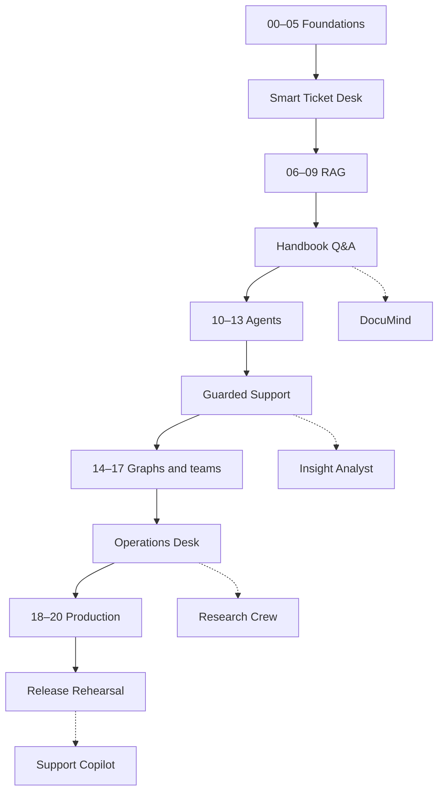

# Learning path

**Phase 1 curriculum plan.** The course is for someone who knows Python functions, classes, dictionaries, pip, virtual environments, a terminal and basic git. You do not need prior knowledge of language models, agents or async programming.

Allow **54 hours** for the core course and five checkpoints. This is a planning estimate, not a promise of mastery: the complete feature reference is deliberately broader than a first pass. Optional examples, full exercise sets and capstones can add substantial time. Module 17 contributes two optional hours to the 54-hour route; skip it for a 52-hour core. Capstones add roughly 4–12 hours each.

## How to study

Read the big idea, draw the data flow, run the smallest example, predict one change, then make it. Work through Practice, Apply and Stretch before reading solutions. Keep a short failure log containing the input, expected behavior, observed behavior and fix. Use quizzes to check understanding, not memorized import names.

All lessons use synthetic Brightwave Outfitters data. Module 00 starts at assistant version 0; versions 1–11 mark behavior upgrades. Modules that explore a technique keep the latest version number. Every module README opens with its version statement, followed by the required template.

## Setup and execution modes

Recommend Python 3.12; planned support is 3.12, 3.13 and 3.14. Install dependencies once using uv; pip/venv instructions will also be supplied. Ordinary examples use your selected real provider. The smoke runner and pytest explicitly use deterministic fake models, fake embeddings and offline fixtures. Fakes verify program behavior; they do not measure real language-model quality.

The OpenAI profile is the default. The planned .env profile system switches chat and embeddings to local Ollama by changing `LLM_PROVIDER=ollama`, with model defaults read from .env.example. Explicit LLM_MODEL and EMBEDDINGS_* overrides take precedence. Ollama must be installed and the selected models downloaded first. Multimodal lessons need a vision-capable local model in addition to the smaller text/tool model.

Optional LangSmith tracing, live web search, Studio and managed deployment are labelled opt-ins. Local examples and evaluation reports remain usable without those accounts.

## Tier 1: Foundations — 10 hours

| Module | Time | Observable outcome |
|---|---:|---|
| [00 Setup and orientation](modules/00_setup/README.md) | 60 min | Make a first call and inspect an optional trace. |
| [01 Chat models and messages](modules/01_chat_models/README.md) | 90 min | Stream a support reply and report token usage and estimated cost. |
| [02 Prompt templates](modules/02_prompt_templates/README.md) | 75 min | Write a product description and rewrite an email in Brightwave's voice. |
| [03 Structured output](modules/03_structured_output/README.md) | 90 min | Extract ticket fields into CSV and measure labelled-subset accuracy. |
| [04 LCEL and Runnables](modules/04_lcel_runnables/README.md) | 90 min | Analyze sentiment, extract themes and suggest replies in parallel with a cheaper fallback. |
| [05 Tools and tool calling](modules/05_tools/README.md) | 105 min | Answer order, shipment and stock questions through a hand-written tool loop. |

**Checkpoint: Smart Ticket Desk — 90 minutes.** Triage tickets, look up orders with your own tool loop and draft replies. [Project and acceptance criteria](checkpoints/01_ticket_desk/README.md).

You're ready for the next tier when you can:

- Explain messages, prompts and structured output without framework jargon.
- Validate a triage object and calculate accuracy on labelled tickets.
- Trace every model-requested tool call to a validated Python function.
- Switch provider configuration and diagnose a missing key safely.

## Tier 2: Working with knowledge — 10 hours

| Module | Time | Observable outcome |
|---|---:|---|
| [06 Document loaders and text splitters](modules/06_loaders_splitters/README.md) | 120 min | Load policies and handbook with source/page metadata; compare three chunking strategies. |
| [07 Embeddings, vector stores and retrievers](modules/07_embeddings_retrievers/README.md) | 150 min | Search waterproof four-person tents under $300 with category and price constraints. |
| [08 RAG fundamentals](modules/08_rag_fundamentals/README.md) | 120 min | Answer policy questions with file and page citations and explicit abstention. |
| [09 Advanced RAG and evaluation](modules/09_advanced_rag/README.md) | 150 min | Compare baseline and improved retrieval on a held-out golden set. |

**Checkpoint: Employee Handbook Q&A — 60 minutes.** Build grounded handbook answers and submit a local evaluation report. [Project and acceptance criteria](checkpoints/02_handbook_qa/README.md).

You're ready for the next tier when you can:

- Explain what embeddings and vector similarity do and do not prove.
- Preserve source/page metadata from loading through final citations.
- Measure retrieval hit rate on held-out queries and diagnose a miss.
- Reject unsupported answers and report actual before/after scores.

## Tier 3: Agents — 12 hours

| Module | Time | Observable outcome |
|---|---:|---|
| [10 Agents with create_agent](modules/10_agents/README.md) | 150 min | Combine SQL, stock and policy tools with validated return creation. |
| [11 Memory and state](modules/11_memory/README.md) | 150 min | Keep conversation state and customer preferences across sessions. |
| [12 Middleware and guardrails](modules/12_middleware/README.md) | 180 min | Redact PII, pause refunds over $100, add fallback and enforce limits. |
| [13 Model Context Protocol](modules/13_mcp/README.md) | 120 min | Connect inventory MCP tools to create_agent. |

**Checkpoint: Guarded Support Agent — 120 minutes.** Combine memory, refund approval and inventory MCP tools. [Project and acceptance criteria](checkpoints/03_guarded_support/README.md).

You're ready for the next tier when you can:

- Explain the create_agent loop and inspect its trace.
- Keep customer identities, threads and preferences isolated.
- Demonstrate approve and reject paths for a refund above $100.
- Restart a process and recover state; describe the MCP trust boundary.

## Tier 4: Orchestration — 12 hours

| Module | Time | Observable outcome |
|---|---:|---|
| [14 LangGraph fundamentals](modules/14_langgraph/README.md) | 210 min | Classify, check policy, interrupt for approval, record refund and write a local notification outbox. |
| [15 Workflow patterns](modules/15_workflows/README.md) | 150 min | Map-reduce product reviews by category and improve the report with a bounded evaluator loop. |
| [16 Multi-agent systems](modules/16_multi_agent/README.md) | 180 min | Route to billing, product RAG and logistics SQL specialists; supervise the combined answer. |
| [17 Deep Agents (optional)](modules/17_deep_agents/README.md) | 120 min | Plan, research offline documents and write a sourced outdoor-gear trends report. |

**Checkpoint: Multi-agent Operations Desk — 60 minutes.** Submit a graph diagram, working operations team and design rationale. [Project and acceptance criteria](checkpoints/04_operations_desk/README.md).

You're ready for the next tier when you can:

- Define state and reducers and justify every graph edge.
- Resume an interruption without duplicating a refund.
- Bound fan-out and evaluator loops and explain their costs.
- Compare a single agent with specialists using measured results.

## Tier 5: Production — 10 hours

| Module | Time | Observable outcome |
|---|---:|---|
| [18 Streaming, APIs and user interfaces](modules/18_apps/README.md) | 180 min | FastAPI streaming backend and Streamlit chat with per-thread memory and approval controls. |
| [19 Observability, testing and evaluation](modules/19_evaluation/README.md) | 180 min | Gate regressions in tool trajectories, grounding and tone with a local evaluation suite. |
| [20 Production readiness and deployment](modules/20_production/README.md) | 180 min | Package the guarded assistant with logs, budgets, security checks and deployment documentation. |

**Checkpoint: Production Release Rehearsal — 60 minutes.** Package, evaluate and run the assistant locally as a service. [Project and acceptance criteria](checkpoints/05_production_release/README.md).

You're ready for the next tier when you can:

- Stream a reply and an approval request through the UI.
- Reject access to another customer’s thread and data.
- Run key-free tests and explain which claims require live evaluation.
- Build a container, inspect redacted logs and apply the launch checklist.

## Four-week intensive schedule

| Week | Work | Hours | Evidence to keep |
|---|---|---:|---|
| 1 | Tier 1, checkpoint 1, module 06 | 12 | Ticket-desk trace and annotated document chunks |
| 2 | Remaining Tier 2, checkpoint 2, modules 10–11 | 13 | RAG report and restored conversation |
| 3 | Remaining Tier 3, checkpoint 3, modules 14–15 | 13 | Approved/rejected refund traces and a report graph |
| 4 | Remaining Tier 4, checkpoint 4, Tier 5 and checkpoint 5 | 16 | Operations rationale, evaluation results and container rehearsal |

## Eight-week part-time schedule

| Week | Work | Hours |
|---|---|---:|
| 1 | Modules 00–03 | 5.25 |
| 2 | Modules 04–05 and checkpoint 1 | 4.75 |
| 3 | Modules 06–08 | 6.5 |
| 4 | Module 09, checkpoint 2 and module 10 | 6 |
| 5 | Modules 11–12 | 5.5 |
| 6 | Module 13, checkpoint 3 and module 14 | 7.5 |
| 7 | Modules 15–17 and checkpoint 4 | 8.5 |
| 8 | Modules 18–20 and checkpoint 5 | 10 |

The final weeks are heavier because integration takes time. If you have a strict six-hour weekly limit, spread the course over nine or more weeks. Neither schedule includes capstones.

## Capstone routes

| Project | Start after | Deliverable | Extra time |
|---|---|---|---:|
| [DocuMind](capstones/01_documind/README.md) | Tier 2 | PDF chat, hybrid retrieval, verified citations, evaluation report, Streamlit UI | 6–8 h |
| [Support Copilot](capstones/02_support_copilot/README.md) | Tier 5 | SQL + RAG, memory, approval, guardrails, API/UI, evaluation and Docker | 8–12 h |
| [Insight Analyst](capstones/03_insight_analyst/README.md) | Tier 3 | Schema inspection, read-only SQL, repair loop, charts and executive summary | 6–8 h |
| [Research Crew](capstones/04_research_crew/README.md) | Tier 4 | Planner/researcher/writer/critic, bounded revisions and sourced report | 6–8 h |
| [Personal Ops](capstones/05_personal_ops/README.md), optional | Tier 3; richer orchestration after Tier 4 | Notes/tasks through local MCP servers | 4–6 h |

DocuMind includes a small self-contained Streamlit primer so its Tier 2 route does not assume module 18. Insight Analyst introduces plotting before using it. Each capstone has user stories, acceptance criteria, a Mermaid architecture, runnable starter, full reference solution, tests, evaluation cases, extension challenges and a self-grading rubric.

## Progress and evidence

Use the [feature map](docs/FEATURE_MAP.md) to jump to a topic. If prerequisites are unfamiliar, follow their module links first. For each checkpoint keep an offline test report and, when available, an Ollama or hosted run report with the model name, date, configuration and estimated cost. Do not describe a fake-model evaluation as measured live accuracy.
