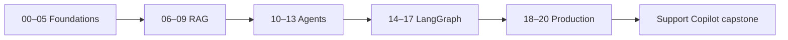

# Getting started with LangChain

A hands-on course for Python learners building the **Brightwave assistant**, an outdoor-gear support application. Learn how to choose between a model call, chain, retrieval system, agent and graph, then test the choice with synthetic business data.

**Build status: Phase 2, foundation.** Setup, provider helpers, offline checks and the committed datasets are available. The 21 teaching modules and capstones are planned and will arrive in Phases 3–8. See the [coverage contract](docs/FEATURE_MAP.md), [learning path](LEARNING_PATH.md) and [verification notes](docs/VERIFICATION_NOTES.md). This is not yet the completed course.



## Five-minute quick start

Know basic Python, terminal commands and git. Install Python 3.12 (recommended; 3.12–3.14 supported) and [uv](https://docs.astral.sh/uv/getting-started/installation/). Clone this repository using its GitHub **Code** button, or open your existing checkout. Remote publication is scheduled for the final phase; no invented clone URL is provided here.

From the repository root, the following commands work in **Windows PowerShell, macOS and Linux**:

```text
uv sync
uv run python scripts/configure.py
uv run python scripts/check_env.py --offline
uv run python scripts/first_call.py --offline
uv run pytest
```

The first-call output is labelled **OFFLINE FIXTURE**, not generated intelligence. Open `.env`, enter `OPENAI_API_KEY`, then run a real call:

```text
uv run python scripts/check_env.py
uv run python scripts/first_call.py
```

The checked low-cost default is in `.env.example`. A short call should cost well below one cent; usage and the current configured cost estimate print after the answer. Estimates are not invoices. The first-call deadline depends on downloads, hardware and provider access; the offline path needs no account after installation.

## Free local models

Install [Ollama](https://ollama.com/download), start it, then download the two profiles:

```text
ollama pull qwen3:4b
ollama pull embeddinggemma
```

Change **one line** in `.env` to `LLM_PROVIDER=ollama`. Keep `LLM_MODEL` and `EMBEDDINGS_MODEL` blank and `EMBEDDINGS_PROVIDER=auto` to select the local profiles automatically. Run the real-call commands above. Initial model downloads need internet and disk space; inference has no API fee. Image lessons later use the separately downloaded `qwen3-vl:4b` model. See [provider capabilities](docs/PROVIDER_CAPABILITIES.md).

## pip and venv fallback

Create a virtual environment with `python -m venv .venv`. Commands below deliberately use its Python directly, so PowerShell execution policy cannot block activation.

Windows PowerShell:

```powershell
.venv\Scripts\python.exe -m pip install -e .
.venv\Scripts\python.exe scripts/configure.py
.venv\Scripts\python.exe scripts/first_call.py --offline
```

macOS/Linux:

```sh
.venv/bin/python -m pip install -e .
.venv/bin/python scripts/configure.py
.venv/bin/python scripts/first_call.py --offline
```

Install a tier with `python -m pip install -e ".[rag]"` using the appropriate virtual-environment Python. uv is recommended for the exact locked development environment; pip resolves the compatible ranges.

## Three ways to learn

1. Follow the [learning path](LEARNING_PATH.md) in order and finish each checkpoint.
2. Find a topic through the [feature map](docs/FEATURE_MAP.md); planned links are labelled until their phase is implemented.
3. Use a capstone spec and reference solution once Phase 8 lands. The plan includes DocuMind, Support Copilot, Insight Analyst, Research Crew and optional Personal Ops.

| Tier | Modules | Guided time, including checkpoint |
|---|---|---:|
| Foundations | 00–05 | 10 h |
| Knowledge and retrieval | 06–09 | 10 h |
| Agents | 10–13 | 12 h |
| Orchestration | 14–17 | 12 h |
| Production | 18–20 | 10 h |

Total: about 54 hours including optional Deep Agents; capstones and exhaustive exercise practice take extra time. Schedules and readiness checks are in the learning path.

## Data, cost and safety

Everything in [data/](data/README.md) is synthetic. Read-only seed databases are kept separate from writable runtime copies. The current foundation executes no generated SQL, issues no refunds and contacts no customers. `.env` and `.runtime/` are ignored. Tracing is off unless explicitly enabled and can upload prompts; only use synthetic data for this course. A poisoned document is deliberately kept outside the normal policy corpus for a later security lesson.

## FAQ

**Do tests require keys or network?** No. After dependency installation, tests force fakes and block networking. A fresh `uv sync` requires downloads unless your cache is populated. `pytest --live` is an explicit opt-in for real providers.

**Can I switch providers?** Yes: `openai`, `anthropic`, `google_genai`, `ollama`. All four chat integrations are in the base install. Embeddings can use OpenAI, Gemini or Ollama independently.

**Why no automatic fallback to fake output?** A broken credential should not look like a successful model call. Failures show a setup hint and a nonzero exit code.

**Is the course finished?** No. Phase 2 establishes the runnable foundation. [The completion checklist](docs/COMPLETION_CHECKLIST.md) distinguishes checked work from future work.

**Where can I troubleshoot?** Start with `uv run python scripts/check_env.py`, then [troubleshooting](docs/TROUBLESHOOTING.md).

## Development

```text
uv sync --group authoring
uv run ruff check .
uv run ruff format --check .
uv run pytest
uv run python scripts/run_all_examples.py
uv run python scripts/check_links.py --allow-planned
uv run python scripts/check_coverage.py
```

The authoring group is needed only to regenerate or inspect data/PDFs and notebooks. `uv sync --all-extras --group authoring` installs the full future course stack. See [contributing](CONTRIBUTING.md), [conduct](CODE_OF_CONDUCT.md), [changelog](CHANGELOG.md) and the [MIT license](LICENSE).
