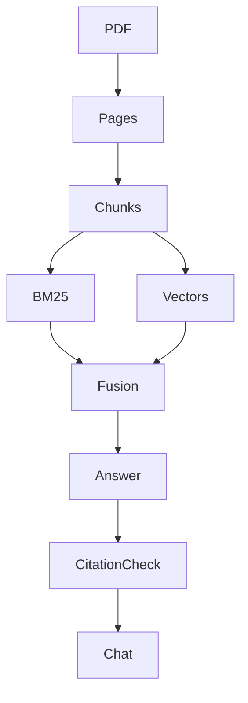

# DocuMind

**Prerequisites:** Tier 2: retrieval. **Time:** 6–8 hours, plus extensions. **Cost:** One embedding batch, one query embedding and one answer call per question; usually cents for a small PDF, depending on document length. Offline costs $0; local Ollama has no API fee.

## The big idea

A reader uploads a text PDF and gets a page citation they can inspect. Think of a librarian who attaches the relevant page to every answer.

## User stories

- As a reader, I can use my own PDF or the synthetic handbook without editing code.
- As a reviewer, I see the source filename, page number and exact quote for each supported answer.
- As a private-document user, my index belongs to my browser session and live processing requires consent.

## Acceptance criteria

- Reject invalid, encrypted, scanned-only, over-5-MB or over-50-page PDFs; extracted text is capped at 200,000 characters.
- Combine BM25 and vector rankings, preserving page metadata. Require lexical overlap before answering.
- Validate every quoted citation against retrieved text; abstain when evidence is absent.
- Keep ten displayed turns per session; clear history and rebuild the index when the document changes.

## Architecture



### Under the hood

PDF extraction establishes page provenance before chunking. Two retrievers feed reciprocal-rank fusion, which combines positions rather than incomparable raw scores. The answer is structured data: prose plus quoted evidence. A deterministic validator rejects fabricated source/page/quote combinations. In scripted mode the embeddings exercise the vector interface but do not measure semantic relevance.

The Streamlit primer: each interaction reruns the Python file. `st.session_state` retains this browser session's index and display history. The history is for display; ask self-contained questions. Conversational query rewriting is an extension, not a hidden prerequisite.

## Walkthrough

Run all commands from the repository root in PowerShell, macOS or Linux:

```text
uv sync --extra apps
uv run --no-sync python capstones/01_documind/solution.py --offline
uv run --no-sync pytest capstones/01_documind
```

Expected: the default question identifies the 30-day window on page 2. See [the measured report](evaluation_report.md).

Additional entry points:

```text
uv run --extra apps streamlit run capstones/01_documind/app.py
uv run --extra apps python capstones/01_documind/solution.py --offline --pdf data/handbook/employee_handbook.pdf
```

Remove `--offline` from the solution command for your configured provider. See [provider setup](../../modules/00_setup/README.md) before a live run. Offline evaluation is deterministic interface/behavior testing, not a measurement of real-model reasoning.

## Build it yourself

Run `uv run --no-sync python capstones/01_documind/starter.py --offline`. Its runnable baseline reports an unmet contract. Implement `run_case` at `YOUR CODE HERE`, keeping expected labels out of the answer-producing path. Reuse the shared helpers or build a smaller equivalent; explain the boundaries you chose.

```text
uv run --no-sync pytest capstones/01_documind/tests/test_acceptance.py --exercise-target exercises
```

This command intentionally fails for the untouched starter. The default test command selects the complete reference [solution](solution.py). Grade your work with the [rubric](rubric.md), then run the independent [evaluation set](eval.jsonl). Reference solutions can include deliberate, documented quality misses; do not change expected facts to make them pass.

## Cost and safety

PDF byte/page/text caps reduce accidental overload; they do not isolate a hostile PDF parser. Run this local teaching app on trusted documents. Live mode sends excerpts and embeddings to configured providers after consent. Raw tracing is disabled. There is no account system or public upload service. Exact quotes can still be irrelevant; the independent expected-answer checks catch that separate failure.

## Extend it

1. Implement history-based question rewriting and evaluate pronoun follow-ups.
2. Compare retrieval hit rate for BM25, vectors and fusion using held-out questions.
3. Add an isolated OCR process with explicit resource limits and page provenance.

## Next

Compare the five capstones in the [learning path](../../LEARNING_PATH.md). Run all evaluation sets with `uv run --extra apps python scripts/evaluate.py --offline`; add `--release` to require every quality contract to pass.
