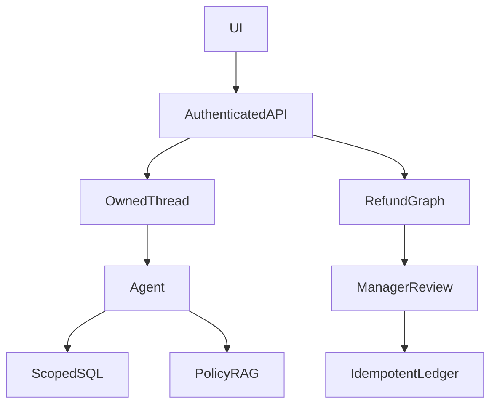

# Brightwave Support Copilot

**Prerequisites:** Tier 5: production. **Time:** 3–6 hours, plus extensions. **Cost:** At most five logical calls per chat and 30 across six evaluation cases; retries are disabled in this chat path. Small requests should be cents, not a guaranteed budget. Offline costs $0; Ollama has no API fee.

## The big idea

A customer asks about an order or policy, and a manager reviews large refunds. Think of a service desk whose agents can read records but need a signed authorization to change them.

## User stories

- As a customer, I can stream answers and reopen only my own conversation.
- As a customer, I can query my orders, public stock and policy evidence.
- As a manager, I can approve or reject an exact refund quote; rejection produces no ledger write.
- As an operator, I can evaluate the actual HTTP path and package the same service in Docker.

## Acceptance criteria

- Authenticate every customer route; bind ownership from the token, never a model argument.
- Store bounded, redacted thread history and reject access by another customer.
- Use policy retrieval as an actual agent tool with validated source quotes.
- Refunds above 10,000 cents require manager approval; stale reviews, changed quotes and duplicate writes are rejected or replayed safely.
- Reserve five possible model calls per chat (three agent calls plus two policy tools with one call each), with provider retries disabled. The 30-call thread ceiling admits six full reservations.
- Pass API ownership/review contracts while reporting answer-quality failures honestly.

## Architecture



### Under the hood

The API and UI reuse the module 18 boundary. `CopilotService` adds policy RAG to its scoped SQL tools. Both the API and Docker image construct the same service. Persisted history is reconstructed as LangChain messages for subsequent requests. The refund graph is a separate authenticated workflow; a model sentence cannot approve it.

Policy citation validation checks literal support. It cannot prove the answer addresses the question. The six-case suite keeps these metrics separate: the scripted baseline passes four complete contracts, with return-window and shipping correctness still failing. The customer release gate remains closed.

## Walkthrough

Run all commands from the repository root in PowerShell, macOS or Linux:

```text
uv sync --extra apps
uv run --no-sync python capstones/02_support_copilot/solution.py --offline
uv run --no-sync pytest capstones/02_support_copilot
```

Run the two commands in separate terminals after configuring distinct API tokens in `.env`; enter the appropriate token in the UI. See [app setup](../../modules/18_apps/README.md) for the exact environment variables and review flow. The fixture CLI needs no keys.

Additional entry points:

```text
uv run --extra apps uvicorn common.copilot:copilot_app --factory --host 127.0.0.1 --port 8000
uv run --extra apps streamlit run capstones/02_support_copilot/app.py
```

Remove `--offline` from the solution command for your configured provider. See [provider setup](../../modules/00_setup/README.md) before a live run. Offline evaluation is deterministic interface/behavior testing, not a measurement of real-model reasoning.

## Build it yourself

Run `uv run --no-sync python capstones/02_support_copilot/starter.py --offline`. Its runnable baseline reports an unmet contract. Implement `run_case` at `YOUR CODE HERE`, keeping expected labels out of the answer-producing path. Reuse the shared helpers or build a smaller equivalent; explain the boundaries you chose.

```text
uv run --no-sync pytest capstones/02_support_copilot/tests/test_acceptance.py --exercise-target exercises
```

This command intentionally fails for the untouched starter. The default test command selects the complete reference [solution](solution.py). Grade your work with the [rubric](rubric.md), then run the independent [evaluation set](eval.jsonl). Reference solutions can include deliberate, documented quality misses; do not change expected facts to make them pass.

## Cost and safety

This is a local educational deployment with synthetic customers, one process and SQLite state. It is not a public identity provider or a customer-ready product. Redaction is a narrow email/card/known-secret filter, not general DLP. Raw chat tracing is disabled. Refund eligibility uses a trusted inspection record: do not replace that with a customer assertion. The copied `langgraph.json` registers the separate read-only Studio example; it is not an alternative deployment of this entire authenticated API.

## Extend it

1. Improve answer relevance, then pass all six cases without weakening their expected facts.
2. Add a real identity provider and test token rotation and customer isolation.
3. Replace local admission and SQLite with coordinated storage before adding workers.

## Next

Compare the five capstones in the [learning path](../../LEARNING_PATH.md). Run all evaluation sets with `uv run --extra apps python scripts/evaluate.py --offline`; add `--release` to require every quality contract to pass.

See [Docker rehearsal](deployment.md) for the matching image commands.
