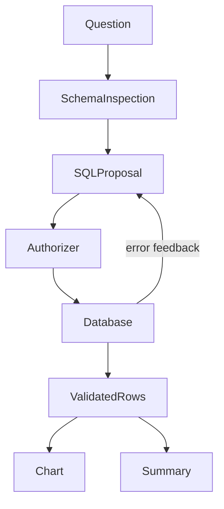

# Insight Analyst

**Prerequisites:** Tier 3: tools and guardrails. **Time:** 3–6 hours, plus extensions. **Cost:** Up to three SQL proposal calls plus one summary call. SDK retries can add attempts. Short hosted runs typically cost cents; offline costs $0 and local Ollama has no API fee.

## The big idea

A staff analyst asks a question about synthetic sales, sees a repaired SQL query, a chart and a summary. Think of a junior analyst whose spreadsheet formulas must pass a read-only accounting check.

## User stories

- As an analyst, I inspect the actual allowed schema rather than rely on a guessed schema.
- As an analyst, I see a SQL failure and a bounded repair attempt.
- As a reviewer, I can reproduce chart values directly from the query and distinguish them from model prose.

## Acceptance criteria

- Inspect database metadata and expose only allowlisted staff analytics columns.
- Use a read-only connection, SQLite authorizer, limited functions, 100,000-instruction budget and at most 50 returned rows.
- Reject writes, private customer columns and unexpected output shapes. Return `label` and nonnegative finite `value`.
- Allow at most three SQL proposals; produce no chart when attempts are exhausted.
- Derive chart numbers and total from SQL, saving a PNG, evidence JSON and executive summary outside seed data.

## Architecture



### Under the hood

The model proposes SQL as structured output. Python runs it through the SQLite engine's authorizer, not a promise in the prompt. A bounded loop feeds database errors into the next proposal. The offline first query intentionally names a missing column, so repair is observable. This explicit tool loop is an agent even though its workflow is smaller than a general-purpose agent framework.

The summary is generated prose; only the rows and computed total are mechanically verified. An accurate SQL result can still answer the wrong business question. Compare independently expected numbers in `eval.jsonl`.

## Walkthrough

Run all commands from the repository root in PowerShell, macOS or Linux:

```text
uv sync --extra agents
uv run --no-sync python capstones/03_insight_analyst/solution.py --offline
uv run --no-sync pytest capstones/03_insight_analyst
```

Expected: 200 orders in three status groups after one repair. `.runtime/insight-analyst/` contains orders.png, evidence.json and summary.md. Category units total 470; the revenue query totals 7,978,950 cents.

Additional entry points:

```text
uv run --extra agents python capstones/03_insight_analyst/solution.py --offline
```

Remove `--offline` from the solution command for your configured provider. See [provider setup](../../modules/00_setup/README.md) before a live run. Offline evaluation is deterministic interface/behavior testing, not a measurement of real-model reasoning.

## Build it yourself

Run `uv run --no-sync python capstones/03_insight_analyst/starter.py --offline`. Its runnable baseline reports an unmet contract. Implement `run_case` at `YOUR CODE HERE`, keeping expected labels out of the answer-producing path. Reuse the shared helpers or build a smaller equivalent; explain the boundaries you chose.

```text
uv run --no-sync pytest capstones/03_insight_analyst/tests/test_acceptance.py --exercise-target exercises
```

This command intentionally fails for the untouched starter. The default test command selects the complete reference [solution](solution.py). Grade your work with the [rubric](rubric.md), then run the independent [evaluation set](eval.jsonl). Reference solutions can include deliberate, documented quality misses; do not change expected facts to make them pass.

## Cost and safety

This is staff analytics over synthetic records, not customer-scoped access. Never expose it as a customer SQL endpoint. The allowlist permits aggregate analysis across orders; customer identifiers, email and customer tables are denied. SQL syntax checks are defense in depth; the engine authorizer and read-only connection enforce permissions. Instruction and row limits do not make arbitrary SQL cheap on a larger production database.

## Extend it

1. Add an independently labelled question that joins a new approved table.
2. Measure SQL correctness and question relevance separately on live models.
3. Add approved date grouping with deterministic reference dates and units.

## Next

Compare the five capstones in the [learning path](../../LEARNING_PATH.md). Run all evaluation sets with `uv run --extra apps python scripts/evaluate.py --offline`; add `--release` to require every quality contract to pass.
