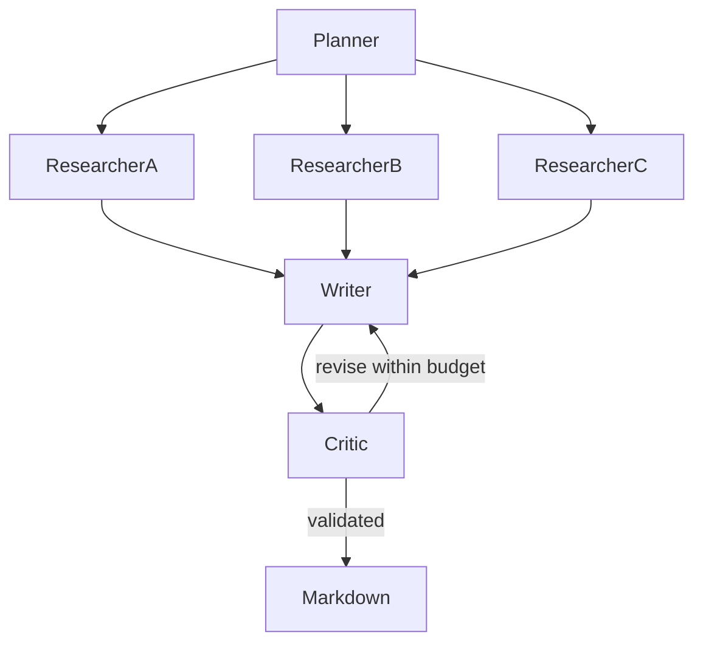

# Research Crew

**Prerequisites:** Tier 4: orchestration. **Time:** 3–6 hours, plus extensions. **Cost:** Up to 13 logical model calls for the maximum three draft attempts; short-context hosted runs typically cost a few cents but vary by provider. Offline costs $0; Ollama has no API fee.

## The big idea

A planner divides a research request among readers, a writer assembles evidence and a critic asks for a revision. Think of an editorial team with a shared source folder and a strict deadline.

## User stories

- As a researcher, I see a plan with at most three distinct search tasks.
- As an editor, I receive only sourced claims from the shared evidence set.
- As a reader, I get a Markdown report only after quote validation and a critic verdict agree.

## Acceptance criteria

- Fan out with LangGraph Send, limiting concurrent researchers to two.
- Give researchers only a local read tool; no writes or open Internet access.
- Merge evidence using a reducer and keep tool content untrusted.
- Bound revisions to one through three attempts; a failed first draft is visible in scripted mode.
- Require known source IDs, exact quotes and a synthetic title before publication, and cap logical calls at 13.

## Architecture



### Under the hood

`Send` creates one researcher state per query. An additive reducer merges their evidence before the writer runs. Writer and critic return validated Pydantic structures. The routing edge ends on acceptance or attempt exhaustion. A separate host gate checks quotations even when the critic says yes; an unaccepted draft cannot be rendered as a finished report.

The offline critic demonstrates the loop, not human-level editorial judgment. Sources are fictional research notes. The output is a sourced evidence brief, not real market intelligence.

## Walkthrough

Run all commands from the repository root in PowerShell, macOS or Linux:

```text
uv sync --extra agents
uv run --no-sync python capstones/04_research_crew/solution.py --offline
uv run --no-sync pytest capstones/04_research_crew
```

Expected: the first draft is rejected, the second accepted, with 11 logical calls and `.runtime/research-crew/report.md`. A one-attempt evaluation case stops without a report.

Additional entry points:

```text
uv run --extra agents python capstones/04_research_crew/solution.py --offline
```

Remove `--offline` from the solution command for your configured provider. See [provider setup](../../modules/00_setup/README.md) before a live run. Offline evaluation is deterministic interface/behavior testing, not a measurement of real-model reasoning.

## Build it yourself

Run `uv run --no-sync python capstones/04_research_crew/starter.py --offline`. Its runnable baseline reports an unmet contract. Implement `run_case` at `YOUR CODE HERE`, keeping expected labels out of the answer-producing path. Reuse the shared helpers or build a smaller equivalent; explain the boundaries you chose.

```text
uv run --no-sync pytest capstones/04_research_crew/tests/test_acceptance.py --exercise-target exercises
```

This command intentionally fails for the untouched starter. The default test command selects the complete reference [solution](solution.py). Grade your work with the [rubric](rubric.md), then run the independent [evaluation set](eval.jsonl). Reference solutions can include deliberate, documented quality misses; do not change expected facts to make them pass.

## Cost and safety

All source text is untrusted. Literal quotations validate provenance, not truth or relevance. The writer has no file tool; only host code saves an accepted report. No email, messaging or publication service is connected. SDK retry attempts can exceed the displayed logical-call count.

## Extend it

1. Add a live-search adapter with an explicit domain allowlist and a saved source snapshot.
2. Compare a single-agent brief with the crew using the same held-out rubric.
3. Add persistent checkpoints and verify resumed workers do not duplicate evidence.

## Next

Compare the five capstones in the [learning path](../../LEARNING_PATH.md). Run all evaluation sets with `uv run --extra apps python scripts/evaluate.py --offline`; add `--release` to require every quality contract to pass.
