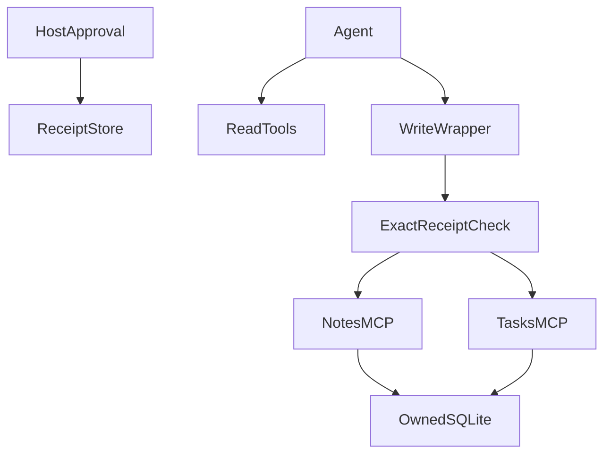

# Personal Ops Agent

**Prerequisites:** Optional after Tier 3: MCP. **Time:** 4–6 hours, plus extensions. **Cost:** At most five logical model calls and four tool calls per run, plus possible SDK retries. Offline costs $0; short hosted runs normally cost cents, and Ollama has no API fee.

## The big idea

An assistant reads local notes and tasks and proposes exact changes for host approval. Think of a personal organizer holding a signed work order for each change.

## User stories

- As a learner, I run two real MCP servers for notes and tasks, including my own server implementation.
- As an owner, I see only my local items.
- As an approver, I authorize an exact action outside the model; a changed payload or different owner cannot reuse its receipt.

## Acceptance criteria

- Discover exactly the reviewed tool names and input fields through the current MCP adapter.
- Give the agent read tools and constrained write wrappers; never expose the approval method.
- Require an owner-bound receipt for note creation, task creation or task completion.
- Make repeat use of the same approved action idempotent, and reject guessed receipts or altered payloads.
- Exercise both in-memory protocol transport and real stdio subprocesses.
- Default `approved=False`; the standalone fixture explicitly approves only its two synthetic temporary actions.

## Architecture



### Under the hood

The official SDK builds the servers. The FastMCP client carries protocol messages, and LangChain MCPAdapter converts reviewed tools for an agent. These are real tool exchanges even in scripted mode. The host stores a random receipt bound to an owner, operation and canonical redacted payload. The model never receives that receipt. A write wrapper injects it only for the previously approved action; SQLite applies the write and records its result in one transaction.

Each server trusts its host-selected owner. Local process/file access is the trust boundary; this is not remote-user authentication. The current LangChain MCP integration is beta and version-pinned.

## Walkthrough

Run all commands from the repository root in PowerShell, macOS or Linux:

```text
uv sync --extra agents
uv run --no-sync python capstones/05_personal_ops/solution.py --offline
uv run --no-sync pytest capstones/05_personal_ops
```

Expected: one approved note and one approved task in a temporary database. The denied case stores neither. Tests also launch notes_server.py and tasks_server.py through stdio; do not type into their protocol streams.

Additional entry points:

```text
uv run --extra agents python capstones/05_personal_ops/solution.py --offline
uv run --extra agents pytest capstones/05_personal_ops tests/test_tools.py tests/test_security.py
```

Remove `--offline` from the solution command for your configured provider. See [provider setup](../../modules/00_setup/README.md) before a live run. Offline evaluation is deterministic interface/behavior testing, not a measurement of real-model reasoning.

## Build it yourself

Run `uv run --no-sync python capstones/05_personal_ops/starter.py --offline`. Its runnable baseline reports an unmet contract. Implement `run_case` at `YOUR CODE HERE`, keeping expected labels out of the answer-producing path. Reuse the shared helpers or build a smaller equivalent; explain the boundaries you chose.

```text
uv run --no-sync pytest capstones/05_personal_ops/tests/test_acceptance.py --exercise-target exercises
```

This command intentionally fails for the untouched starter. The default test command selects the complete reference [solution](solution.py). Grade your work with the [rubric](rubric.md), then run the independent [evaluation set](eval.jsonl). Reference solutions can include deliberate, documented quality misses; do not change expected facts to make them pass.

## Cost and safety

Use trusted local server programs only. Tool annotations are hints, not permission enforcement. The server verifies receipts even if a client bypasses the agent wrapper. Owner IDs come from the host, never model arguments. Known PII patterns are redacted before persistence, and raw agent tracing is disabled. Live mode may send requested note/task content to your selected model provider; use only synthetic data for the lesson.

## Extend it

1. Add an approval UI that displays the canonical payload before issuing its receipt.
2. Add a calendar-like local server with date validation and the same ownership tests.
3. Implement approval expiration and test that expired and replayed receipts behave differently.

## Next

Compare the five capstones in the [learning path](../../LEARNING_PATH.md). Run all evaluation sets with `uv run --extra apps python scripts/evaluate.py --offline`; add `--release` to require every quality contract to pass.
