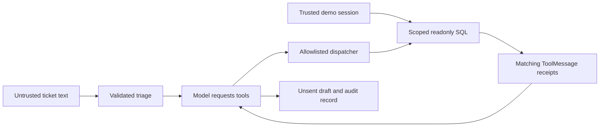

# Tier 1 checkpoint: Smart Ticket Desk

**Assistant version 4:** turn an incoming ticket into validated triage, scoped order evidence and an unsent reply. **Time:** 90 minutes. **Cost:** offline is free; a live ticket uses at most five short model calls, usually under $0.01 on the default profile. Local Ollama has no API fee. Complete modules 00–05 first.

You are building a command-line work queue for Brightwave support colleagues. A colleague selects a synthetic customer session and a ticket. The application extracts category, priority, sentiment, order ID and SKU; the hand-written tool loop reads the order and shipment; the final reply stays a draft for review. Nothing is emailed, refunded or changed in the seed database.



The analogy is a support colleague filling a form, consulting authorized records, then writing a letter. Under the hood, the schema validates extraction, model-generated JSON requests database reads, and the application retains both request IDs and results. Schema validation alone cannot verify facts; prompts cannot grant access to another customer's order.

Start with the runnable baseline:

```text
uv run python checkpoints/01_ticket_desk/starter.py --offline
uv run pytest checkpoints/01_ticket_desk/tests --exercise-target exercises
```

The baseline classifies a ticket and queues it for a human. Acceptance tests intentionally fail until you add the missing tool evidence. Implement the `process_ticket(ticket, customer_id, settings)` contract in the starter. Return `ticket_id`, `mode`, `triage`, `draft`, `tool_calls`, `tool_results`, and `sent=False`. Tool results must include their corresponding `call_id`, `name`, and decoded `result`. Keep customer identity supplied by the caller; never derive it from the text. Reuse the shared helpers, but be able to explain their loop and SQL predicates.

Suggested milestones:

1. Validate extracted fields with `TicketTriage`; use null for absent identifiers.
2. Create scoped order tools from the caller's customer ID.
3. Use the explicit loop with no more than four model turns and six tool calls. Return a bounded failure on exhaustion.
4. Preserve every requested call ID beside its result, then produce a reviewable draft using the tool evidence.
5. Run all acceptance cases, including absent orders, no order ID, wrong-customer access and hostile ticket text.

Inspect the complete [solution](solution.py), whose orchestration is in [common/desk.py](../../common/desk.py), after trying your implementation:

```text
uv run python checkpoints/01_ticket_desk/solution.py --offline --ticket T001 --customer C001
uv run python checkpoints/01_ticket_desk/solution.py --offline --ticket T001 --customer C002
uv run pytest checkpoints/01_ticket_desk/tests
```

For the first command, expect category `shipping`, priority `low`, order `BW1001`, two matching order/shipment tool results, `mode: fixture` and `sent: false`. The second command must return access-denied results without disclosing the order's status. `--customer` is a synthetic login selector for learning; it is not a production authentication system.

The [six evaluation cases](eval.jsonl) measure protocol and ownership behavior under scripted model outputs. They do not establish that a live model resists prompt injection or drafts accurate replies. The fixed offline reply avoids factual claims; actual order facts remain visible in tool results. For a live check, remove `--offline` after configuring a provider, then manually verify factual consistency, absent-evidence wording and refusal to invent actions. Do not claim a quality score from the offline acceptance rate.

Use the [rubric](rubric.md) to review your work. You are ready to continue when you can explain who executes a tool, why the result ID matters, where customer identity comes from, what stops repetition, and why structured output is not factual verification. Then start [module 06](../../modules/06_loaders_splitters/README.md), planned for Phase 4.
