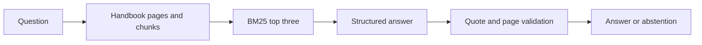

# Checkpoint: Handbook Q&A

Build the Brightwave assistant version 5 using only the ten-page handbook. Allow about 60 minutes after modules 06–09. Offline runs cost no API fees; a real answer needs one short generation call, and the six-case evaluation needs six. Retrieval is local BM25 and does not require embeddings.

Your application must answer handbook questions with application-resolved page references, reject invalid citations and abstain when the requested fact is unavailable. A page number alone is insufficient: the referenced quote must occur on that page. This validates provenance, not the factual correctness of every generated claim.



## Start and test

Run from the repository root on Windows PowerShell, macOS or Linux:

```text
uv sync --locked --extra rag
uv run --extra rag python checkpoints/02_handbook_qa/starter.py --offline
uv run --extra rag pytest checkpoints/02_handbook_qa/tests --exercise-target exercises
```

The [starter](starter.py) safely abstains for every question. Replace `YOUR CODE HERE` with loading, retrieval and grounded generation. Keep the existing function signature so the acceptance tests can call it. The learner-target tests intentionally fail until the implementation satisfies the contract.

1. Load only `data/handbook/employee_handbook.pdf`, retaining one-based page metadata.
2. Split pages while keeping source, page, child ID and parent ID.
3. Retrieve up to three chunks for a question. Reject empty questions and questions longer than 2,000 characters.
4. Call the shared model factory through the grounded answer helper. Copy citation quotes exactly and derive page/source values from retrieved Documents.
5. Return explicit abstention when no evidence supports an answer. Inspect uncertain live results instead of treating a schema-valid answer as automatically correct.

The [rubric](rubric.md) explains the review criteria. Use the [reference solution](solution.py) after trying the implementation:

```text
uv run --extra rag python checkpoints/02_handbook_qa/solution.py --offline
uv run --extra rag python checkpoints/02_handbook_qa/solution.py --offline --question "What refund amount requires manager approval?"
uv run --extra rag python checkpoints/02_handbook_qa/solution.py --offline --evaluate
uv run --extra rag pytest checkpoints/02_handbook_qa/tests
```

Expected: the approval question retrieves page 8 and returns an exact quote stating that refunds **over $100** require manager approval. The fixture may include surrounding wording. A question about the unknown 2025 design award returns `abstained: true` and no citations. Inspect the distinction between “over $100” and “$100 or more”; quote validation alone cannot catch a wrong paraphrase of that boundary.

## Evaluation evidence

The six [evaluation cases](eval.jsonl) cover returns, shipping, warranty, privacy, approval and an unknown fact. They are reserved for scoring and are never part of the search corpus or answer prompt. These are developer-visible regression cases, not a blind benchmark. The committed [offline report](evaluation_report.json) records actual page hits and validated answers; the command writes a fresh report under `.runtime/handbook_evaluation.json`.

The offline answer fixture selects an excerpt using literal word overlap. It exercises retrieval, structured parsing and citation validation with network blocked. It does not demonstrate a real model's reasoning, semantic correctness or resistance to prompt injection. Run without `--offline` only after configuring a provider, then review every answer against the cited page. Keep that live report separate.

## Ready for the next tier

You can trace every returned citation to a source page, explain an abstention, test an invalid quote, and distinguish retrieval failure from generation failure. Continue to [agents](../../modules/10_agents/README.md) with `uv sync --extra agents`; the tier is now available.
