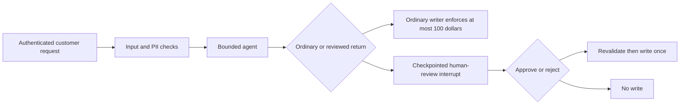

# Checkpoint: Guarded Support

Build assistant version 8 after modules 10–13. Allow about 60 minutes. The task combines customer-scoped tools, transactional return records, middleware limits and a human-review pause. All orders and decisions are synthetic; no payment or customer message is sent.

The central invariant is simple: **a high-value refund must not be recorded before approval, and rejection must not write it at all**. Approval does not bypass ownership, quantity or warehouse eligibility. Keep those checks in the writer as well as the agent workflow.



## Build and verify

Run from the repository root on Windows PowerShell, macOS or Linux:

```text
uv sync --locked --extra agents
uv run --extra agents python checkpoints/03_guarded_support/starter.py --offline
uv run --extra agents pytest checkpoints/03_guarded_support/tests --exercise-target exercises
```

The [starter](starter.py) denies every write. Replace `YOUR CODE HERE` while retaining `run_case(case, settings)` so the acceptance checks can invoke it. The learner-target tests intentionally fail until ordinary and reviewed eligible requests can succeed.

1. Create a disposable copy of the seed database. Never modify committed data.
2. Use `SupportContext` for authenticated identity and explicitly simulated warehouse checks. Models receive order/SKU/reason/key fields, not customer identity, database paths or approval flags.
3. Use the current agent factory with redaction, bounded calls and review middleware. Keep the ordinary writer's independent $100 limit.
4. Stop on `__interrupt__`. A real application must authenticate and authorize its reviewer before accepting a resume decision; the benchmark explicitly simulates that decision.
5. Revalidate policy in the transaction and deduplicate repeated requests. Verify both same-key retries and new-key quantity checks.
6. Report what was paused, how many records existed before review, and the final record count. Distinguish control correctness from model intelligence.

Inspect the [reference solution](solution.py) after trying the implementation:

```text
uv run --extra agents python checkpoints/03_guarded_support/solution.py --offline
uv run --extra agents pytest checkpoints/03_guarded_support/tests
uv run --extra agents pytest tests/test_agent_contracts.py
```

Expected: the ordinary C008 return records 4,995 cents. The high-value C001 request pauses before writing; simulated approval records it once and simulated rejection leaves no new record. Wrong-customer requests, missing warehouse checks, hostile approval text and attempts to use the ordinary writer for a large refund write nothing. A repeated identical request creates only one record.

## Evaluation evidence and limits

Eight [cases](eval.jsonl) declare their scripted tool requests, expected pauses and write counts. The committed [report](evaluation_report.json) records actual outcomes; a fresh run writes `.runtime/guarded_support.json`. The test uses expected values only for assertions. Scripted tool trajectories and simulated reviewer decisions are explicit test inputs, so the result is a control/transaction regression report, **not an agent accuracy or prompt-injection resistance score**.

The shared tests additionally verify concurrent retries, exact $100 boundaries, quantity limits, trusted context schemas, isolated history, a paused SQLite checkpoint reopened by a new agent instance, and real local MCP transports. The checkpoint uses an in-memory saver for disposable cases; use the durable pattern from module 11 when an application must survive restart.

Offline runs require no keys or external network and cost no API fees. Removing `--offline` uses the configured provider: up to five logical model calls per case, potentially doubled by fallback, plus provider-level retries. Budget roughly $0.10 on the configured low-cost profile and inspect actual usage. Decisions remain explicitly simulated and ledgers disposable; this is not a production approval interface. Keep live results separate from the committed scripted report.

Use the [rubric](rubric.md) for review. You are ready for [LangGraph orchestration](../../modules/14_langgraph/README.md) when you can demonstrate a paused action, reopen its state, reject it without a write, and explain the remaining authentication and deployment work. The orchestration tier is now available.
