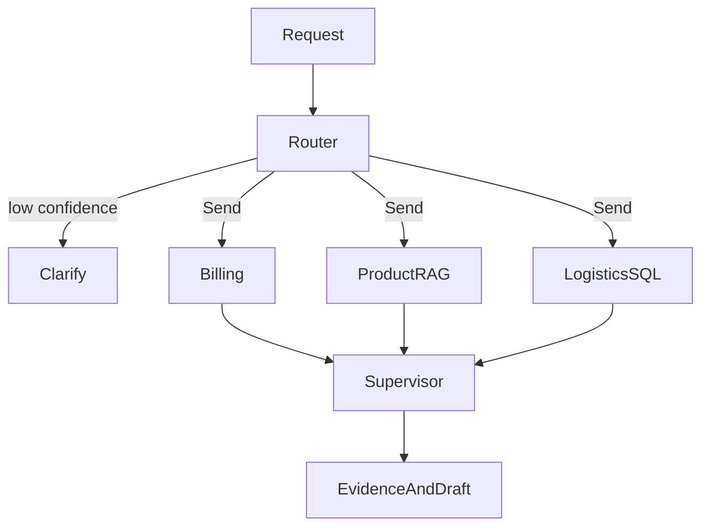

# Checkpoint 4: Operations Desk

Build a read-only Brightwave desk that routes a customer request to billing, product and logistics specialists, then combines their evidence. Budget two hours after modules 14–17; module 17's SDK is optional. Install with `uv sync --extra agents`.

## User stories and acceptance criteria

- As a customer, I can ask about an order total, product specifications or shipment and receive the corresponding evidence.
- As an operator, I can inspect each specialist's result, including denied requests, independently of the final prose.
- As a customer, I cannot read another customer's order by putting their ID or an instruction in the question.
- As a maintainer, I can explain the graph, restrict worker inputs, cap model/tool calls, and route unclear requests to clarification.

The host fixes customer identity. Each billing or logistics tool performs a parameterized customer-scoped SQL read. The product specialist retrieves public catalogue documents and validates citations. No specialist has a write, payment, notification, shell or arbitrary filesystem capability.

## Architecture



The [design rationale](design_rationale.md) explains why this graph is bounded, where customer identity lives, and why a single agent may be cheaper. The solution also exports the actual compiled graph as `.runtime/operations-desk/graph.mmd`.

## Build and run

Start with [starter.py](starter.py), a runnable clarification-only baseline. Use [solution.py](solution.py) after trying the task. Shared implementations live in [common/operations.py](../../common/operations.py), making the tool and context boundaries inspectable.

```text
uv run --extra agents python checkpoints/04_operations_desk/starter.py --offline
uv run --extra agents python checkpoints/04_operations_desk/solution.py --offline
uv run --extra agents pytest checkpoints/04_operations_desk/tests -q
```

Expected: **8/8 contract cases pass**. The solution writes evaluation JSON and Mermaid text under `.runtime/operations-desk`. The committed [evaluation report](evaluation_report.json) records an actual offline run. The tests exercise the reference solution; adapt `run_case` to your implementation to evaluate your own desk.

The input fixture supplies a question, customer, order and SKU. Expected roles and denials stay in the evaluator; they are not added to model prompts. The offline router is an explicitly labelled keyword fixture, and every specialist tool call is scripted. These cases measure orchestration and access controls, not model routing accuracy or general resistance to prompt injection.

## Cost, limits and failure handling

Offline runs need no credentials and block networking. A live case may use up to twelve short logical calls: one router, at most three specialist agents with three-call limits, one product RAG generation and one synthesis. Provider retries may add requests. Run one case before attempting the eight-case live suite. Local Ollama needs a model supporting tool calls and structured output; configure it through the root guide.

Low-confidence routing ends with clarification. Unknown or duplicate specialist labels fail validation. An unavailable model fails visibly. SQL denial remains in the returned evidence even if model wording is inaccurate; do not treat the final draft as an authorization decision. Source quotations are validated, but that alone cannot prove a generated claim follows from them. Runtime identity, thread access and a real approval UI belong to the host application and later production work.

## Extend it

- Record real token usage and latency for matched single-agent and specialist runs; keep accuracy labels independent of the prompt.
- Add an account-free report showing citation coverage and tool denials.
- Add a reviewed handoff into module 14's return workflow, preserving its human approval boundary.

## Ready for the next tier

You can draw the running graph, distinguish parallel workers from conversational handoffs, prove an ownership denial, explain the call ceiling, and show exactly which context each worker receives. Grade with the [rubric](rubric.md).

Next: [Streaming, APIs and user interfaces](../../modules/18_apps/README.md), available with `uv sync --extra apps`.
