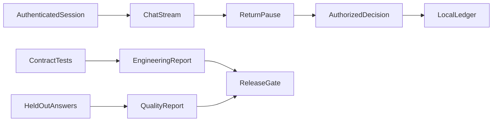

# Production Release checkpoint

Build a release rehearsal for Brightwave Assistant version 11. Prerequisites: modules 18–20, Python 3.12 and `uv sync --extra apps`. Allow 2–3 hours. Offline execution costs nothing; live answer evaluation can make up to 30 logical calls (provider retries can add attempts). This is a local release exercise, not permission to expose a demo to customers.

Start from [starter.py](starter.py). Implement `run_case` using the authenticated HTTP API, inspect each independent case in [eval.jsonl](eval.jsonl), and document why every boundary matters. The runnable baseline reports failure rather than inventing evidence. [solution.py](solution.py) is the complete reference.



The analogy is a vehicle inspection: the engine may start while the brakes still fail inspection. Under the hood, the same FastAPI routes used by Streamlit run against temporary copies of synthetic orders. A separate evaluator runs six questions through real read-only tools with scripted model decisions. All model calls use the common factory; access controls do not depend on model obedience.

## Build and verify

1. Require authentication before creating a thread and deny another customer's read.
2. Finish a framed chat stream and persist owned history.
3. Pause a $121.95 return, deny a customer's review attempt, then resume as manager using the current interrupt ID.
4. Verify rejection writes nothing and duplicate review cannot resume twice. Repeat policy and amount checks at write time.
5. Produce a report that separates engineering contracts from answer quality; a failed quality gate must block release.
6. Build the non-root container from module 20. Verify runtime secrets, health, read-only source and durable-storage requirements for the chosen environment. Explain why this single-worker SQLite host is not horizontally scalable.

```text
uv run --extra apps python checkpoints/05_production_release/starter.py --offline
uv run --extra apps pytest checkpoints/05_production_release/tests --exercise-target exercises
uv run --extra apps pytest checkpoints/05_production_release/tests
uv run --extra apps python checkpoints/05_production_release/solution.py --offline
```

The starter target checks intentionally fail until implemented. Reference acceptance tests pass. The rehearsal saves `.runtime/production-release.json`; its two approval/rejection scenarios pass every engineering contract, but answer quality is **6/6** and `release_allowed` is **true**. Inspect [the saved report](evaluation_report.json). The corrected return-window and shipping answers now contain the required durations. Exact source support and answer correctness remain separate requirements.

## The actual release gate

```text
uv run --extra apps python checkpoints/05_production_release/solution.py --offline --release
```

Expected: **nonzero exit** for the current baseline. Ordinary rehearsal succeeds because it successfully demonstrates a blocked release. The `--release` option is the enforcement boundary, and CI separately tests its exit status. Improve the answer method and validate on fresh held-out data before attempting a live release. Do not relax thresholds after seeing the failures. Offline equality between prompt versions does not show model improvement.

## Evidence and limits

The container was built and tested locally, and a separate disposable Postgres database passed saver/store reconnect checks. The API itself remains SQLite. The local Agent Server HTTP path was verified earlier; Studio and hosted deployment were not. No live provider, real payment/email, cloud evaluation or public app hosting was used. The report does not claim any of those succeeded. The synthetic policy date is fixed; warehouse facts in acceptance runs are explicit trusted fixtures.

Before a customer deployment, resolve quality misses, implement real identity/TLS, account-wide quotas, shared locking and persistence as needed, retention/deletion, durable redacted logs, backup/restore and environment-specific load/failure tests. See [the rubric](rubric.md) and [module 20](../../modules/20_production/README.md).

You're ready to move on when you can reproduce both review outcomes, explain why a missing fact or denied permission must block release, distinguish call budgets from dollar guarantees, demonstrate persistence after reconnecting, and describe the additional work required for real hosting. Continue with the capstones linked in the learning path.
