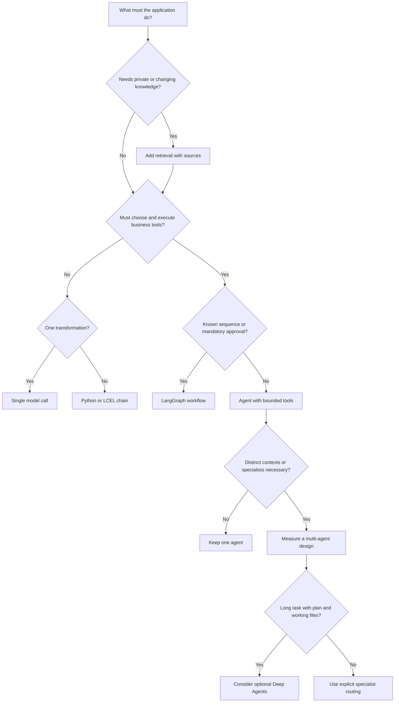

# Choose the smallest useful building block

Start with a measurable task, not with a framework feature. More autonomy adds more paths to test, more model calls and more opportunities for a bad action.

For Brightwave, rewriting a product description starts with one call. A sequence that extracts fields and produces a reply can be a chain. Answering policy questions needs retrieval. Looking up an order may use a small tool-calling agent. A refund that must pause for approval fits an explicit graph. Multiple agents earn their complexity only if separate context or responsibilities improve measured outcomes.

Retrieval is an ingredient, not a mutually exclusive architecture: both chains and agents can retrieve. An LLM should not decide whether authorization rules apply. Keep that decision in application code regardless of the chosen abstraction.
