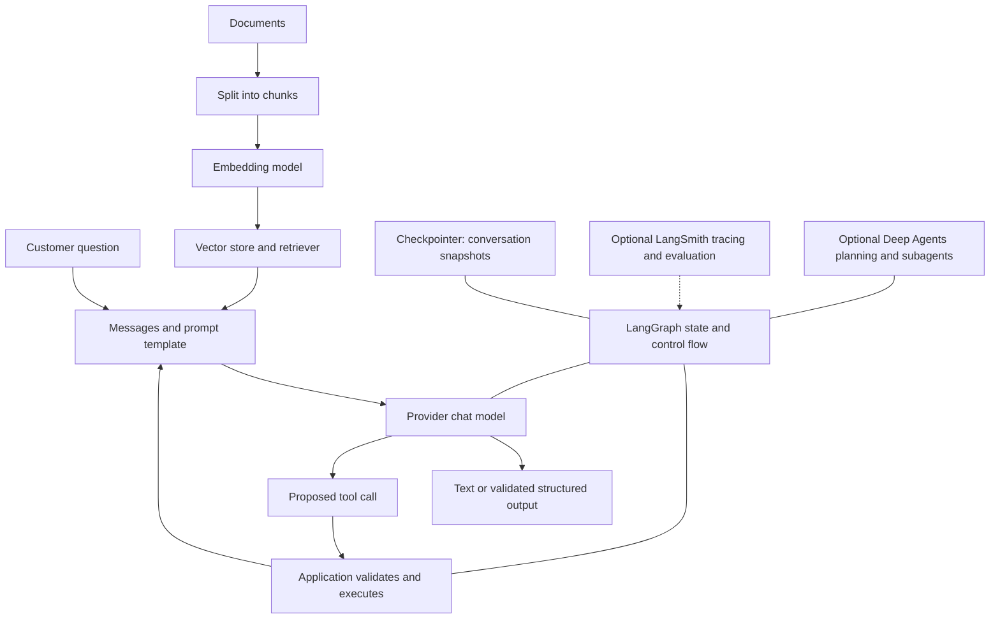

# How the pieces fit

A language model predicts a response from the messages you send. It does not automatically know your database or remember yesterday's conversation. LangChain gives you consistent interfaces for models and tools; LangGraph controls state and execution; LangSmith is an optional place to inspect and evaluate runs.

Think of a support desk. A prompt is the briefing, the model is a fallible assistant, retrieval is the filing cabinet, and a tool is a permitted business operation. A graph is the desk's written procedure. A checkpointer records where the procedure stopped. These parts help you build reliable behavior, but the application must still enforce authorization and validate actions.

The `langchain-core` package defines common objects such as messages, documents, tools and runnables. Provider packages translate those objects to a service's API. `langchain` supplies higher-level model and agent interfaces. LangGraph adds explicit orchestration. Deep Agents adds more opinionated long-task helpers. You can use the smaller parts without adopting every layer.

This is a conceptual map; the [feature map](FEATURE_MAP.md) shows where each mechanism will be implemented and tested.
