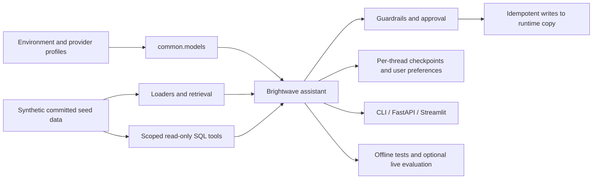

# Phase 1: repository and course plan

**Historical Phase 1 plan, approved by the user’s continue on October 28, 2026.** Original checks: October 27, 2026, America/Chicago. See [current progress](progress.json) and [verification notes](VERIFICATION_NOTES.md) for Phase 2 results.

## Deliverables

- [Verified package table, sources and compatibility decisions](VERIFICATION_NOTES.md).
- [Complete planned repository tree](REPOSITORY_TREE.md).
- [Feature map: each topic, example file, use case and official source](FEATURE_MAP.md).
- [Learning path, checkpoint criteria and 4-/8-week schedules](../LEARNING_PATH.md).
- [Machine-readable course inventory](course-plan.json).
- [PyPI metadata](pypi-verification.json), [candidate dependency ranges](dependency-candidates.in) and [successful resolution](dependency-resolution.txt).

Only planning documents and verification evidence exist at this stage. Planned example links are intentionally future targets. No empty course files have been created to make coverage appear complete.

## Assumptions and decisions

1. Build in the provided local workspace; publish the final public repository as `getting_started_with_langchain`. The GitHub owner will be resolved from the connected account when publication is reached. Phase 1 does not create a remote repository.
2. Recommend Python 3.12 and support 3.12–3.14 on Windows, macOS and Linux. CI will run all supported Python versions on Ubuntu and Windows, with a macOS smoke job. Compatibility of the complete stack determines support, not just LangChain's minimum.
3. Use latest verified stable LangChain 1.x and LangGraph 1.x, conservative minor-bounded ranges and a committed uv.lock. Dependency resolution has passed; installation and API behavior have not yet been tested.
4. OpenAI is the real-model default. Anthropic, Gemini and Ollama chat are supported centrally. Embedding selection is independent; no nonexistent provider integration is promised. Provider profiles in .env.example make the ordinary OpenAI-to-Ollama switch one line, after Ollama model installation.
5. Unit tests and the smoke runner use explicit fakes and block outbound network. Examples normally exercise the selected provider. Optional services never silently become requirements for the main lesson. Fake results and live quality measurements have distinct labels.
6. Keep all reusable code in common/. Each teaching script keeps its central mechanism visible, has a main function, and stays around 120 lines. Exercises contain runnable baseline behavior and YOUR CODE HERE improvement sections; a baseline need not pass the learner's target assertions, but complete solutions must pass.
7. Each README starts with its assistant-version statement, then includes every requested template section. Versions follow the requested milestones 0–11; related exploration modules retain the last version. Every introduced concept receives an analogy, diagram and under-the-hood explanation in its walkthrough.
8. Preserve the full requested scope. At least three examples, three exercises/solutions, one realistic use case, notebook, quiz and tests exist per module; the feature inventory allocates 139 examples across 21 modules. The final glossary has at least 60 terms, each quiz has 5–8 questions with hidden answers, and each module documents at least four reproduced errors and their fixes.
9. The 54-hour course is a guided first-pass estimate, including five checkpoints. Exhaustive study and capstones take longer. Notebook parity, explicit prerequisites and small self-contained primers prevent earlier capstones from depending on later instruction.
10. Proposed upstream-driven changes: migrate the archived MCP adapter to the documented replacement, expose its beta status, and keep a stable-SDK fallback design; keep Deep Agents optional; omit unsupported temperature parameters. See verification notes before approving the plan.

## Dependency installation design

Use `[project.optional-dependencies]` extras for tier functionality and `[dependency-groups]` for development. The base install includes foundations and all four chat-provider adapters so the provider-switch lesson does not require an undisclosed install step. A `foundations` convenience extra mirrors that path. Default dev dependencies contain pytest, pytest-asyncio and ruff so plain `uv sync` followed by `uv run pytest` works.

| Selection | Adds | Planned command |
|---|---|---|
| Base / foundations | LangChain, core, LangGraph, splitters, four provider integrations, Pydantic/settings, dotenv, Rich, httpx, LangSmith | `uv sync` |
| rag | Community loaders, Chroma, pypdf, BM25, NumPy, matplotlib | `uv sync --extra rag` |
| agents | RAG dependencies, SQLite checkpoints, current MCP integration and SDK | `uv sync --extra agents` |
| apps | Agents plus FastAPI, Uvicorn and Streamlit | `uv sync --extra apps` |
| deep | Optional Deep Agents and the agents tier | `uv sync --extra deep` |
| search | Optional Tavily integration | `uv sync --extra search` |
| deployment | LangGraph CLI with in-memory server, Postgres saver/store and psycopg binary | `uv sync --extra deployment` |
| dev group | pytest, pytest-asyncio, ruff; default for the root test command | `uv sync` |
| authoring group | pre-commit, nbstripout, Jupyter, ReportLab, plotting dependencies | `uv sync --group authoring` |
| Contributor full install | All extras and authoring | `uv sync --all-extras --group authoring` |

Tests for absent optional dependencies skip with an explicit install hint in a minimal install. Full CI installs all extras and must run them without dependency-based skips. Network-backed tests are marked live and skipped unless explicitly requested. Core tests must never all skip. notebooks are executed only in the full authoring CI job.

## Shared data and application architecture

The dataset generator uses a fixed seed, fixed reference date, stable ordering and deterministic PDF metadata. Data includes 60 products, four numbered policies, a ten-page handbook derived from committed Markdown, 40 FAQ pairs, 100 tickets, 200 orders and 300 reviews. Synthetic emails use reserved example domains. All order/customer/SKU references and foreign keys are consistent. Card-like fixtures are clearly synthetic and never production credentials.

Golden sets cover RAG, triage and tool trajectories, including unknown evidence, hostile input, wrong-customer access, approval denial and repeated-write attempts. Hold out evaluation cases from few-shot prompts. The database and PDF are committed with a checksum manifest. Examples write only to ignored runtime folders or temporary directories, preserving seed data. Notifications and market research use synthetic local fixtures unless live mode is explicitly selected.

## Validation and completion gates

| Gate | Evidence required before marking it complete |
|---|---|
| Versions and APIs | PyPI snapshot, resolution, installed signature/import checks and dated official references |
| Foundation | Minimal uv sync, offline pytest, data determinism and foreign-key tests |
| Every module | Template/coverage checks, runnable examples, use case, exercises/solutions, notebook parity, quiz and meaningful tests |
| Formatting | `uv run ruff check .` and `uv run ruff format --check .` |
| Smoke run | `uv run python scripts/run_all_examples.py` uses fakes, per-script timeout, temporary state and failure summary; no network |
| Legacy scan | Parse Python and notebook code; scan tutorial text; exception only for migration guide; avoid flagging unrelated asyncio/subprocess APIs or the scanner's own encoded signatures |
| Links | Offline paths and anchors in tests; separate online external-link CI check with bounded retries and reported failures |
| Retrieval | Verified citations and held-out metrics; honest before/after results rather than assumed improvement |
| Agents and security | Tool arguments, ownership, approval threshold, reject paths, bounded loops, budget caps, prompt injection and idempotency tests |
| Provider coverage | Actual Ollama and at least one hosted run of each applicable example; capability limitations documented, never inferred from fakes |
| Cross-platform | Ubuntu/Windows Python 3.12–3.14 CI; macOS smoke; PowerShell and POSIX command review |
| Publication | Public repository, tracked seed artifacts, working clean-clone instructions and accurate completion checklist |

Server/UI examples have finite health/interaction smoke checks; they do not hang the example runner. External network tests run separately from offline pytest. No new service credentials, paid calls or deployment are required to verify basic program behavior. A fresh dependency install requires network or a populated cache.

## Delivery phases and stop points

| Phase | Scope | Completion evidence |
|---|---|---|
| 1, this phase | Plan, verified versions, final tree, feature map, learning path | Documents reviewed; dependency set resolves |
| 2 | Foundation, config, common base helpers, scripts, deterministic committed data, root docs and CI | Installation, tests, lint and data validation; uv.lock committed |
| 3 | Tier 1, modules 00–05 and Smart Ticket Desk | Complete lessons and checkpoint; offline smoke tests |
| 4 | Tier 2, modules 06–09 and Handbook Q&A | Citations and reproducible evaluation report |
| 5 | Tier 3, modules 10–13 and Guarded Support | Memory restart, approval and MCP transport tests |
| 6 | Tier 4, modules 14–17 and Operations Desk | Resume/idempotency and orchestration tests |
| 7 | Tier 5, modules 18–20 and Release Rehearsal | API/UI tests, evaluation gates and container verification |
| 8 | All five capstones, cheatsheets, final glossary/troubleshooting/migration material, full audit and publication | Definition-of-done checklist with evidence or explicit gaps |

Shared feature helpers are added with the tier that introduces them, so Phase 2 does not contain unfinished placeholder implementations. The glossary and troubleshooting guide grow with each tier; Phase 8 completes and audits them. At each phase boundary report completed work, checks and remaining gaps, then wait for `continue`.

## Current evidence and limits

Phase 1 checked package metadata, inspected core official documentation, and resolved the proposed combined dependency set. Structural checks confirmed 21 modules, 139 example mappings, 598 unique planned files and 463 local links that either exist or match the planned inventory. All 49 distinct non-PyPI external documentation links were reachable, and both schedules reconcile to 54 hours. PyPI package metadata was fetched successfully for all 42 inspected packages.

This confirms a feasible dependency proposal, not an executable course. Runtime tests, installed API signatures, live model behavior, complete per-module cost estimates, existence of future files and remote CI are pending. The required instruction to stop after Phase 1 is the reason implementation ends here.
