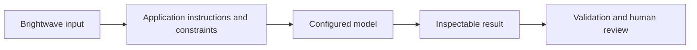
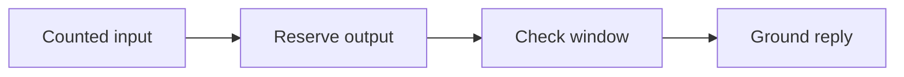
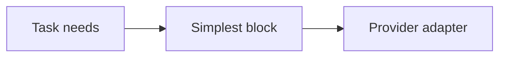
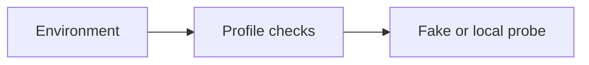

Assistant version 0: Make a first call and inspect an optional trace.

# 00 — Setup and orientation

After this module, you can **make a grounded first call and explain the surrounding packages.**

**Time:** 60 minutes (guided first pass). **Level:** Beginner.
**Cost:** Most short hosted examples are below $0.01 each on the configured low-cost model; see each script's explicit call count. The 100-ticket triage run budgets $0.10, and all-review analysis can approach $1. These are estimates, not spending caps. `--offline` is free and scripted; local Ollama has no API fee. No LangSmith account is required.

## Prerequisites

Python basics and a terminal; no LLM experience. Run every command below from the repository root after `uv sync --locked`. Read [provider capabilities](../../docs/PROVIDER_CAPABILITIES.md) before switching model features. To use a real configured provider, omit `--offline`; never mistake fixture output for a quality evaluation.

New terms are defined in the [foundation glossary](../../docs/GLOSSARY.md).

## Learning objectives

- Explain tokens, context limits, temperature and hallucinations without jargon.
- Install the locked environment and check it without a paid request.
- Switch the configured provider and explain each ecosystem package.
- Make one evidence-grounded call with tracing optional.

## The big idea

A language model is like a very practiced text completer. It predicts pieces of text from the conversation you give it. It is not looking up a guaranteed answer in a database. LangChain supplies common plugs for different model services; your application still decides what evidence, tools and permissions to provide. Start with one call before adding an agent.

## How it works



**Under the hood:** the script loads local synthetic data and settings, invokes the demonstrated API, and exposes its output. A provider adapter is used only when a model call is needed. Offline mode replaces generation with explicit responses while retaining formatting, parsing, dispatch and SQL behavior. It blocks network in the test and smoke harness.

### Before the first call

An **LLM** (large language model) predicts the next **token**, a piece of text such as a word fragment or punctuation. Tokens are neither words nor characters; different model tokenizers split text differently. The **context window** limits the tokens the model can consider in one request. Reserve room for output as well as the instructions, history and evidence. The 256-token example is an arithmetic illustration, not the size of a real model.

**Temperature** adjusts randomness in token sampling. Lower values often produce more repeatable wording, but even temperature zero does not guarantee truth or identical outputs. A **hallucination** is a plausible claim unsupported by the evidence. Ask about the return window in our supplied policy, then ask for a private delivery date that is absent. Check that a real model admits the missing fact; the offline fixture does not measure this skill.

| Package | Analogy | What it actually does |
|---|---|---|
| `langchain-core` | Standard plug/socket | Messages, prompts, runnables, tools and model interfaces |
| Provider adapters | Travel plug adapter | Translate the common request into each provider's API |
| `langchain` | Assembly kit | High-level model initialization and agent construction |
| LangGraph | Workflow controller | Explicit state, steps, durable execution and pauses |
| LangSmith | Flight recorder | Optional traces and evaluations; it is a separate service |
| Deep Agents | Specialist toolkit | Optional planning/filesystem patterns taught much later |

### Install and choose a provider

Start in the downloaded/cloned repository root, with Python 3.12 available. Publication is scheduled for the final phase; the root README records current repository status.

```text
python -m pip install uv
uv sync --locked
uv run python scripts/configure.py
uv run python scripts/check_env.py --offline
```

`uv sync` creates an isolated `.venv` using the committed dependency lock. Open the created `.env` in an editor and set `OPENAI_API_KEY` for the default hosted provider. Never commit this file. A **provider** is the service running inference; its adapter is the Python package that speaks its API. See the root [pip fallback](../../README.md) if you cannot use uv.

For local inference, install [Ollama](https://ollama.com/download), start it, and pull the profiles recorded in `.env.example`:

```text
ollama pull qwen3:4b
ollama pull embeddinggemma
```

Change just `LLM_PROVIDER=ollama` in `.env`. The central configuration selects the local chat and embedding profiles automatically. Then run:

```text
uv run python scripts/check_env.py
uv run python modules/00_setup/use_case/first_call.py
```

Ollama requires enough local memory; a slow first response may be model loading. No API fee does not mean no hardware/electricity cost. For hosted alternatives choose `anthropic` or `google_genai` and set their corresponding key in `.env`.

Optional tracing: set `LANGSMITH_TRACING=true`, `LANGSMITH_API_KEY`, and the project in `.env`, then run the first-call use case. Inspect its messages and latency in your LangSmith project. Traces can contain prompts and outputs; use only synthetic data here. With tracing disabled the same call still works. Offline mode always disables trace uploads.

## Key APIs at a glance

| API or concept | Where to inspect it | What to notice |
|---|---|---|
| LLMs, tokens, context windows, temperature, hallucinations | [01_llm_basics.py](examples/01_llm_basics.py) | Input/output types and the `KEY IDEA` comment |
| LangChain, core, provider packages, LangGraph, LangSmith, Deep Agents; choose a building block | [02_ecosystem.py](examples/02_ecosystem.py) | Input/output types and the `KEY IDEA` comment |
| uv, pip fallback, virtual environments, .env, package and key checks, Ollama pull, optional tracing | [03_verify_environment.py](examples/03_verify_environment.py) | Input/output types and the `KEY IDEA` comment |

## Walkthrough

Open each file, predict its output, run it, then change one input. Commands use explicit fixtures so the first pass needs no keys.

### 1. Llm basics

**Analogy:** A desk with finite space. **Under the hood:** The input and reserved output share the context budget; a system message supplies evidence, while temperature controls sampling rather than factuality.



```text
uv run python modules/00_setup/examples/01_llm_basics.py --offline
```

**Expected:** A grounded return-window reply; unknown private facts require evidence. Read [the source](examples/01_llm_basics.py) to connect the visible result to the exact API call. Live wording and usage can differ.

### 2. Ecosystem

**Analogy:** Choose a vehicle for the trip. **Under the hood:** A deterministic decision tree selects the smallest block; installed package versions reveal which layer supplies each interface.



```text
uv run python modules/00_setup/examples/02_ecosystem.py --offline
```

**Expected:** Draft -> model; fixed pipeline -> LCEL; durable approval -> LangGraph. Read [the source](examples/02_ecosystem.py) to connect the visible result to the exact API call. Live wording and usage can differ.

### 3. Verify environment

**Analogy:** A pre-flight checklist. **Under the hood:** The setup script inspects Python, packages and committed data; offline mode tests fake interfaces, while the live local check probes installed Ollama models.



```text
uv run python modules/00_setup/examples/03_verify_environment.py --offline
```

**Expected:** Package versions and OFFLINE CHECK PASSED. Read [the source](examples/03_verify_environment.py) to connect the visible result to the exact API call. Live wording and usage can differ.

## Real-world use case

**Make a first call and inspect an optional trace.** Run the mini-application against the committed Brightwave dataset:

```text
uv run python modules/00_setup/use_case/first_call.py --offline
```

**Sample input:** Unused gear delivered 12 days ago, with a receipt.

**Sample output:** Brightwave Outfitters offers 30-day returns for unused gear with proof of purchase.

**Business application:** Support staff can inspect how a policy reaches the model and optionally inspect its trace. Inspect [the application](use_case/first_call.py). Output remains a draft. Fixtures are predetermined and do not establish that a live model will select the same wording or actions.

## Common mistakes

These exception classes and message excerpts were reproduced against the locked installation. The CLI prints a shorter safe hint; direct calls in tests expose the underlying error.

### Missing key

```text
ConfigurationError: Set OPENAI_API_KEY in .env for openai.
```

**Fix:** Set the key in your ignored .env, choose a configured local provider, or pass --offline.

### Unknown provider

```text
ValidationError: 1 validation error for Settings
llm_provider
  Input should be 'openai', 'anthropic', 'google_genai' or 'ollama' [type=literal_error]
```

**Fix:** Use exactly openai, anthropic, google_genai or ollama; provider package names are not provider IDs.

### Missing data

```text
ConfigurationError: Missing data/not-present.txt; restore the committed dataset.
```

**Fix:** Restore the committed dataset from this repository; do not invent an answer for absent files.

### Negative token cap

```text
ValidationError: 1 validation error for Settings
model_max_tokens
  Input should be greater than 0 [type=greater_than]
```

**Fix:** Use a positive token cap (the course default is 512).

## Exercises

Starters have working baseline behavior; improve the named function at `YOUR CODE HERE`. Do not inspect the solution until you have tried the target checks.

1. **Practice — Reserve output tokens.** Implement fits(input_tokens, reserve, window). Include the output reserve; reject negative counts. [Starter](exercises/01_practice.py) · [Solution](solutions/01_practice.py).

2. **Apply — Choose a building block.** Choose LangGraph for durable work, agent for tool decisions, LCEL for fixed steps, model otherwise. [Starter](exercises/02_apply.py) · [Solution](solutions/02_apply.py).

3. **Stretch — Summarize configuration safely.** Return provider, model and local fields from Settings; never serialize keys or all settings. [Starter](exercises/03_stretch.py) · [Solution](solutions/03_stretch.py).

```text
uv run python modules/00_setup/exercises/01_practice.py --offline
uv run pytest modules/00_setup/tests/test_exercises.py --exercise-target exercises
uv run pytest modules/00_setup/tests
```

The second command intentionally fails until you complete the starters. The last command checks the supplied solutions plus examples and the use case. Both modes are offline. The [notebook](notebook.ipynb) contains the same example source and a use-case launch cell with outputs cleared; change inputs interactively after the first run. Install notebook tools with `uv sync --group authoring`, then `uv run jupyter lab`.

## Quiz


**Are tokens always words?**

<details><summary>Answer</summary>

No. A tokenizer can split words, punctuation and whitespace differently.

</details>

**Why reserve output space?**

<details><summary>Answer</summary>

Input, evidence and history consume the context budget; the answer also needs room.

</details>

**Does temperature zero prevent hallucinations?**

<details><summary>Answer</summary>

No. Sampling settings do not verify factual claims.

</details>

**Which package translates provider requests?**

<details><summary>Answer</summary>

A provider adapter; langchain-core defines the common interface.

</details>

**What does a passing offline setup check prove?**

<details><summary>Answer</summary>

The local installation and fixture interfaces work. It does not prove key validity, local model availability or answer quality.

</details>

**When is LangSmith required?**

<details><summary>Answer</summary>

It is optional throughout this course; tracing is useful but the application runs without it.

</details>

## Key takeaways

- Explain tokens, context limits, temperature and hallucinations without jargon.
- Install the locked environment and check it without a paid request.
- Switch the configured provider and explain each ecosystem package.
- Make one evidence-grounded call with tracing optional.
- Keep fixtures distinct from live behavior and validate the result.

## Go deeper

- [Model interface guide](https://docs.langchain.com/oss/python/langchain/models)
- [LangChain overview](https://docs.langchain.com/oss/python/langchain/overview)
- [Current verification and limits](../../docs/VERIFICATION_NOTES.md)

## Next: Chat models and messages

Continue to [Chat models and messages](../01_chat_models/README.md). Re-run this module's tests if you change its shared helpers.
