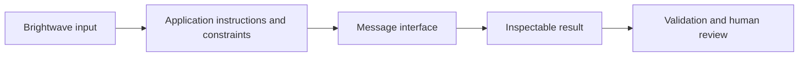
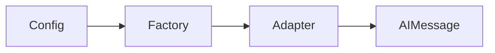
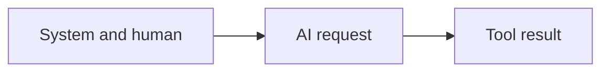
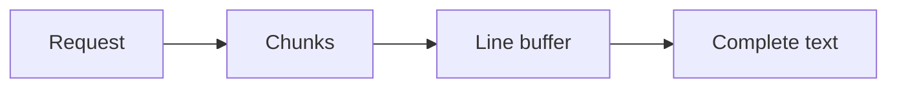
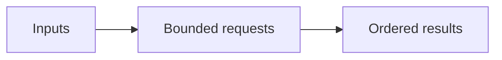
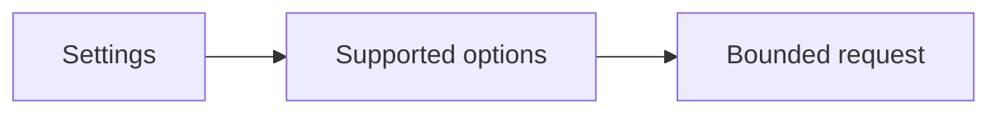
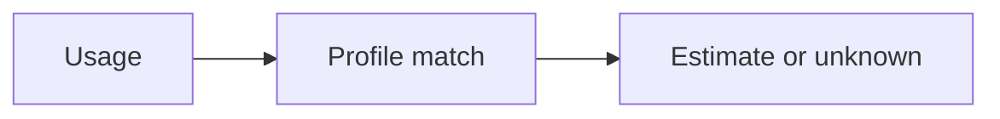
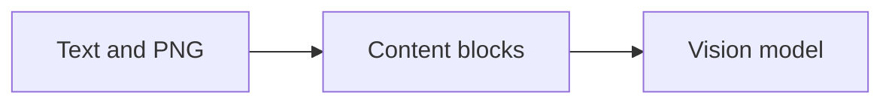
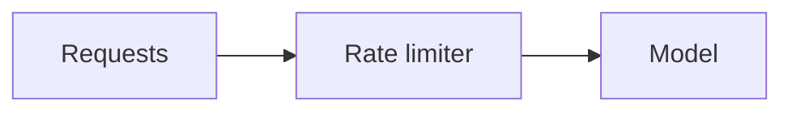

Assistant version 1: Stream a support reply and report token usage and estimated cost.

# 01 — Chat models and messages

After this module, you can **draft a streamed reply while keeping roles, usage and provider limits explicit.**

**Time:** 90 minutes (guided first pass). **Level:** Beginner.
**Cost:** Most short hosted examples are below $0.01 each on the configured low-cost model; see each script's explicit call count. The 100-ticket triage run budgets $0.10, and all-review analysis can approach $1. These are estimates, not spending caps. `--offline` is free and scripted; local Ollama has no API fee. No LangSmith account is required.

## Prerequisites

Complete [Setup and orientation](../00_setup/README.md). Run every command below from the repository root after `uv sync --locked`. Read [provider capabilities](../../docs/PROVIDER_CAPABILITIES.md) before switching model features. To use a real configured provider, omit `--offline`; never mistake fixture output for a quality evaluation.

New terms are defined in the [foundation glossary](../../docs/GLOSSARY.md).

## Learning objectives

- Construct role-correct message lists and equivalent dictionaries.
- Invoke, stream, batch and await a configured model.
- Interpret token usage without counting reasoning tokens twice.
- Compare raw HTTP with the adapter and explain provider capability limits.
- Send image content and distinguish rate from concurrency.

## The big idea

A chat request is an envelope containing several labelled notes. System notes set application instructions; human notes supply the customer request; assistant notes contain earlier replies; tool notes carry program results. The provider adapter translates the envelope, and an AIMessage comes back. Streaming opens the envelope a piece at a time. Batch and async overlap waiting; neither makes inference free.

## How it works



**Under the hood:** the script loads local synthetic data and settings, invokes the demonstrated API, and exposes its output. A provider adapter is used only when a model call is needed. Offline mode replaces generation with explicit responses while retaining formatting, parsing, dispatch and SQL behavior. It blocks network in the test and smoke harness.

### First-use concepts

A **tool call** is a model-written request to run a named application function. We inspect its message format here; module 05 teaches the dispatcher that actually executes the function.

**Async** means a function can yield while waiting for input/output. Calling an `async def` function creates a coroutine; `await` waits for its result while letting other work progress. `asyncio.run` creates an event loop for a standalone script. A notebook already has a loop; its lesson cells run the script's synchronous `main` in a worker thread. Batch returns outputs in input order; it does not imply that requests finish in that order. Use a concurrency cap to avoid a burst of simultaneous requests.

The factory in [common/models.py](../../common/models.py) calls `init_chat_model(model, model_provider=..., **options)`. `LLM_PROVIDER` selects the adapter; `LLM_MODEL` optionally overrides the provider's profile. All ordinary lessons use that factory so a provider switch stays one line. The raw HTTP exercise implements both OpenAI Responses and Ollama chat. Other providers use the common factory in all remaining model lessons; select OpenAI or Ollama for this one wire-protocol comparison.

| Parameter | Meaning | Important difference |
|---|---|---|
| temperature | Sampling randomness | Some reasoning models reject it; our Anthropic profile omits it |
| max_tokens | Output cap, not guaranteed answer length | Ollama receives `num_predict`; reasoning can consume the output allowance |
| timeout | Maximum wait for an individual transport operation/request as supported by the adapter | Not a whole workflow deadline |
| max_retries | SDK transport retries | Each retry adds latency; Ollama has no matching factory retry setting |

An **AIMessageChunk** is a fragment. Add chunks to preserve metadata; concatenate their text only when you need plain text. Our display buffers complete lines before printing so a key split across chunks can still be redacted. A single-line answer may therefore appear only at completion, even though chunks are being consumed incrementally.

`usage_metadata` normally separates input/output/total tokens, sometimes with cached or reasoning details. Details are subsets, not extra tokens to add again. An absent usage field means unknown, not zero. The cost helper only estimates the exact configured pricing profile; discounts, caching and special billing may differ.

**Content blocks** are typed pieces such as text and images within one message. The local tent drawing is synthetic and not evidence of a real product's waterproofness. For the image example, local users also run `ollama pull qwen3-vl:4b`. Its live path checks `/api/show` for vision capability. Hosted vision support depends on your selected model.

`InMemoryRateLimiter` is like a door admitting a limited number of requests per second. `max_concurrency` limits how many guests are inside at once. The limiter is process-local and counts requests, not tokens or spending; it cannot coordinate several servers. See [provider capabilities](../../docs/PROVIDER_CAPABILITIES.md).

## Key APIs at a glance

| API or concept | Where to inspect it | What to notice |
|---|---|---|
| init_chat_model; invoke; switch OpenAI, Anthropic, Gemini, Ollama via configuration | [01_hello_model.py](examples/01_hello_model.py) | Input/output types and the `KEY IDEA` comment |
| SystemMessage, HumanMessage, AIMessage, ToolMessage, plain-dict messages | [02_message_types.py](examples/02_message_types.py) | Input/output types and the `KEY IDEA` comment |
| stream; assemble content chunks; print a reply as it arrives | [03_streaming.py](examples/03_streaming.py) | Input/output types and the `KEY IDEA` comment |
| batch, ainvoke; introduce async, await and asyncio before use | [04_batch_async.py](examples/04_batch_async.py) | Input/output types and the `KEY IDEA` comment |
| temperature, max_tokens, timeout, max_retries; provider capability differences | [05_parameters.py](examples/05_parameters.py) | Input/output types and the `KEY IDEA` comment |
| usage_metadata; input, output and reasoning tokens; missing-usage handling; cost estimate | [06_usage_cost.py](examples/06_usage_cost.py) | Input/output types and the `KEY IDEA` comment |
| content_blocks; image input; local vision-model capability check | [07_multimodal.py](examples/07_multimodal.py) | Input/output types and the `KEY IDEA` comment |
| InMemoryRateLimiter; bounded requests | [08_rate_limit.py](examples/08_rate_limit.py) | Input/output types and the `KEY IDEA` comment |
| Build it yourself: httpx provider HTTP call; mocked transport offline; compare LangChain | [09_http_by_hand.py](examples/09_http_by_hand.py) | Input/output types and the `KEY IDEA` comment |

## Walkthrough

Open each file, predict its output, run it, then change one input. Commands use explicit fixtures so the first pass needs no keys.

### 1. Hello model

**Analogy:** A universal electrical socket. **Under the hood:** The factory calls init_chat_model for the selected provider and returns the common BaseChatModel interface. invoke produces an AIMessage.



```text
uv run python modules/01_chat_models/examples/01_hello_model.py --offline
```

**Expected:** One AIMessage and the selected provider name. Read [the source](examples/01_hello_model.py) to connect the visible result to the exact API call. Live wording and usage can differ.

### 2. Message types

**Analogy:** Labelled notes in an envelope. **Under the hood:** System/Human/AI/Tool messages keep distinct roles; dictionary roles are normalized by the model adapter. A tool result answers an existing call ID.



```text
uv run python modules/01_chat_models/examples/02_message_types.py --offline
```

**Expected:** system, human, ai, tool roles, followed by a reply from plain-dict input. Read [the source](examples/02_message_types.py) to connect the visible result to the exact API call. Live wording and usage can differ.

### 3. Streaming

**Analogy:** An answer arriving in parcels. **Under the hood:** stream yields message chunks. The display joins content and buffers complete lines; chunk boundaries do not necessarily coincide with words.



```text
uv run python modules/01_chat_models/examples/03_streaming.py --offline
```

**Expected:** A streamed reply, then its character count. Read [the source](examples/03_streaming.py) to connect the visible result to the exact API call. Live wording and usage can differ.

### 4. Batch async

**Analogy:** Several checkout queues. **Under the hood:** batch overlaps independent requests and preserves input order. ainvoke is awaited inside an asyncio event loop to let waiting work share the thread.



```text
uv run python modules/01_chat_models/examples/04_batch_async.py --offline
```

**Expected:** Two ordered batch replies and one awaited reply. Read [the source](examples/04_batch_async.py) to connect the visible result to the exact API call. Live wording and usage can differ.

### 5. Parameters

**Analogy:** Controls on a camera. **Under the hood:** Sampling, output limits, timeout and retries control different behaviors. The factory translates supported options and omits unsupported temperature settings.



```text
uv run python modules/01_chat_models/examples/05_parameters.py --offline
```

**Expected:** Configured limits and a short reply; unsupported sampling parameters are omitted. Read [the source](examples/05_parameters.py) to connect the visible result to the exact API call. Live wording and usage can differ.

### 6. Usage cost

**Analogy:** A receipt with line items. **Under the hood:** The adapter normalizes usage fields; reasoning details belong within output tokens. Missing usage and unrecognized model pricing remain unknown.



```text
uv run python modules/01_chat_models/examples/06_usage_cost.py --offline
```

**Expected:** Usage fields and an honest unknown estimate when usage is absent. Read [the source](examples/06_usage_cost.py) to connect the visible result to the exact API call. Live wording and usage can differ.

### 7. Multimodal

**Analogy:** A folder containing text and a photo. **Under the hood:** Typed image blocks carry base64 PNG pixels and a MIME type. Vision-capable adapters encode them for the provider; the local path checks capabilities first.



```text
uv run python modules/01_chat_models/examples/07_multimodal.py --offline
```

**Expected:** A description of the simple tent drawing; never a claim about real product quality. Read [the source](examples/07_multimodal.py) to connect the visible result to the exact API call. Live wording and usage can differ.

### 8. Rate limit

**Analogy:** A turnstile. **Under the hood:** A token bucket admits starts over time. It is shared by requests using this model instance, not by other processes and not by a distributed fleet.



```text
uv run python modules/01_chat_models/examples/08_rate_limit.py --offline
```

**Expected:** Two replies paced at no more than two requests per second. Read [the source](examples/08_rate_limit.py) to connect the visible result to the exact API call. Live wording and usage can differ.

### 9. Http by hand

**Analogy:** Addressing a parcel by hand. **Under the hood:** httpx sends provider-specific JSON to OpenAI Responses or Ollama chat and reads the different response envelopes directly. The factory supplies adapter translation, message types and common execution interfaces for the second call.


```text
uv run python modules/01_chat_models/examples/09_http_by_hand.py --offline
```

**Expected:** The mock raw API and LangChain both return a greeting in offline mode. Read [the source](examples/09_http_by_hand.py) to connect the visible result to the exact API call. Live wording and usage can differ.

## Real-world use case

**Stream a support reply and report token usage and estimated cost.** Run the mini-application against the committed Brightwave dataset:

```text
uv run python modules/01_chat_models/use_case/reply_drafter.py --offline
```

**Sample input:** Ticket T002 asks to return unused gear.

**Sample output:** A short return-policy draft, followed by OFFLINE FIXTURE cost status.

**Business application:** A support colleague reviews the draft before sending; no mail integration is invoked. Inspect [the application](use_case/reply_drafter.py). Output remains a draft. Fixtures are predetermined and do not establish that a live model will select the same wording or actions.

## Common mistakes

These exception classes and message excerpts were reproduced against the locked installation. The CLI prints a shorter safe hint; direct calls in tests expose the underlying error.

### Invalid model input

```text
ValueError: Invalid input type <class 'int'>. Must be a PromptValue, str, or list of BaseMessages.
```

**Fix:** Pass a string, prompt value or message list rather than a raw integer.

### Missing tool result ID

```text
KeyError: 'tool_call_id'
```

**Fix:** Copy the id from the pending AIMessage.tool_calls entry into tool_call_id.

### Invalid timeout

```text
ValidationError: 1 validation error for Settings
model_timeout
  Input should be greater than 0 [type=greater_than]
```

**Fix:** Set a positive timeout. A zero timeout is not a request to disable timeouts.

### Exhausted fixture

```text
StopIteration: (no message; scripted response iterator exhausted)
```

**Fix:** Provide enough scripted responses for all expected calls. Exhaustion intentionally exposes an extra call.

## Exercises

Starters have working baseline behavior; improve the named function at `YOUR CODE HERE`. Do not inspect the solution until you have tried the target checks.

1. **Practice — Construct message roles.** Return a system instruction followed by the unchanged customer text as a HumanMessage. [Starter](exercises/01_practice.py) · [Solution](solutions/01_practice.py).

2. **Apply — Read usage without inventing zero.** Return None for absent usage, otherwise (input, output, total). Do not add reasoning tokens a second time. [Starter](exercises/02_apply.py) · [Solution](solutions/02_apply.py).

3. **Stretch — Batch complete drafts.** Use model.batch with max_concurrency=2; return text for every input in input order. [Starter](exercises/03_stretch.py) · [Solution](solutions/03_stretch.py).

```text
uv run python modules/01_chat_models/exercises/01_practice.py --offline
uv run pytest modules/01_chat_models/tests/test_exercises.py --exercise-target exercises
uv run pytest modules/01_chat_models/tests
```

The second command intentionally fails until you complete the starters. The last command checks the supplied solutions plus examples and the use case. Both modes are offline. The [notebook](notebook.ipynb) contains the same example source and a use-case launch cell with outputs cleared; change inputs interactively after the first run. Install notebook tools with `uv sync --group authoring`, then `uv run jupyter lab`.

## Quiz


**Does bind_tools execute a tool?**

<details><summary>Answer</summary>

No. Binding describes tools; application code executes requested calls.

</details>

**What matches a ToolMessage to a request?**

<details><summary>Answer</summary>

tool_call_id must match the AIMessage tool call id.

</details>

**What does await do?**

<details><summary>Answer</summary>

It waits for a coroutine result while allowing the event loop to progress on other work.

</details>

**Are reasoning tokens added to output_tokens again?**

<details><summary>Answer</summary>

No. They are normally a detail within output tokens, not additional billable output to double-count.

</details>

**Is missing usage zero cost?**

<details><summary>Answer</summary>

No. The usage or estimate is unknown; local and explicit fake calls are labelled separately.

</details>

**Does a rate limiter cap the number of concurrent requests?**

<details><summary>Answer</summary>

Not by itself. It limits starts per time interval; concurrency limits in-flight work.

</details>

**Can a text-only model read an image filename?**

<details><summary>Answer</summary>

It can read the name as text, but needs image pixels and vision capability to inspect the picture.

</details>

## Key takeaways

- Construct role-correct message lists and equivalent dictionaries.
- Invoke, stream, batch and await a configured model.
- Interpret token usage without counting reasoning tokens twice.
- Compare raw HTTP with the adapter and explain provider capability limits.
- Send image content and distinguish rate from concurrency.

## Go deeper

- [Model interface guide](https://docs.langchain.com/oss/python/langchain/models)
- [Message roles and content blocks](https://docs.langchain.com/oss/python/langchain/messages)
- [OpenAI text generation](https://developers.openai.com/api/docs/guides/text)
- [Ollama chat API](https://docs.ollama.com/api/chat)
- [HTTPX mock transports](https://www.python-httpx.org/advanced/transports/)
- [Current verification and limits](../../docs/VERIFICATION_NOTES.md)

## Next: Prompt templates

Continue to [Prompt templates](../02_prompt_templates/README.md). Re-run this module's tests if you change its shared helpers.
