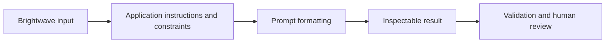
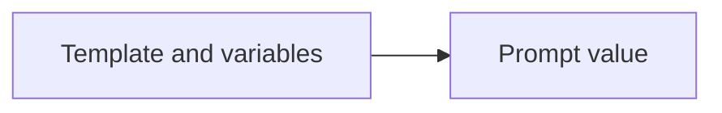
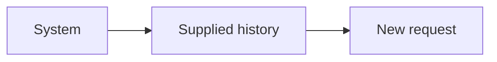
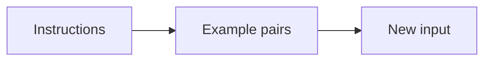
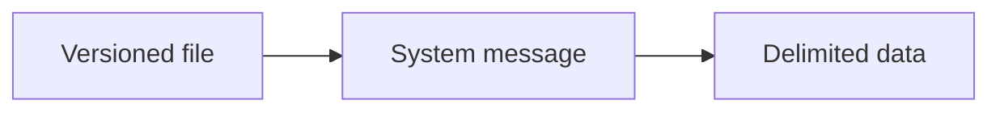

Assistant version 2: Write a product description and rewrite an email in Brightwave's voice.

# 02 — Prompt templates

After this module, you can **write consistent product and email drafts using versioned templates.**

**Time:** 75 minutes (guided first pass). **Level:** Beginner.
**Cost:** Most short hosted examples are below $0.01 each on the configured low-cost model; see each script's explicit call count. The 100-ticket triage run budgets $0.10, and all-review analysis can approach $1. These are estimates, not spending caps. `--offline` is free and scripted; local Ollama has no API fee. No LangSmith account is required.

## Prerequisites

Complete [Chat models and messages](../01_chat_models/README.md). Run every command below from the repository root after `uv sync --locked`. Read [provider capabilities](../../docs/PROVIDER_CAPABILITIES.md) before switching model features. To use a real configured provider, omit `--offline`; never mistake fixture output for a quality evaluation.

New terms are defined in the [foundation glossary](../../docs/GLOSSARY.md).

## Learning objectives

- Format text/chat templates and bind constants with partial.
- Insert explicit history without assuming persistent memory.
- Construct few-shot message pairs ahead of a new request.
- Load reviewed prompt files and preserve untrusted input as data.

## The big idea

A prompt template is a reusable form. The printed instructions stay fixed, while labelled blanks receive a product or customer message. Partial variables pre-fill constants. A history placeholder inserts an actual list of earlier notes; it is not a filing cabinet. Few-shot examples show the format you want, like completed sample forms, without training the model.

## How it works



**Under the hood:** the script loads local synthetic data and settings, invokes the demonstrated API, and exposes its output. A provider adapter is used only when a model call is needed. Offline mode replaces generation with explicit responses while retaining formatting, parsing, dispatch and SQL behavior. It blocks network in the test and smoke harness.

### Write a prompt that can be inspected

Use five ingredients: **role** (what job), **constraints** (what must stay true), **examples** (what good output looks like), **output format** (how to consume it), and **delimiters** (where source material begins/ends). The prompt files use all five. A delimiter such as `<email>` helps readability; it does not create a security boundary. A model can still follow malicious instructions inside the source, so sensitive actions require code-enforced permissions later.

`PromptTemplate` returns a prompt value that can become text. `ChatPromptTemplate` preserves roles. Curly braces in the template identify variables; literal braces in a template must be doubled. Values passed in a dictionary are substituted once, so a customer's `{ignore_rules}` text is not reinterpreted as a new template variable.

`MessagesPlaceholder` expects a list of messages. Supplying an empty list gives a fresh conversation. It does not remember the previous invocation. Few-shot prompting puts demonstration messages in the context window each time: it adds tokens/cost and can bias outputs. Keep examples short, representative, and separate from held-out evaluation tickets.

The versioned files under [prompts](prompts/brand_voice.txt) are application instructions reviewed like code. Keep customer text out of that file and in the human-message variable. Do not evaluate untrusted template code. Product data describes facts; the model is only drafting wording, and a person reviews the result before publication.

## Key APIs at a glance

| API or concept | Where to inspect it | What to notice |
|---|---|---|
| PromptTemplate, variables, partial variables | [01_variables.py](examples/01_variables.py) | Input/output types and the `KEY IDEA` comment |
| ChatPromptTemplate, MessagesPlaceholder; distinguish supplied history from persistent memory | [02_chat_history.py](examples/02_chat_history.py) | Input/output types and the `KEY IDEA` comment |
| FewShotChatMessagePromptTemplate; example selection by hand | [03_few_shot.py](examples/03_few_shot.py) | Input/output types and the `KEY IDEA` comment |
| Version-controlled prompt files; roles, constraints, examples, output format, delimiters | [04_prompt_files.py](examples/04_prompt_files.py) | Input/output types and the `KEY IDEA` comment |

## Walkthrough

Open each file, predict its output, run it, then change one input. Commands use explicit fixtures so the first pass needs no keys.

### 1. Variables

**Analogy:** A reusable form. **Under the hood:** PromptTemplate tracks required variables; partial pre-fills brand, and invoke returns a prompt value. It performs formatting without calling a model.



```text
uv run python modules/02_prompt_templates/examples/01_variables.py --offline
```

**Expected:** A formatted prompt containing Brightwave and Ridge Tent. Read [the source](examples/01_variables.py) to connect the visible result to the exact API call. Live wording and usage can differ.

### 2. Chat history

**Analogy:** Insert earlier pages into a letter. **Under the hood:** MessagesPlaceholder expands the supplied list between instructions and the new request. No hidden state stores earlier calls.



```text
uv run python modules/02_prompt_templates/examples/02_chat_history.py --offline
```

**Expected:** system, human, ai, human message order. Read [the source](examples/02_chat_history.py) to connect the visible result to the exact API call. Live wording and usage can differ.

### 3. Few shot

**Analogy:** Two completed sample forms. **Under the hood:** FewShotChatMessagePromptTemplate renders each example as human/assistant messages before the new human input.



```text
uv run python modules/02_prompt_templates/examples/03_few_shot.py --offline
```

**Expected:** A prompt with two examples and a new customer request. Read [the source](examples/03_few_shot.py) to connect the visible result to the exact API call. Live wording and usage can differ.

### 4. Prompt files

**Analogy:** A versioned style guide. **Under the hood:** The application reads a reviewed instruction file and supplies product data separately. Values with braces stay data after a single substitution.



```text
uv run python modules/02_prompt_templates/examples/04_prompt_files.py --offline
```

**Expected:** A prompt with file-based instructions and delimited product data. Read [the source](examples/04_prompt_files.py) to connect the visible result to the exact API call. Live wording and usage can differ.

## Real-world use case

**Write a product description and rewrite an email in Brightwave's voice.** Run the mini-application against the committed Brightwave dataset:

```text
uv run python modules/02_prompt_templates/use_case/brand_writer.py --offline
```

**Sample input:** The first product row and a receipt-request email.

**Sample output:** brand_voice draft: Ridge Tent: practical shelter for two.

**Business application:** A catalogue editor and support writer can share reviewed brand rules while changing the source facts. Inspect [the application](use_case/brand_writer.py). Output remains a draft. Fixtures are predetermined and do not establish that a live model will select the same wording or actions.

## Common mistakes

These exception classes and message excerpts were reproduced against the locked installation. The CLI prints a shorter safe hint; direct calls in tests expose the underlying error.

### Missing variable

```text
KeyError: "Input to PromptTemplate is missing variables {'facts'}.  Expected: ['facts'] Received: []\nNote: if you intended {facts} to be part of the string and not a variable, please escape it with double curly braces like: '{{facts}}'.\nFor troubleshooting, visit: https://docs.langchain.com/oss/python/langchain/errors/INVALID_PROMPT_INPUT "
```

**Fix:** Supply every required variable, or bind a constant with partial.

### History is a string

```text
ValueError: variable history should be a list of base messages, got text of type <class 'str'>
```

**Fix:** Pass a list of messages, including [] for an empty conversation.

### Wrong role

```text
ValueError: Unexpected message type: customer. Use one of 'human', 'user', 'ai', 'assistant', or 'system'.
```

**Fix:** Use supported message roles, normally system/human/ai, or user/assistant aliases.

### Unescaped JSON

```text
KeyError: 'Input to PromptTemplate is missing variables {\'"sku"\'}.  Expected: [\'"sku"\'] Received: []\nNote: if you intended {"sku"} to be part of the string and not a variable, please escape it with double curly braces like: \'{{"sku"}}\'.\nFor troubleshooting, visit: https://docs.langchain.com/oss/python/langchain/errors/INVALID_PROMPT_INPUT '
```

**Fix:** Double literal braces in the template, or pass the JSON as a variable value.

## Exercises

Starters have working baseline behavior; improve the named function at `YOUR CODE HERE`. Do not inspect the solution until you have tried the target checks.

1. **Practice — Bind a brand constant.** Return a PromptTemplate with brand partially bound to Brightwave and required product/facts inputs. [Starter](exercises/01_practice.py) · [Solution](solutions/01_practice.py).

2. **Apply — Supply chat history.** Build a chat template with system, supplied history, then current human request. History is not storage. [Starter](exercises/02_apply.py) · [Solution](solutions/02_apply.py).

3. **Stretch — Build a few-shot rewriter.** Include one rough/polite example pair before the new rough input and retain a no-invented-facts system rule. [Starter](exercises/03_stretch.py) · [Solution](solutions/03_stretch.py).

```text
uv run python modules/02_prompt_templates/exercises/01_practice.py --offline
uv run pytest modules/02_prompt_templates/tests/test_exercises.py --exercise-target exercises
uv run pytest modules/02_prompt_templates/tests
```

The second command intentionally fails until you complete the starters. The last command checks the supplied solutions plus examples and the use case. Both modes are offline. The [notebook](notebook.ipynb) contains the same example source and a use-case launch cell with outputs cleared; change inputs interactively after the first run. Install notebook tools with `uv sync --group authoring`, then `uv run jupyter lab`.

## Quiz


**What does partial bind?**

<details><summary>Answer</summary>

Constant prompt variables, leaving the remaining variables required.

</details>

**Does MessagesPlaceholder persist a conversation?**

<details><summary>Answer</summary>

No. The application supplies the message list each time.

</details>

**Is few-shot prompting model training?**

<details><summary>Answer</summary>

No. Demonstrations are placed in the context of each request.

</details>

**How do you include literal braces in a template?**

<details><summary>Answer</summary>

Double them, or insert the literal text as a variable value.

</details>

**Do XML-like delimiters enforce security?**

<details><summary>Answer</summary>

No. They clarify boundaries but do not prevent prompt injection.

</details>

**Why keep prompts in files?**

<details><summary>Answer</summary>

Reviewable version history makes instruction changes auditable and separates stable rules from variable input.

</details>

## Key takeaways

- Format text/chat templates and bind constants with partial.
- Insert explicit history without assuming persistent memory.
- Construct few-shot message pairs ahead of a new request.
- Load reviewed prompt files and preserve untrusted input as data.
- Keep fixtures distinct from live behavior and validate the result.

## Go deeper

- [Prompt API reference](https://reference.langchain.com/python/langchain_core/prompts/)
- [Current verification and limits](../../docs/VERIFICATION_NOTES.md)

## Next: Structured output

Continue to [Structured output](../03_structured_output/README.md). Re-run this module's tests if you change its shared helpers.
