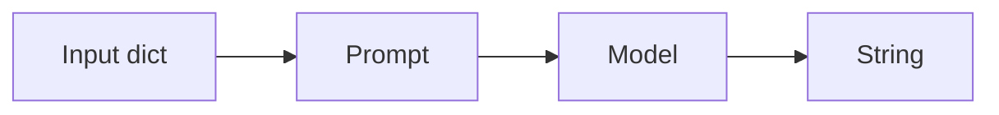
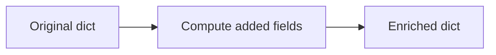
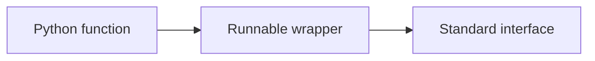
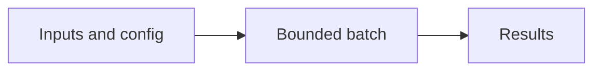

Assistant version 3: Analyze sentiment, extract themes and suggest replies in parallel with a cheaper fallback.

# 04 — LCEL and Runnables

After this module, you can **compose review analysis while keeping execution and failure behavior inspectable.**

**Time:** 90 minutes (guided first pass). **Level:** Beginner.
**Cost:** Most short hosted examples are below $0.01 each on the configured low-cost model; see each script's explicit call count. The 100-ticket triage run budgets $0.10, and all-review analysis can approach $1. These are estimates, not spending caps. `--offline` is free and scripted; local Ollama has no API fee. No LangSmith account is required.

## Prerequisites

Complete [Structured output](../03_structured_output/README.md). Run every command below from the repository root after `uv sync --locked`. Read [provider capabilities](../../docs/PROVIDER_CAPABILITIES.md) before switching model features. To use a real configured provider, omit `--offline`; never mistake fixture output for a quality evaluation.

New terms are defined in the [foundation glossary](../../docs/GLOSSARY.md).

## Learning objectives

- Compose sequences, parallel branches and dictionary enrichment.
- Adapt Python functions and route with explicit business rules.
- Distinguish retries, fallbacks and provider SDK retries.
- Use metadata/concurrency and inspect async lifecycle events.
- Explain when plain Python or a durable graph is clearer than LCEL.

## The big idea

LCEL is an assembly line for data. A sequence passes one station's result to the next. Parallel branches are several stations working from copies of the same incoming order, then returning a labelled tray of results. Passthrough keeps the original order slip, and assign attaches new fields. The Runnable interface gives each station the same invoke, batch, streaming and configuration controls.

## How it works


**Under the hood:** the script loads local synthetic data and settings, invokes the demonstrated API, and exposes its output. A provider adapter is used only when a model call is needed. Offline mode replaces generation with explicit responses while retaining formatting, parsing, dispatch and SQL behavior. It blocks network in the test and smoke harness.

### Read the shape at each connection

**LCEL** means LangChain Expression Language. The `|` operator composes runnables; it is not a Unix shell pipe and never executes a shell. A `RunnableSequence` requires at least two stages. Check each stage's input/output type: a prompt takes a dictionary, a model takes messages or a prompt value, and a string parser turns the reply into text.

`RunnableParallel` fans the same input out to branches and returns a dictionary keyed by branch name. `RunnablePassthrough` returns the input untouched. `.assign` requires a dictionary and returns an enriched dictionary; its new fields are computed from the original input, so dependent additions need separate assign stages. `RunnableLambda` adapts a function; `@chain` supplies the same wrapper through decorator syntax.

`RunnableBranch` tries conditions in order and needs a default path. Use plain Python for a small local decision. Use LCEL for an inspectable prompt/model/parser dataflow. Use LangGraph when state must survive interruptions, steps loop, or people must approve actions. Routing on validated priority is deterministic and needs no extra model call.

`.with_retry` repeats a failed operation; `.with_fallbacks` tries another runnable. Limit exception types so bugs and permission failures stay visible. Provider SDK retries can multiply outer retries, so the review application disables SDK retries and uses one fallback. Its fallback is the low-cost provider profile from `.env.example`; it is cheaper only if you set `LLM_MODEL` to a more expensive primary model. Defaults may use the same model twice, which offers no protection against a provider-wide outage.

The fallback handles documented transport/timeouts, OpenAI/Anthropic rate limits, and Gemini server failures. It does not catch authentication errors or every provider-specific quota condition. The deliberately failing resilience example proves the mechanism offline; live provider failover is still unverified.

`.with_config` attaches `tags`, `metadata` and `run_name` for callbacks/traces. Keep metadata free of credentials and personal details. `max_concurrency` bounds batch execution, but nested parallel branches can multiply simultaneous calls. A count of two reviews can create up to six model requests. `astream_events(version="v2")` reports lifecycle events; not every event is a text token. `get_graph().draw_mermaid()` returns local diagram text and does not upload your chain to an image service.

## Key APIs at a glance

| API or concept | Where to inspect it | What to notice |
|---|---|---|
| Runnable interface; pipe operator; RunnableSequence | [01_sequence.py](examples/01_sequence.py) | Input/output types and the `KEY IDEA` comment |
| RunnableParallel; fan-out and merged results | [02_parallel.py](examples/02_parallel.py) | Input/output types and the `KEY IDEA` comment |
| RunnablePassthrough; assign; preserve original inputs | [03_passthrough.py](examples/03_passthrough.py) | Input/output types and the `KEY IDEA` comment |
| RunnableLambda; @chain; adapting ordinary Python | [04_python_functions.py](examples/04_python_functions.py) | Input/output types and the `KEY IDEA` comment |
| Routing and branching; plain Python versus LCEL versus LangGraph | [05_routing.py](examples/05_routing.py) | Input/output types and the `KEY IDEA` comment |
| with_fallbacks, with_retry; failure then recovery | [06_resilience.py](examples/06_resilience.py) | Input/output types and the `KEY IDEA` comment |
| with_config tags, metadata, run_name; batch max_concurrency; async | [07_config_batch.py](examples/07_config_batch.py) | Input/output types and the `KEY IDEA` comment |
| astream_events; get_graph().draw_mermaid() | [08_events_diagram.py](examples/08_events_diagram.py) | Input/output types and the `KEY IDEA` comment |

## Walkthrough

Open each file, predict its output, run it, then change one input. Commands use explicit fixtures so the first pass needs no keys.

### 1. Sequence

**Analogy:** An assembly line. **Under the hood:** The pipe operator constructs a RunnableSequence; output from prompt, model and parser travels through compatible interfaces.



```text
uv run python modules/04_lcel_runnables/examples/01_sequence.py --offline
```

**Expected:** A RunnableSequence and a brief Brightwave reply. Read [the source](examples/01_sequence.py) to connect the visible result to the exact API call. Live wording and usage can differ.

### 2. Parallel

**Analogy:** Two counters measuring one parcel. **Under the hood:** RunnableParallel submits the same input to both branches and gathers their results under stable dictionary keys.


```text
uv run python modules/04_lcel_runnables/examples/02_parallel.py --offline
```

**Expected:** A dictionary with length and words, both computed from the same input. Read [the source](examples/02_parallel.py) to connect the visible result to the exact API call. Live wording and usage can differ.

### 3. Passthrough

**Analogy:** Attach a note to the original order. **Under the hood:** assign creates an enriched dictionary while keeping the original values. Newly computed keys are not inputs to sibling computations.



```text
uv run python modules/04_lcel_runnables/examples/03_passthrough.py --offline
```

**Expected:** The original review_id/text plus character count. Read [the source](examples/03_passthrough.py) to connect the visible result to the exact API call. Live wording and usage can differ.

### 4. Python functions

**Analogy:** An adapter around an existing machine. **Under the hood:** RunnableLambda and @chain expose standard execution methods around ordinary Python functions without changing their business logic.



```text
uv run python modules/04_lcel_runnables/examples/04_python_functions.py --offline
```

**Expected:** A clean Brightwave SKU and its catalogue label. Read [the source](examples/04_python_functions.py) to connect the visible result to the exact API call. Live wording and usage can differ.

### 5. Routing

**Analogy:** A sorting desk with a default tray. **Under the hood:** RunnableBranch evaluates conditions in order. The final runnable handles all remaining inputs, avoiding an unhandled route.


```text
uv run python modules/04_lcel_runnables/examples/05_routing.py --offline
```

**Expected:** high -> human review; low -> standard queue. Read [the source](examples/05_routing.py) to connect the visible result to the exact API call. Live wording and usage can differ.

### 6. Resilience

**Analogy:** Try the door again, then another door. **Under the hood:** with_retry repeats only specified transient failures within an attempt cap; with_fallbacks changes the execution path after failure.


```text
uv run python modules/04_lcel_runnables/examples/06_resilience.py --offline
```

**Expected:** Retry succeeds on attempt 2; a permanent failure uses the alternate path. Read [the source](examples/06_resilience.py) to connect the visible result to the exact API call. Live wording and usage can differ.

### 7. Config batch

**Analogy:** Work orders with routing labels. **Under the hood:** Execution config carries callback labels and concurrency limits outside prompt data. Async execution waits without blocking the event loop.



```text
uv run python modules/04_lcel_runnables/examples/07_config_batch.py --offline
```

**Expected:** Three normalized SKUs followed by one awaited SKU. Read [the source](examples/07_config_batch.py) to connect the visible result to the exact API call. Live wording and usage can differ.

### 8. Events diagram

**Analogy:** A time-stamped work log. **Under the hood:** astream_events emits callback lifecycle records for each named stage; the graph diagram is derived from the runnable structure without executing a provider call.


```text
uv run python modules/04_lcel_runnables/examples/08_events_diagram.py --offline
```

**Expected:** Mermaid text plus on_chain_start/on_chain_stream/on_chain_end events. Read [the source](examples/08_events_diagram.py) to connect the visible result to the exact API call. Live wording and usage can differ.

## Real-world use case

**Analyze sentiment, extract themes and suggest replies in parallel with a cheaper fallback.** Run the mini-application against the committed Brightwave dataset:

```text
uv run python modules/04_lcel_runnables/use_case/review_insights.py --offline
```

**Sample input:** The first three reviews by default.

**Sample output:** Each record has review_id, sentiment, theme and reply.

**Business application:** A customer-experience analyst can review parallel signals; use --all only after checking the 900-call cost. Output is saved to .runtime/review_insights.jsonl. Inspect [the application](use_case/review_insights.py). Output remains a draft. Fixtures are predetermined and do not establish that a live model will select the same wording or actions.

## Common mistakes

These exception classes and message excerpts were reproduced against the locked installation. The CLI prints a shorter safe hint; direct calls in tests expose the underlying error.

### assign on text

```text
ValueError: The input to RunnablePassthrough.assign() must be a dict.
```

**Fix:** Wrap text in a dictionary before assign, with the field name expected by your function.

### Sequence with one stage

```text
ValueError: RunnableSequence must have at least 2 steps, got 1
```

**Fix:** Use one runnable directly or add a real second stage; do not create a meaningless sequence.

### Branch without default

```text
ValueError: RunnableBranch requires at least two branches
```

**Fix:** Supply at least one condition/runnable pair plus a default runnable.

### Zero concurrency

```text
ValueError: max_workers must be greater than 0
```

**Fix:** Use a positive max_concurrency; zero does not mean unlimited.

## Exercises

Starters have working baseline behavior; improve the named function at `YOUR CODE HERE`. Do not inspect the solution until you have tried the target checks.

1. **Practice — Compose normalization.** Return a RunnableSequence: strip whitespace, then uppercase a SKU. [Starter](exercises/01_practice.py) · [Solution](solutions/01_practice.py).

2. **Apply — Preserve and enrich.** Use assign and parallel branches to retain review_id/text and add analysis with characters and words. [Starter](exercises/02_apply.py) · [Solution](solutions/02_apply.py).

3. **Stretch — Retry then fall back narrowly.** Wrap primary: retry TimeoutError twice with no wait, then use backup. ValueError must propagate. [Starter](exercises/03_stretch.py) · [Solution](solutions/03_stretch.py).

```text
uv run python modules/04_lcel_runnables/exercises/01_practice.py --offline
uv run pytest modules/04_lcel_runnables/tests/test_exercises.py --exercise-target exercises
uv run pytest modules/04_lcel_runnables/tests
```

The second command intentionally fails until you complete the starters. The last command checks the supplied solutions plus examples and the use case. Both modes are offline. The [notebook](notebook.ipynb) contains the same example source and a use-case launch cell with outputs cleared; change inputs interactively after the first run. Install notebook tools with `uv sync --group authoring`, then `uv run jupyter lab`.

## Quiz


**What does the pipe operator connect?**

<details><summary>Answer</summary>

The output of one runnable to the input of the next.

</details>

**Do parallel branches consume one another's output?**

<details><summary>Answer</summary>

No. Each receives the same initial input.

</details>

**What input does assign require?**

<details><summary>Answer</summary>

A dictionary; it preserves existing fields and adds computed fields.

</details>

**What distinguishes retry from fallback?**

<details><summary>Answer</summary>

Retry repeats a path; fallback chooses another runnable after a failure.

</details>

**Where should tags and metadata go?**

<details><summary>Answer</summary>

Execution config, without secrets or sensitive prompt content.

</details>

**Is every astream_events item a token?**

<details><summary>Answer</summary>

No. Many events describe starts, ends or intermediate pipeline activity.

</details>

**When should you choose LangGraph?**

<details><summary>Answer</summary>

When explicit state, durable execution, loops or human interruptions require more than a fixed dataflow.

</details>

## Key takeaways

- Compose sequences, parallel branches and dictionary enrichment.
- Adapt Python functions and route with explicit business rules.
- Distinguish retries, fallbacks and provider SDK retries.
- Use metadata/concurrency and inspect async lifecycle events.
- Explain when plain Python or a durable graph is clearer than LCEL.

## Go deeper

- [Runnable API reference](https://reference.langchain.com/python/langchain_core/runnables/)
- [Current verification and limits](../../docs/VERIFICATION_NOTES.md)

## Next: Tools and tool calling

Continue to [Tools and tool calling](../05_tools/README.md). Re-run this module's tests if you change its shared helpers.
