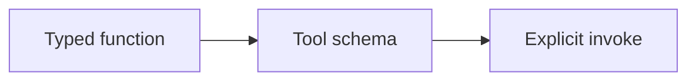
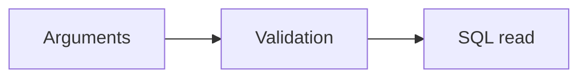
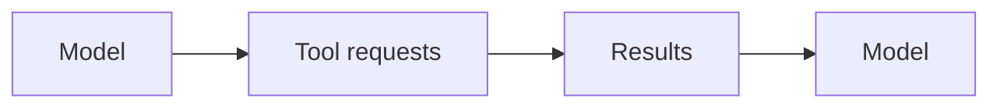
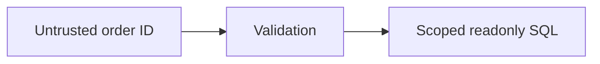

Assistant version 4: Answer order, shipment and stock questions through a hand-written tool loop.

# 05 — Tools and tool calling

After this module, you can **let the assistant read scoped order data through an explicit tool loop.**

**Time:** 105 minutes (guided first pass). **Level:** Beginner.
**Cost:** Most short hosted examples are below $0.01 each on the configured low-cost model; see each script's explicit call count. The 100-ticket triage run budgets $0.10, and all-review analysis can approach $1. These are estimates, not spending caps. `--offline` is free and scripted; local Ollama has no API fee. No LangSmith account is required.

## Prerequisites

Complete [LCEL and Runnables](../04_lcel_runnables/README.md). Run every command below from the repository root after `uv sync --locked`. Read [provider capabilities](../../docs/PROVIDER_CAPABILITIES.md) before switching model features. To use a real configured provider, omit `--offline`; never mistake fixture output for a quality evaluation.

New terms are defined in the [foundation glossary](../../docs/GLOSSARY.md).

## Learning objectives

- Derive tool schemas from docstrings/type hints or explicit Pydantic models.
- Dispatch bound tool calls and match ToolMessage IDs.
- Run independent reads in parallel while preserving result identity.
- Bound model turns/tool calls and reject unknown requests.
- Enforce read-only SQL and trusted customer scope, including runtime context.

## The big idea

A tool call is a work order, not the work itself. The model writes a tool name, arguments and call ID. Your dispatcher checks that name against an allowlist, validates the arguments, performs the permitted read, and returns a receipt with the same ID. Repeating model → tool → model is an agent. The application controls permissions and stop limits even when the model asks for more.

## How it works


**Under the hood:** the script loads local synthetic data and settings, invokes the demonstrated API, and exposes its output. A provider adapter is used only when a model call is needed. Offline mode replaces generation with explicit responses while retaining formatting, parsing, dispatch and SQL behavior. It blocks network in the test and smoke harness.

### What actually executes a tool

`@tool` wraps a Python function. Its docstring describes when to use it, and type hints become an input JSON Schema. `args_schema` supplies stronger Pydantic constraints. `bind_tools` gives those descriptions to a model; it does not execute Python. An `AIMessage.tool_calls` entry has `name`, `args` and `id`. Your code dispatches it, then appends a `ToolMessage` whose `tool_call_id` matches that ID. Preserve the assistant request before the results in conversation history.

The three tools are defined in [common/tools.py](../../common/tools.py): `lookup_order`, `get_shipment_status`, and `check_stock`. Both order tools close over trusted customer identity. Customer ID is absent from the model-facing arguments, so changing a prompt cannot change the SQL scope. Every order query uses `?` placeholders and an ownership predicate. A readonly SQLite connection additionally rejects writes. Parameterization prevents value-shaped SQL injection; it does not replace authorization.

Independent read requests can run concurrently, each with its own database connection. Never assume writes, refunds or dependent lookups are safe to parallelize. `tool_choice` requests a tool on supported providers; Ollama's adapter accepts but ignores that parameter, so the lesson omits it there. Even supported providers need not generate two calls in one turn. The offline fixture supplies two requests explicitly and does not prove live tool-selection quality.

The hand-written loop stops when a response has no tool requests, or raises when turn/call limits are exhausted. Unknown names and invalid arguments become short tool errors; invalid model envelopes and unexpected application failures surface. Do not catch everything and tell the model it succeeded. Repeated invalid requests also consume the limits. Text in tool results remains data rather than permission to run new code.

`ToolRuntime` is an injected toolbox: **context** contains trusted per-run facts such as customer identity; **state** contains evolving workflow data such as messages; **store** is optional persistent storage; the **stream writer** emits progress. The runtime example supplies those fields in a small harness and confirms runtime is hidden from the public schema. It does not implement authentication or persistent memory. Module 10 introduces the agent that injects it automatically.

This module exposes no arbitrary SQL, shell, filesystem or code-execution tool. Such tools would give model-generated arguments much broader authority. Never expose secrets, full database dumps, or an unsandboxed Python interpreter just because a model can generate a valid JSON request. The demo login is synthetic application context; a production app must obtain identity from real authentication.

## Key APIs at a glance

| API or concept | Where to inspect it | What to notice |
|---|---|---|
| @tool; docstrings and type hints become JSON schema | [01_tool_schema.py](examples/01_tool_schema.py) | Input/output types and the `KEY IDEA` comment |
| Pydantic args_schema; input validation; bounded tool errors | [02_args_schema.py](examples/02_args_schema.py) | Input/output types and the `KEY IDEA` comment |
| bind_tools; AIMessage.tool_calls; ToolMessage; matching tool_call_id | [03_dispatch.py](examples/03_dispatch.py) | Input/output types and the `KEY IDEA` comment |
| Parallel tool calls; tool_choice; provider support checks | [04_parallel_choice.py](examples/04_parallel_choice.py) | Input/output types and the `KEY IDEA` comment |
| Build it yourself: bounded tool-calling loop; stop condition and unknown-tool rejection | [05_manual_agent.py](examples/05_manual_agent.py) | Input/output types and the `KEY IDEA` comment |
| ToolRuntime; runtime state and context; preview with a minimal harness | [06_runtime.py](examples/06_runtime.py) | Input/output types and the `KEY IDEA` comment |
| Parameterized SQL; read-only database connection; customer scope; filesystem/code tool risks | [07_sql_safety.py](examples/07_sql_safety.py) | Input/output types and the `KEY IDEA` comment |

## Walkthrough

Open each file, predict its output, run it, then change one input. Commands use explicit fixtures so the first pass needs no keys.

### 1. Tool schema

**Analogy:** A menu describes dishes without cooking. **Under the hood:** The tool schema exposes name, description and allowed arguments; calling invoke on the tool executes the Python database function.



```text
uv run python modules/05_tools/examples/01_tool_schema.py --offline
```

**Expected:** A JSON input schema and a stock record from the read-only database. Read [the source](examples/01_tool_schema.py) to connect the visible result to the exact API call. Live wording and usage can differ.

### 2. Args schema

**Analogy:** A gate checking the form first. **Under the hood:** Pydantic rejects malformed arguments before the function body runs. Valid syntax still needs a lookup to confirm the record exists.



```text
uv run python modules/05_tools/examples/02_args_schema.py --offline
```

**Expected:** Invalid SKU rejected, followed by a valid stock result. Read [the source](examples/02_args_schema.py) to connect the visible result to the exact API call. Live wording and usage can differ.

### 3. Dispatch

**Analogy:** A work order and matching receipt. **Under the hood:** The bound model emits a tool-call dictionary; dispatch resolves an allowlisted tool and constructs a ToolMessage with the same ID.


```text
uv run python modules/05_tools/examples/03_dispatch.py --offline
```

**Expected:** A stock request and a result with tool_call_id=call-1. Read [the source](examples/03_dispatch.py) to connect the visible result to the exact API call. Live wording and usage can differ.

### 4. Parallel choice

**Analogy:** Two clerks checking separate shelves. **Under the hood:** The application dispatches independent calls through a bounded executor and preserves each call ID. Provider choice constraints differ by adapter.


```text
uv run python modules/05_tools/examples/04_parallel_choice.py --offline
```

**Expected:** Two stock results with distinct call IDs in offline mode. Read [the source](examples/04_parallel_choice.py) to connect the visible result to the exact API call. Live wording and usage can differ.

### 5. Manual agent

**Analogy:** Ask, act, report, repeat. **Under the hood:** The loop appends assistant requests and tool replies to history before calling the model again. Turn and total-call limits bound repetition.



```text
uv run python modules/05_tools/examples/05_manual_agent.py --offline
```

**Expected:** A stock tool result followed by a final fixture reply. Read [the source](examples/05_manual_agent.py) to connect the visible result to the exact API call. Live wording and usage can differ.

### 6. Runtime

**Analogy:** A staff badge and current clipboard. **Under the hood:** The trusted harness injects runtime context and state. Those fields are not model-authored arguments in the public schema.


```text
uv run python modules/05_tools/examples/06_runtime.py --offline
```

**Expected:** Customer C001 and two supplied messages; runtime is absent from the public tool schema. Read [the source](examples/06_runtime.py) to connect the visible result to the exact API call. Live wording and usage can differ.

### 7. Sql safety

**Analogy:** A locked filing cabinet with an ownership index. **Under the hood:** Readonly connections block writes; parameterized predicates protect SQL values; the customer predicate restricts which records may be returned.



```text
uv run python modules/05_tools/examples/07_sql_safety.py --offline
```

**Expected:** Owned order found, another customer denied, malformed ID rejected. Read [the source](examples/07_sql_safety.py) to connect the visible result to the exact API call. Live wording and usage can differ.

## Real-world use case

**Answer order, shipment and stock questions through a hand-written tool loop.** Run the mini-application against the committed Brightwave dataset:

```text
uv run python modules/05_tools/use_case/order_status.py --offline
```

**Sample input:** Demo customer C001 asks about order BW1001.

**Sample output:** lookup_order and get_shipment_status results, then a draft reporting delivered.

**Business application:** Support staff get scoped order evidence without giving the model a SQL interpreter or write permission. Inspect [the application](use_case/order_status.py). Output remains a draft. Fixtures are predetermined and do not establish that a live model will select the same wording or actions.

## Common mistakes

These exception classes and message excerpts were reproduced against the locked installation. The CLI prints a shorter safe hint; direct calls in tests expose the underlying error.

### Missing tool docstring

```text
ValueError: Function must have a docstring if description not provided.
```

**Fix:** Add a meaningful docstring or an explicit description; the model needs a usable tool contract.

### Invalid order ID

```text
ValidationError: 1 validation error for OrderInput
order_id
  String should match pattern '^BW\d{4}$' [type=string_pattern_mismatch, input_value='bad', input_type=str]
```

**Fix:** Supply a matching BW order ID. Validation must happen before the database operation.

### Loop cannot terminate

```text
RuntimeError: Turn budget exhausted; ask a human to review the ticket.
```

**Fix:** Inspect repeated requests and return a human-review error; do not remove the stop bound.

### Write to seed database

```text
OperationalError: attempt to write a readonly database
```

**Fix:** Keep seed data read-only. A later write lesson uses an isolated runtime copy and explicit controls.

## Exercises

Starters have working baseline behavior; improve the named function at `YOUR CODE HERE`. Do not inspect the solution until you have tried the target checks.

1. **Practice — Validate tool inputs.** Define a tool lookup with OrderInput args_schema that returns the supplied order_id. No database access is needed. [Starter](exercises/01_practice.py) · [Solution](solutions/01_practice.py).

2. **Apply — Match tool result IDs.** Dispatch an allowlisted call and return its ToolMessage with the same id. Unknown names must return an error. [Starter](exercises/02_apply.py) · [Solution](solutions/02_apply.py).

3. **Stretch — Bound an agent loop.** Use the shared loop with max_turns=3 and max_tool_calls=4; return final text. Repeated calls must stop. [Starter](exercises/03_stretch.py) · [Solution](solutions/03_stretch.py).

```text
uv run python modules/05_tools/exercises/01_practice.py --offline
uv run pytest modules/05_tools/tests/test_exercises.py --exercise-target exercises
uv run pytest modules/05_tools/tests
```

The second command intentionally fails until you complete the starters. The last command checks the supplied solutions plus examples and the use case. Both modes are offline. The [notebook](notebook.ipynb) contains the same example source and a use-case launch cell with outputs cleared; change inputs interactively after the first run. Install notebook tools with `uv sync --group authoring`, then `uv run jupyter lab`.

## Quiz


**Who runs a requested tool?**

<details><summary>Answer</summary>

The application dispatcher, not the model.

</details>

**Where must customer identity come from?**

<details><summary>Answer</summary>

Trusted application context or authentication, never the model-authored arguments.

</details>

**Does parameterized SQL guarantee authorization?**

<details><summary>Answer</summary>

No. It handles values safely, but a separate ownership predicate is required.

</details>

**Why preserve call IDs?**

<details><summary>Answer</summary>

They match each result to the exact pending request, including parallel calls.

</details>

**Should independent reads and refund writes use the same parallel strategy?**

<details><summary>Answer</summary>

No. Writes and dependencies need different controls; this lesson only parallelizes independent reads.

</details>

**What happens after the turn budget is exhausted?**

<details><summary>Answer</summary>

Raise a bounded failure and request human review, rather than continue indefinitely.

</details>

**Does ToolRuntime implement authentication?**

<details><summary>Answer</summary>

No. It transports context supplied by the application; the identity source must already be trusted.

</details>

## Key takeaways

- Derive tool schemas from docstrings/type hints or explicit Pydantic models.
- Dispatch bound tool calls and match ToolMessage IDs.
- Run independent reads in parallel while preserving result identity.
- Bound model turns/tool calls and reject unknown requests.
- Enforce read-only SQL and trusted customer scope, including runtime context.

## Go deeper

- [Tool creation and runtime guide](https://docs.langchain.com/oss/python/langchain/tools)
- [Model interface guide](https://docs.langchain.com/oss/python/langchain/models)
- [Current verification and limits](../../docs/VERIFICATION_NOTES.md)

## Next: Document loaders and text splitters

Complete the [Smart Ticket Desk checkpoint](../../checkpoints/01_ticket_desk/README.md) before starting retrieval. You are ready when you can explain the loop, reject wrong-customer access, and keep fixture metrics separate from model quality.

Continue to [Document loaders and text splitters](../06_loaders_splitters/README.md). The retrieval tier is now available; install it with `uv sync --extra rag`.
