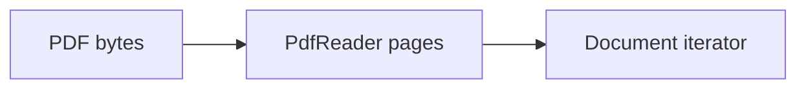
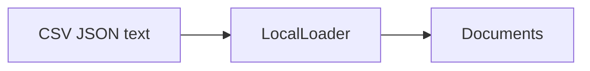
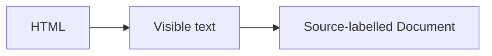
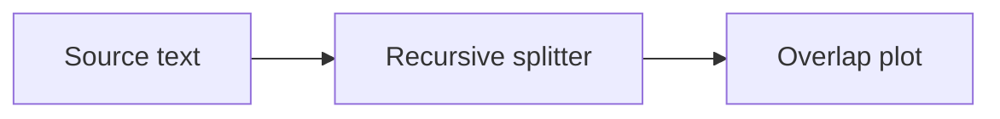

Assistant version 4: Load policies and handbook with source/page metadata; compare three chunking strategies.

# Document loaders and text splitters

**Outcome:** Turn local business files into traceable chunks without losing their origin.

**Time:** 120 minutes plus optional practice. **Level:** Intermediate Python, first retrieval course.

**Cost:** Offline fixtures: $0 API fees. Local inference: no API fee, hardware required. Ordinary short hosted examples generally budget under $0.01; reranking adds up to six calls and the live benchmark budgets $0.10. Actual cost depends on configured models, tokens and retries. Ingestion itself makes no model calls.

## Prerequisites

Complete [Tools and tool calling](../05_tools/README.md). Run commands from the repository root in Windows PowerShell, macOS or Linux:

```text
uv sync --locked --extra rag
uv run --extra rag python scripts/check_env.py --offline
```

Use the root [pip fallback](../../README.md) if needed. Keep `--extra rag` on uv commands: an ordinary uv invocation can remove optional dependencies. Offline examples block network and use no keys. For a configured real provider, omit `--offline`; check [provider capabilities](../../docs/PROVIDER_CAPABILITIES.md) first. A live provider failure never silently becomes a fixture.

## Learning objectives

- Load text, CSV, JSON and PDF through a common Document interface.
- Preserve file, page, row and parent identifiers through splitting.
- Compare fixed, recursive, Markdown, token and code-aware boundaries.
- Inspect chunk size and overlap visually before building an index.

## The big idea

A retrieval corpus is a box of labelled index cards. A loader copies each source onto a card; a splitter makes smaller cards that fit on the reading desk. The source label must survive every cut. Overlapping cards can preserve a sentence near a boundary, but also repeat text and increase storage. Before adding a model, inspect what was actually loaded and where each piece came from.

## How it works


### Documents, pages and lazy loading

A **Document** pairs `page_content` text with `metadata`, a dictionary of provenance such as source file, one-based page or CSV row. Its optional `id` identifies the record. Our IDs hash content and metadata, so editing either produces a new identity. A **chunk** is a smaller Document; `parent_id` points to the original record. See the [glossary](../../docs/GLOSSARY.md) for these terms.

`BaseLoader.load()` collects the iterator returned by `lazy_load()`. Iteration lets callers process pages incrementally; it does not guarantee that the underlying PDF parser uses constant memory. Our small [LocalLoader](../../common/knowledge.py) uses `pypdf.PdfReader`, Python's CSV reader and JSON parser. CSV rows and FAQ records become separate Documents. Markdown/text stays one Document until splitting. Directory ingestion explicitly selects policy Markdown files and the handbook; it never sweeps evaluation answers or poisoned fixtures into the normal corpus.

The `langchain-community` project was sunset in 2026. The original plan's PDF and file loader classes are replaced here by the current core loader interface and visible adapters. See [verification notes](../../docs/VERIFICATION_NOTES.md) for the official notice. No legacy loader package is required. PDFs containing only scanned images need **OCR**, optical character recognition; this lesson does not perform OCR, and an empty extracted page is a signal to inspect the source.

### Choose a boundary and measure it

Recursive splitting tries paragraph, line and word boundaries before individual characters. With the default length function, `chunk_size=450` means characters, not tokens. `chunk_overlap=80` is a target maximum shared tail, not a guarantee that every pair shares exactly 80 characters. Fixed splitting ignores semantic boundaries. Markdown splitting records headings first, then applies the character limit; code-aware splitting prefers language boundaries but is not a syntax-preserving parser.

A **tokenizer** translates text into model-specific integer pieces. The live token example uses `TokenTextSplitter` with `cl100k_base`; its first use can download a vocabulary. The offline ASCII byte tokenizer tests the splitting algorithm without network. Its counts are not model token counts. The code example is ASCII on purpose. Compare chunk count, maximum length, repeated characters and source metadata before choosing parameters.

The web example reads committed HTML by default. `--fetch-docs` explicitly fetches one allowlisted official URL, with timeout and redirects disabled. Visible text extraction removes scripts, styles and comments; it is not a general prompt-injection defence. Retrieved prose remains untrusted data.

## Key APIs at a glance

| API or concept | Example | What to inspect |
|---|---|---|
| Document.page_content and metadata; source provenance | [01_documents.py](examples/01_documents.py) | Construct a Document, then assign a deterministic ID from its text and metadata. |
| Current BaseLoader PDF adapter with pypdf; lazy_load, one-based pages; replacement for sunset community loaders | [02_pdf_lazy.py](examples/02_pdf_lazy.py) | Iterate the BaseLoader adapter over the ten-page PDF and keep page numbers starting at one. |
| Current BaseLoader adapters for CSV, text, Markdown and JSON; explicit directory ingestion | [03_file_loaders.py](examples/03_file_loaders.py) | CSV and JSON records become row-labelled Documents; text and Markdown keep their source path. |
| Web loading; local HTML fixture and explicit network mode | [04_web_loader.py](examples/04_web_loader.py) | HTMLParser excludes comments, script and style content; live fetching is an explicit separate flag. |
| RecursiveCharacterTextSplitter; chunk size/overlap visualization | [05_recursive_chunks.py](examples/05_recursive_chunks.py) | Compare bounded chunks and plot their start offsets and overlapping spans. |
| MarkdownHeaderTextSplitter; heading and parent metadata | [06_markdown_chunks.py](examples/06_markdown_chunks.py) | MarkdownHeaderTextSplitter adds heading metadata before recursive length bounding. |
| Token-based splitting; code splitters; tokenizer limits | [07_token_code_chunks.py](examples/07_token_code_chunks.py) | Token splitting measures tokenizer IDs; Python-aware recursive splitting prefers code separators. |

## Walkthrough

Predict each result, run the example, then change one input. Inspect metadata as carefully as the answer text.

### 1. Documents

**Analogy:** A luggage tag stays attached to each bag. **Under the hood:** Construct a Document, then assign a deterministic ID from its text and metadata.


```text
uv run --extra rag python modules/06_loaders_splitters/examples/01_documents.py --offline
```

**Expected:** Return-policy text, a stable ID, and a relative source path. Inspect [the source](examples/01_documents.py) and the `KEY IDEA` comment. Live ranks, wording and usage may differ.

### 2. Pdf lazy

**Analogy:** Read a book one labelled page at a time. **Under the hood:** Iterate the BaseLoader adapter over the ten-page PDF and keep page numbers starting at one.



```text
uv run --extra rag python modules/06_loaders_splitters/examples/02_pdf_lazy.py --offline
```

**Expected:** Ten pages with one-based page citations and handbook source. Inspect [the source](examples/02_pdf_lazy.py) and the `KEY IDEA` comment. Live ranks, wording and usage may differ.

### 3. File loaders

**Analogy:** Use different readers but the same output card. **Under the hood:** CSV and JSON records become row-labelled Documents; text and Markdown keep their source path.



```text
uv run --extra rag python modules/06_loaders_splitters/examples/03_file_loaders.py --offline
```

**Expected:** Four policy files, 60 product rows, and 40 FAQ records. Inspect [the source](examples/03_file_loaders.py) and the `KEY IDEA` comment. Live ranks, wording and usage may differ.

### 4. Web loader

**Analogy:** Copy the visible page, not its hidden notes. **Under the hood:** HTMLParser excludes comments, script and style content; live fetching is an explicit separate flag.



```text
uv run --extra rag python modules/06_loaders_splitters/examples/04_web_loader.py --offline
```

**Expected:** Visible text from the local Brightwave HTML fixture; comments/scripts are excluded. Inspect [the source](examples/04_web_loader.py) and the `KEY IDEA` comment. Live ranks, wording and usage may differ.

### 5. Recursive chunks

**Analogy:** Cut a long receipt with a little repeated edge. **Under the hood:** Compare bounded chunks and plot their start offsets and overlapping spans.



```text
uv run --extra rag python modules/06_loaders_splitters/examples/05_recursive_chunks.py --offline
```

**Expected:** Chunk sizes/start offsets and .runtime/chunk_overlap.png. Inspect [the source](examples/05_recursive_chunks.py) and the `KEY IDEA` comment. Live ranks, wording and usage may differ.

### 6. Markdown chunks

**Analogy:** Keep the book section title on every excerpt. **Under the hood:** MarkdownHeaderTextSplitter adds heading metadata before recursive length bounding.


```text
uv run --extra rag python modules/06_loaders_splitters/examples/06_markdown_chunks.py --offline
```

**Expected:** Chunks with heading, source, parent_id and chunk_id. Inspect [the source](examples/06_markdown_chunks.py) and the `KEY IDEA` comment. Live ranks, wording and usage may differ.

### 7. Token code chunks

**Analogy:** Use the ruler appropriate to the material. **Under the hood:** Token splitting measures tokenizer IDs; Python-aware recursive splitting prefers code separators.


```text
uv run --extra rag python modules/06_loaders_splitters/examples/07_token_code_chunks.py --offline
```

**Expected:** Bounded token chunks and two small Python code sections. Inspect [the source](examples/07_token_code_chunks.py) and the `KEY IDEA` comment. Live ranks, wording and usage may differ.

## Real-world use case

**Sample input:** Four policy files plus ten handbook pages.

```text
uv run --extra rag python modules/06_loaders_splitters/use_case/knowledge_ingest.py --offline
```

**Sample output:** JSON entries for fixed, recursive and markdown, including chunks, max_characters and sample_metadata.

**Business application:** An operations analyst can inspect ingestion before anyone trusts an answer. The report is saved under .runtime/ingest_comparison.json. Read [the application](use_case/knowledge_ingest.py). All input data is synthetic.

## Common mistakes

These failures are exercised against the locked helpers in [retrieval contract tests](../../tests/test_rag_contracts.py) or the local exercise tests. Exception-only entries show the class rather than promising a provider-specific message. The CLI normally prints a shorter troubleshooting hint.

### Unsupported source

```text
ValueError: Supported local formats: Markdown, text, CSV, JSON and PDF.
```

**Fix:** Use html_document for HTML, or select one of LocalLoader's explicit formats.

### Impossible overlap

```text
ValueError
```

**Fix:** An overlap equal to or larger than chunk size is invalid. Keep 0 <= overlap < size.

### Missing input

```text
ConfigurationError
```

**Fix:** Pass a path relative to data, such as handbook/employee_handbook.pdf; data_path accepts files, not directories.

### Byte fixture used for Unicode

```text
UnicodeEncodeError
```

**Fix:** Keep the offline ASCII demonstration ASCII; use a real tokenizer for arbitrary language text.

## Exercises

Each starter runs as a baseline. Complete `YOUR CODE HERE` before opening the matching solution.

1. **Normalize page provenance.** Return a new Document with source and one-based page from a zero-based page index; reject negatives. [Starter](exercises/01_practice.py) · [Solution](solutions/01_practice.py).

2. **Split while preserving metadata.** Split Documents into chunks of at most 120 characters with target overlap 20, preserving source/page and parent ID. [Starter](exercises/02_apply.py) · [Solution](solutions/02_apply.py).

3. **Implement a JSON loader.** Create FAQDocuments(BaseLoader) with lazy_load yielding one Document per supplied record and row/source metadata. [Starter](exercises/03_stretch.py) · [Solution](solutions/03_stretch.py).

```text
uv run --extra rag python modules/06_loaders_splitters/exercises/01_practice.py --offline
uv run --extra rag pytest modules/06_loaders_splitters/tests/test_exercises.py --exercise-target exercises
uv run --extra rag pytest modules/06_loaders_splitters/tests
```

The middle command intentionally fails until the starters meet the contracts. The final command checks supplied solutions, all scripts and the application. The [notebook](notebook.ipynb) mirrors the actual example and application source, with outputs cleared. For notebooks run `uv sync --extra rag --group authoring`, then `uv run --extra rag --group authoring jupyter lab`.

## Quiz

**Does a Document automatically know its PDF page?**

<details><summary>Answer</summary>

No. The loader must supply the page in metadata; splitting must preserve it.

</details>

**Why keep parent_id?**

<details><summary>Answer</summary>

It links a small searchable child back to the original page or section for context expansion.

</details>

**Does lazy_load prove constant-memory PDF processing?**

<details><summary>Answer</summary>

No. It yields incrementally, but PdfReader may retain the PDF structure internally.

</details>

**Does a 450-character chunk contain 450 model tokens?**

<details><summary>Answer</summary>

No. Token counts depend on the tokenizer and text.

</details>

**Why keep gold evaluation files out of ingestion?**

<details><summary>Answer</summary>

Otherwise the index could retrieve the answer key and make evaluation misleading.

</details>

**Does removing HTML comments prevent every injection?**

<details><summary>Answer</summary>

No. Malicious instructions can be visible text too; application permissions must remain separate.

</details>

## Key takeaways

- Load text, CSV, JSON and PDF through a common Document interface.
- Preserve file, page, row and parent identifiers through splitting.
- Compare fixed, recursive, Markdown, token and code-aware boundaries.
- Inspect chunk size and overlap visually before building an index.
- Keep offline mechanics, live model behaviour and measured quality claims distinct.

## Go deeper

- [Official document_loaders guide](https://docs.langchain.com/oss/python/integrations/document_loaders)
- [Official splitters guide](https://docs.langchain.com/oss/python/integrations/splitters)
- [API verification and substitutions](../../docs/VERIFICATION_NOTES.md)

## Next: Embeddings, vector stores and retrievers

Continue to [Embeddings, vector stores and retrievers](../07_embeddings_retrievers/README.md). Re-run this module's checks when changing shared helpers.
