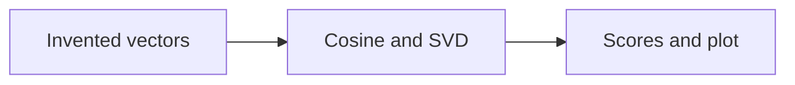
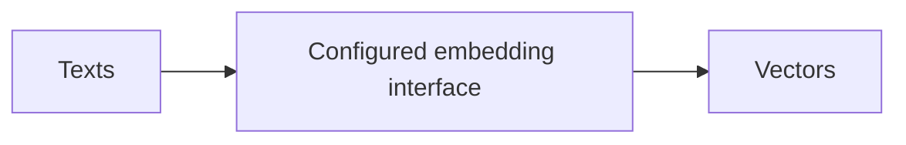
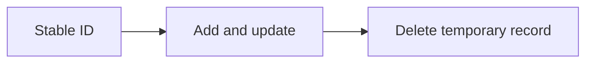

Assistant version 4: Search waterproof four-person tents under $300 with category and price constraints.

# Embeddings, vector stores and retrievers

**Outcome:** Retrieve matching products while enforcing price and capacity constraints in code.

**Time:** 150 minutes plus optional practice. **Level:** Intermediate Python, first retrieval course.

**Cost:** Offline fixtures: $0 API fees. Local inference: no API fee, hardware required. Ordinary short hosted examples generally budget under $0.01; reranking adds up to six calls and the live benchmark budgets $0.10. Actual cost depends on configured models, tokens and retries. Ingestion itself makes no model calls.

## Prerequisites

Complete [Document loaders and text splitters](../06_loaders_splitters/README.md). Run commands from the repository root in Windows PowerShell, macOS or Linux:

```text
uv sync --locked --extra rag
uv run --extra rag python scripts/check_env.py --offline
```

Use the root [pip fallback](../../README.md) if needed. Keep `--extra rag` on uv commands: an ordinary uv invocation can remove optional dependencies. Offline examples block network and use no keys. For a configured real provider, omit `--offline`; check [provider capabilities](../../docs/PROVIDER_CAPABILITIES.md) first. A live provider failure never silently becomes a fixture.

## Learning objectives

- Compute cosine similarity and explain what an embedding represents.
- Use the common embedding interface with memory and persistent vector stores.
- Add, update, delete and filter documents with stable IDs.
- Separate model identities in both persistent indexes and embedding caches.

## The big idea

An embedding is a coordinate on a learned map of text. Nearby coordinates can represent related meaning, but the map has no guarantee of truth. A vector store keeps those coordinates beside document labels; a retriever asks for nearby cards. Hard requirements such as price are gate checks, not something to hope a similarity score will respect. Our offline map is deliberately artificial, so it demonstrates the machinery without pretending to understand language.

## How it works


### Embeddings before the first vector store

An **embedding** is a list of numbers produced by a trained model. **Dimensions** are the number of coordinates in that list. `embed_documents(list[str])` returns one vector per text; `embed_query(str)` returns one query vector. Some models encode queries and documents differently, so our cache keeps separate namespaces for those operations.

**Cosine similarity** is the dot product divided by the product of vector lengths: `dot(a,b) / (norm(a) * norm(b))`. A zero vector has no direction and must be rejected. The first example uses invented three-dimensional coordinates and a two-dimensional SVD projection. **SVD** (singular value decomposition) finds axes that retain variation; a flattened plot can distort distances. Neither these coordinates nor the offline factory's deterministic fake vectors are learned semantics.

Real embeddings come from [get_embeddings](../../common/models.py), which follows the configured provider and model. Models with the same dimension are not interchangeable maps. A query vector must use the same embedding space as the indexed documents. Switching `LLM_PROVIDER=ollama` selects the configured local embedding profile automatically unless explicitly overridden.

### Retrieval, persistence and cache identity

`InMemoryVectorStore` lasts only for the current process. `Chroma` with `persist_directory` saves automatically. A **collection** is a named set of records inside the store. The wrapper records provider, model, dimensions, corpus hash and collection in a manifest. Reopening checks that identity; a mismatch requires a new index name and rebuild. It does not silently delete old data. The dimension probe embeds one short query on each open, including reopens, and may incur a live embedding charge.

The lifecycle example adds, updates and deletes only its temporary record. IDs define which record changes. This manifest guards configuration compatibility, not hostile modification of storage. Keep index files and the manifest together and do not edit them manually.

**Similarity** and **distance** are different conventions: high similarity is usually better; low distance is usually better. The Chroma example labels its raw cosine distance explicitly. Neither is a probability. **MMR**, maximal marginal relevance, trades off similarity to the question against similarity to already selected results. It can reduce redundancy but cannot guarantee diversity or accuracy.

Metadata filtering enforces hard constraints before ranking. The product application requires category tents, capacity exactly four, waterproof rating above zero, and price strictly below 300. The SQLite embedding cache hashes exact text, query/document kind and the full embedding identity. It validates vector length and finite values on both cache hits and misses; a cache hit saves an embedding request, not the later generation call.

## Key APIs at a glance

| API or concept | Example | What to inspect |
|---|---|---|
| Embedding meaning; numpy cosine similarity by hand; 2D projection with caveats | [01_cosine_by_hand.py](examples/01_cosine_by_hand.py) | Normalize vectors with NumPy, reject a zero norm, and plot an SVD projection labelled as synthetic. |
| embed_query, embed_documents; hosted and local models; separate embedding provider | [02_embedding_interface.py](examples/02_embedding_interface.py) | The shared embedding factory exposes embed_documents and embed_query and reports dimensions. |
| InMemoryVectorStore; add documents and similarity_search | [03_memory_store.py](examples/03_memory_store.py) | Add Documents to InMemoryVectorStore and search using the same configured embedding space. |
| Chroma persistence; collection identity; model/dimension metadata | [04_persistent_chroma.py](examples/04_persistent_chroma.py) | Chroma persists automatically and the wrapper compares its manifest before opening stored vectors. |
| Add, update and delete documents by ID; rebuild incompatible indexes | [05_document_lifecycle.py](examples/05_document_lifecycle.py) | Add a temporary ID, update its Document, verify the record, then delete that ID. |
| Similarity with scores; MMR; metadata filters; distinguish scores from probabilities | [06_scores_mmr_filters.py](examples/06_scores_mmr_filters.py) | A Chroma metadata filter enforces price/category; cosine distance and MMR are demonstrated separately. |
| as_retriever; retrieval configuration | [07_retriever.py](examples/07_retriever.py) | as_retriever creates a runnable that takes a string and returns a list of Documents. |
| Build a small Embeddings wrapper cache; key by provider, model, dimensions and text | [08_embedding_cache.py](examples/08_embedding_cache.py) | SQLite keys include provider, model, dimensions, operation kind and text; incompatible vectors never share a key. |

## Walkthrough

Predict each result, run the example, then change one input. Inspect metadata as carefully as the answer text.

### 1. Cosine by hand

**Analogy:** Compare directions on a tiny invented map. **Under the hood:** Normalize vectors with NumPy, reject a zero norm, and plot an SVD projection labelled as synthetic.



```text
uv run --extra rag python modules/07_embeddings_retrievers/examples/01_cosine_by_hand.py --offline
```

**Expected:** Cosine similarity near 1 for aligned vectors, and an illustrative projection PNG. Inspect [the source](examples/01_cosine_by_hand.py) and the `KEY IDEA` comment. Live ranks, wording and usage may differ.

### 2. Embedding interface

**Analogy:** Use one electrical socket for several suppliers. **Under the hood:** The shared embedding factory exposes embed_documents and embed_query and reports dimensions.



```text
uv run --extra rag python modules/07_embeddings_retrievers/examples/02_embedding_interface.py --offline
```

**Expected:** Two document vectors and a query vector with matching dimensions. Inspect [the source](examples/02_embedding_interface.py) and the `KEY IDEA` comment. Live ranks, wording and usage may differ.

### 3. Memory store

**Analogy:** Keep index cards on a temporary desk. **Under the hood:** Add Documents to InMemoryVectorStore and search using the same configured embedding space.


```text
uv run --extra rag python modules/07_embeddings_retrievers/examples/03_memory_store.py --offline
```

**Expected:** Three result IDs and sources; offline order has no semantic meaning. Inspect [the source](examples/03_memory_store.py) and the `KEY IDEA` comment. Live ranks, wording and usage may differ.

### 4. Persistent chroma

**Analogy:** Reopen a labelled filing cabinet. **Under the hood:** Chroma persists automatically and the wrapper compares its manifest before opening stored vectors.


```text
uv run --extra rag python modules/07_embeddings_retrievers/examples/04_persistent_chroma.py --offline
```

**Expected:** The same stored document IDs before and after reopening. Inspect [the source](examples/04_persistent_chroma.py) and the `KEY IDEA` comment. Live ranks, wording and usage may differ.

### 5. Document lifecycle

**Analogy:** Update a card by its catalogue number. **Under the hood:** Add a temporary ID, update its Document, verify the record, then delete that ID.



```text
uv run --extra rag python modules/07_embeddings_retrievers/examples/05_document_lifecycle.py --offline
```

**Expected:** A temporary note changes content, then disappears; seed documents stay intact. Inspect [the source](examples/05_document_lifecycle.py) and the `KEY IDEA` comment. Live ranks, wording and usage may differ.

### 6. Scores mmr filters

**Analogy:** Check eligibility before choosing a varied shortlist. **Under the hood:** A Chroma metadata filter enforces price/category; cosine distance and MMR are demonstrated separately.


```text
uv run --extra rag python modules/07_embeddings_retrievers/examples/06_scores_mmr_filters.py --offline
```

**Expected:** Only tents appear; cosine distances are not answer probabilities. Inspect [the source](examples/06_scores_mmr_filters.py) and the `KEY IDEA` comment. Live ranks, wording and usage may differ.

### 7. Retriever

**Analogy:** Wrap a search engine in a standard request interface. **Under the hood:** as_retriever creates a runnable that takes a string and returns a list of Documents.


```text
uv run --extra rag python modules/07_embeddings_retrievers/examples/07_retriever.py --offline
```

**Expected:** Two filtered tent Documents from retriever.invoke. Inspect [the source](examples/07_retriever.py) and the `KEY IDEA` comment. Live ranks, wording and usage may differ.

### 8. Embedding cache

**Analogy:** Reuse a translation only for the same language and edition. **Under the hood:** SQLite keys include provider, model, dimensions, operation kind and text; incompatible vectors never share a key.


```text
uv run --extra rag python modules/07_embeddings_retrievers/examples/08_embedding_cache.py --offline
```

**Expected:** Repeated query vectors match; cache survives another wrapper instance. Inspect [the source](examples/08_embedding_cache.py) and the `KEY IDEA` comment. Live ranks, wording and usage may differ.

## Real-world use case

**Sample input:** Waterproof four-person tent under $300.

```text
uv run --extra rag python modules/07_embeddings_retrievers/use_case/product_search.py --offline
```

**Sample output:** At most three product metadata records with category=tents, capacity=4, waterproof_mm>0 and price<300.

**Business application:** A catalogue assistant can enforce eligibility before presenting options. Offline ordering is not a recommendation-quality measurement. Read [the application](use_case/product_search.py). All input data is synthetic.

## Common mistakes

These failures are exercised against the locked helpers in [retrieval contract tests](../../tests/test_rag_contracts.py) or the local exercise tests. Exception-only entries show the class rather than promising a provider-specific message. The CLI normally prints a shorter troubleshooting hint.

### Zero vector

```text
ValueError
```

**Fix:** A zero norm makes cosine undefined; reject the input rather than dividing by zero.

### Old index with a new model

```text
ValueError: Stale index: embedding identity or corpus changed. Use a new index name.
```

**Fix:** Choose a fresh index name and rebuild with the selected embedding configuration.

### Half-created index

```text
ValueError: Index has data without a manifest; use a fresh index name.
```

**Fix:** Inspect the interrupted build and use a new name. Do not write a guessed manifest.

### Wrong cached vector size

```text
ValueError: Embedding vector violates the configured dimension/finite contract.
```

**Fix:** Use the actual model dimension in the identity and rebuild the incompatible cache.

## Exercises

Each starter runs as a baseline. Complete `YOUR CODE HERE` before opening the matching solution.

1. **Compute cosine by hand.** Compute normalized cosine similarity; reject a zero vector. [Starter](exercises/01_practice.py) · [Solution](solutions/01_practice.py).

2. **Enforce product constraints.** Accept only waterproof four-person tents with price strictly below 300. [Starter](exercises/02_apply.py) · [Solution](solutions/02_apply.py).

3. **Scope embedding cache keys.** Hash provider, model, dimension, query/document kind and exact text into a stable cache key. [Starter](exercises/03_stretch.py) · [Solution](solutions/03_stretch.py).

```text
uv run --extra rag python modules/07_embeddings_retrievers/exercises/01_practice.py --offline
uv run --extra rag pytest modules/07_embeddings_retrievers/tests/test_exercises.py --exercise-target exercises
uv run --extra rag pytest modules/07_embeddings_retrievers/tests
```

The middle command intentionally fails until the starters meet the contracts. The final command checks supplied solutions, all scripts and the application. The [notebook](notebook.ipynb) mirrors the actual example and application source, with outputs cleared. For notebooks run `uv sync --extra rag --group authoring`, then `uv run --extra rag --group authoring jupyter lab`.

## Quiz

**What does embedding dimension mean?**

<details><summary>Answer</summary>

The number of coordinates in each vector, not the number of documents.

</details>

**Can two 768-dimensional models share an index?**

<details><summary>Answer</summary>

Not safely: their coordinate spaces may be unrelated even though the lengths match.

</details>

**Is a cosine distance of 0.2 an 80% correctness probability?**

<details><summary>Answer</summary>

No. It is a geometric distance in that store's space.

</details>

**Why filter before ranking products?**

<details><summary>Answer</summary>

Similarity does not enforce business constraints such as exact capacity or a strict price ceiling.

</details>

**What does MMR trade off?**

<details><summary>Answer</summary>

Relevance to the query and redundancy relative to already selected documents.

</details>

**Why separate query and document cache keys?**

<details><summary>Answer</summary>

Some embedding models encode the two roles differently; identical text need not produce the same vector.

</details>

## Key takeaways

- Compute cosine similarity and explain what an embedding represents.
- Use the common embedding interface with memory and persistent vector stores.
- Add, update, delete and filter documents with stable IDs.
- Separate model identities in both persistent indexes and embedding caches.
- Keep offline mechanics, live model behaviour and measured quality claims distinct.

## Go deeper

- [Official embeddings guide](https://docs.langchain.com/oss/python/integrations/embeddings/)
- [Official retrieval guide](https://docs.langchain.com/oss/python/langchain/retrieval)
- [Official chroma guide](https://docs.langchain.com/oss/python/integrations/vectorstores/chroma)
- [API verification and substitutions](../../docs/VERIFICATION_NOTES.md)

## Next: RAG fundamentals

Continue to [RAG fundamentals](../08_rag_fundamentals/README.md). Re-run this module's checks when changing shared helpers.
