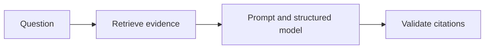
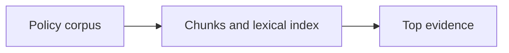
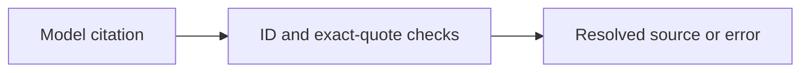

Assistant version 5: Answer policy questions with file and page citations and explicit abstention.

# RAG fundamentals

**Outcome:** Answer policy questions with source references and a visible abstention path.

**Time:** 120 minutes plus optional practice. **Level:** Intermediate Python, first retrieval course.

**Cost:** Offline fixtures: $0 API fees. Local inference: no API fee, hardware required. Ordinary short hosted examples generally budget under $0.01; reranking adds up to six calls and the live benchmark budgets $0.10. Actual cost depends on configured models, tokens and retries. Ingestion itself makes no model calls.

## Prerequisites

Complete [Embeddings, vector stores and retrievers](../07_embeddings_retrievers/README.md). Run commands from the repository root in Windows PowerShell, macOS or Linux:

```text
uv sync --locked --extra rag
uv run --extra rag python scripts/check_env.py --offline
```

Use the root [pip fallback](../../README.md) if needed. Keep `--extra rag` on uv commands: an ordinary uv invocation can remove optional dependencies. Offline examples block network and use no keys. For a configured real provider, omit `--offline`; check [provider capabilities](../../docs/PROVIDER_CAPABILITIES.md) first. A live provider failure never silently becomes a fixture.

## Learning objectives

- Build and inspect an index-retrieve-augment-generate path.
- Compose retrieval and grounded generation with LCEL.
- Validate citation IDs and exact quotes against retrieved evidence.
- Compare a fixed retrieval chain with a tool-driven retrieval loop.

## The big idea

RAG is an open-book answer process: find relevant pages, place them beside the question, then ask for an answer grounded in those pages. The open book does not guarantee that the reader uses it correctly. Keep retrieval and generation separate so you can inspect each failure. A citation should be a pointer the application can resolve, not a page number invented by the model.

## How it works



### Retrieval-augmented generation

**RAG** means retrieval-augmented generation. Indexing prepares searchable records ahead of time. At question time, retrieval selects a small set, augmentation adds it to the prompt, and generation drafts an answer. No model weights are trained by this process. This tier uses a real **BM25** lexical retriever offline: BM25 scores matching words with term-frequency saturation and document-length adjustment. It is useful for inspectable tests, but synonyms may not match. Real embeddings provide an alternative semantic ranking path in module 07 and the live hybrid benchmark.

The retriever never opens evaluation labels. `context_text` includes each ID, source, page and text in the prompt. The model returns a Pydantic `GroundedAnswer` with text, an abstention flag and citation ID/quote pairs. The [answer helper](../../common/rag.py) always obtains its model from the central factory. In offline mode it supplies a generic extractive fixture: choose a sentence by word overlap, then pass it through the same prompt and structured parser. This is a plumbing test, not an LLM quality result.

### What grounding validation proves

**Grounding** means relating an answer to supplied evidence. The application rejects unknown IDs, quotes that are not exact substrings, factual answers without citations, and abstentions that include citations. It derives source paths and pages from retrieved metadata. This proves reference integrity and quote provenance. It does not prove **entailment**, meaning that the cited evidence logically supports every answer claim. A perfectly valid quote can accompany a wrong answer. Human review or calibrated semantic evaluation is still needed.

If no useful evidence is retrieved, return an explicit abstention. Low lexical overlap is only a crude relevance signal; thresholds and model abstention behaviour need live evaluation. The unknown-award question in this synthetic corpus has no matching evidence and exercises the abstention branch. Do not assume this makes every unsupported question safe.

### Fixed steps or a retrieval tool

LCEL's `RunnablePassthrough.assign` adds retrieved Documents to the working dictionary, and `RunnableLambda` invokes the answer helper. The model sees only the resulting context. In the tool version, the model can decide whether to call a scoped retrieval function; the bounded tool loop executes it and returns results. That example's final agent text is a draft, not the citation-validated result of the fixed RAG chain. Tool choice adds flexibility, latency and another possible failure. Retrieved content cannot grant permissions to call other tools or reveal secrets.

## Key APIs at a glance

| API or concept | Example | What to inspect |
|---|---|---|
| Index, retrieve, augment, generate; inspect retrieved context | [01_index_retrieve.py](examples/01_index_retrieve.py) | Split the explicit policy corpus, build BM25, and inspect retrieved metadata before generation. |
| LCEL RAG chain; prompt/model/parser composition | [02_lcel_rag.py](examples/02_lcel_rag.py) | LCEL carries question and retrieved Documents into the shared prompt/model/validation helper. |
| Grounded prompts; I do not know; validate source/page citations | [03_grounding_citations.py](examples/03_grounding_citations.py) | Reject an invented citation ID and demonstrate an empty-evidence abstention using the same schema. |
| Two-step versus agentic RAG using the module 05 manual loop and a retrieval tool | [04_retrieval_tool.py](examples/04_retrieval_tool.py) | Expose a scoped retrieval tool to the bounded loop and compare its unvalidated draft with the fixed chain. |

## Walkthrough

Predict each result, run the example, then change one input. Inspect metadata as carefully as the answer text.

### 1. Index retrieve

**Analogy:** Prepare the bookshelf before answering questions. **Under the hood:** Split the explicit policy corpus, build BM25, and inspect retrieved metadata before generation.



```text
uv run --extra rag python modules/08_rag_fundamentals/examples/01_index_retrieve.py --offline
```

**Expected:** Three evidence chunks with source, IDs and optional PDF page. Inspect [the source](examples/01_index_retrieve.py) and the `KEY IDEA` comment. Live ranks, wording and usage may differ.

### 2. Lcel rag

**Analogy:** Pass a tray through fixed workstations. **Under the hood:** LCEL carries question and retrieved Documents into the shared prompt/model/validation helper.


```text
uv run --extra rag python modules/08_rag_fundamentals/examples/02_lcel_rag.py --offline
```

**Expected:** A structured answer with validated citation metadata. Inspect [the source](examples/02_lcel_rag.py) and the `KEY IDEA` comment. Live ranks, wording and usage may differ.

### 3. Grounding citations

**Analogy:** Check a quotation against the actual page. **Under the hood:** Reject an invented citation ID and demonstrate an empty-evidence abstention using the same schema.



```text
uv run --extra rag python modules/08_rag_fundamentals/examples/03_grounding_citations.py --offline
```

**Expected:** A rejected citation and an answer that says it does not know. Inspect [the source](examples/03_grounding_citations.py) and the `KEY IDEA` comment. Live ranks, wording and usage may differ.

### 4. Retrieval tool

**Analogy:** Let a librarian request a search when needed. **Under the hood:** Expose a scoped retrieval tool to the bounded loop and compare its unvalidated draft with the fixed chain.


```text
uv run --extra rag python modules/08_rag_fundamentals/examples/04_retrieval_tool.py --offline
```

**Expected:** A fixed RAG answer, then a search_policy tool request/result and final draft. Inspect [the source](examples/04_retrieval_tool.py) and the `KEY IDEA` comment. Live ranks, wording and usage may differ.

## Real-world use case

**Sample input:** How many days does the warranty last? Then: Who won the 2025 Brightwave design award?

```text
uv run --extra rag python modules/08_rag_fundamentals/use_case/ask_brightwave.py --offline
```

**Sample output:** A cited warranty excerpt, followed by an abstained=true result for the unknown award.

**Business application:** Support colleagues can inspect source quotes before using a draft. The program sends no customer message. Read [the application](use_case/ask_brightwave.py). All input data is synthetic.

## Common mistakes

These failures are exercised against the locked helpers in [retrieval contract tests](../../tests/test_rag_contracts.py) or the local exercise tests. Exception-only entries show the class rather than promising a provider-specific message. The CLI normally prints a shorter troubleshooting hint.

### Made-up reference

```text
ValueError
```

**Fix:** Use only IDs returned by the retriever. The application, not the model, resolves the page.

### Paraphrase presented as a direct quote

```text
ValueError
```

**Fix:** Copy the cited excerpt exactly, including punctuation, or reject the answer.

### Factual answer without evidence

```text
ValueError
```

**Fix:** Require at least one valid citation, or return an explicit abstention.

### Abstention with citations

```text
ValueError
```

**Fix:** Return an empty citation list for abstentions so the response contract stays unambiguous.

## Exercises

Each starter runs as a baseline. Complete `YOUR CODE HERE` before opening the matching solution.

1. **Format inspectable context.** Include each document ID, source, page and text in the context string. [Starter](exercises/01_practice.py) · [Solution](solutions/01_practice.py).

2. **Validate citation provenance.** Resolve an ID/quote against retrieved documents; derive source/page from metadata and reject unmatched claims. [Starter](exercises/02_apply.py) · [Solution](solutions/02_apply.py).

3. **Wire retrieval to generation.** Call a supplied retriever, pass only returned documents to answer_question, and return a validated result. [Starter](exercises/03_stretch.py) · [Solution](solutions/03_stretch.py).

```text
uv run --extra rag python modules/08_rag_fundamentals/exercises/01_practice.py --offline
uv run --extra rag pytest modules/08_rag_fundamentals/tests/test_exercises.py --exercise-target exercises
uv run --extra rag pytest modules/08_rag_fundamentals/tests
```

The middle command intentionally fails until the starters meet the contracts. The final command checks supplied solutions, all scripts and the application. The [notebook](notebook.ipynb) mirrors the actual example and application source, with outputs cleared. For notebooks run `uv sync --extra rag --group authoring`, then `uv run --extra rag --group authoring jupyter lab`.

## Quiz

**Does indexing train the chat model?**

<details><summary>Answer</summary>

No. It prepares searchable evidence that is supplied at request time.

</details>

**Where should source/page values come from?**

<details><summary>Answer</summary>

Application-controlled metadata of the retrieved Documents, not model-invented values.

</details>

**What can an exact-quote check prove?**

<details><summary>Answer</summary>

That the quote occurs in retrieved evidence. It cannot prove every answer claim is supported.

</details>

**Should evaluation answers be included in the index?**

<details><summary>Answer</summary>

No. Keep labels outside retrieval and generation, using them only in scoring.

</details>

**Why inspect retrieval before changing the prompt?**

<details><summary>Answer</summary>

Generation cannot reliably recover a missing fact that was never retrieved.

</details>

**When is the fixed chain easier to debug?**

<details><summary>Answer</summary>

When every question needs retrieval: fixed steps make the evidence and number of calls predictable.

</details>

## Key takeaways

- Build and inspect an index-retrieve-augment-generate path.
- Compose retrieval and grounded generation with LCEL.
- Validate citation IDs and exact quotes against retrieved evidence.
- Compare a fixed retrieval chain with a tool-driven retrieval loop.
- Keep offline mechanics, live model behaviour and measured quality claims distinct.

## Go deeper

- [Official retrieval guide](https://docs.langchain.com/oss/python/langchain/retrieval)
- [API verification and substitutions](../../docs/VERIFICATION_NOTES.md)

## Next: Advanced RAG and evaluation

Continue to [Advanced RAG and evaluation](../09_advanced_rag/README.md). Re-run this module's checks when changing shared helpers.
