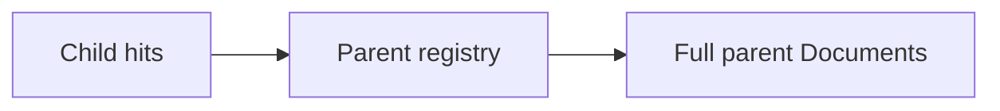
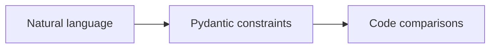
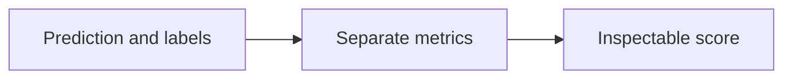
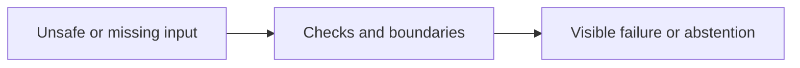

Assistant version 5: Compare baseline and improved retrieval on a held-out golden set.

# Advanced RAG and evaluation

**Outcome:** Measure retrieval changes and identify which extra complexity earns its cost.

**Time:** 150 minutes plus optional practice. **Level:** Intermediate Python, first retrieval course.

**Cost:** Offline fixtures: $0 API fees. Local inference: no API fee, hardware required. Ordinary short hosted examples generally budget under $0.01; reranking adds up to six calls and the live benchmark budgets $0.10. Actual cost depends on configured models, tokens and retries. Ingestion itself makes no model calls.

## Prerequisites

Complete [RAG fundamentals](../08_rag_fundamentals/README.md). Run commands from the repository root in Windows PowerShell, macOS or Linux:

```text
uv sync --locked --extra rag
uv run --extra rag python scripts/check_env.py --offline
```

Use the root [pip fallback](../../README.md) if needed. Keep `--extra rag` on uv commands: an ordinary uv invocation can remove optional dependencies. Offline examples block network and use no keys. For a configured real provider, omit `--offline`; check [provider capabilities](../../docs/PROVIDER_CAPABILITIES.md) first. A live provider failure never silently becomes a fixture.

## Learning objectives

- Rewrite questions with explicit history while retaining the original query.
- Fuse lexical and vector rankings, then rerank or compress bounded evidence.
- Expand child hits to parents and validate structured product filters.
- Measure source/page retrieval, answer proxies and unknown-question handling separately.

## The big idea

Advanced retrieval is a search desk with several assistants: one rewrites the request, another searches by words, another searches by meaning, and a reviewer selects excerpts. More assistants can help, but they can also repeat mistakes and cost more. Keep the original question, bound every extra call, and compare results on the same questions. A smaller index is a real improvement in footprint even when answer quality stays flat; do not rename it an accuracy gain.

## How it works


### Search variants and their costs

**Query rewriting** makes a question easier to search, for example resolving “what about its warranty?” using supplied history. The rewrite schema allows at most three generated queries, and the original query remains included. History is passed explicitly, with only the last four messages used; this is not persistent conversation memory. The offline rewrite concatenates supplied context and a small generic synonym map. It is not a language model evaluation.

**Hybrid search** combines lexical and vector ranking. Our offline example exercises both interfaces, but fake vector ranks carry no semantic meaning. The offline benchmark therefore uses only real lexical ranks. **Reciprocal-rank fusion (RRF)** sums `1 / (constant + rank)` for each document across rankings; rank starts at one. It combines positions instead of treating BM25 scores and cosine distances as comparable units. Duplicate IDs inside one ranking receive only one vote. The constant dampens the advantage of the first position.

**Reranking** rescores a shortlist for the question. The example scores at most six Documents, one structured model call each. These 0–1 scores are model opinions, not calibrated probabilities. **Contextual compression** keeps a short excerpt from each selected item. The helper rejects text that is not copied exactly from its source, but an exact excerpt can still omit an important exception. Inspect refund boundaries after compression.

**Parent retrieval** searches small children but sends their original parent pages to generation. It can restore context lost at a boundary, at the cost of longer prompts. The parent registry must match the child index; missing parents are errors. **Structured filtering** parses a query into an allowlisted Pydantic schema and then applies ordinary comparisons. It never executes model-written SQL. The offline filter fixture is specifically for four-person tents under $300; it is not a parser for arbitrary requests.

### Evaluate the layer that failed

Retrieval hit rate asks whether a known source (and page when specified) appears in the top three. Its denominator excludes unanswerable cases. Keyword correctness checks required words and unknown-case abstention; it is a transparent proxy that can accept a wrong sentence containing the right words. Exact-extract support checks whether the whole answer is contained in a cited quote; it can reject a good paraphrase and accept an irrelevant quote. Neither metric is semantic faithfulness.

The optional live **LLM judge** receives the question, answer, reference and evidence, then applies a rubric for correctness and faithfulness. Reference answers appear only in this scoring step. Calibrate judge decisions against people and report disagreement. Offline judge booleans are deliberately unassessed fixtures and never contribute to benchmark scores. Local evaluation needs no LangSmith account; the official evaluation guide explains how to track a larger evaluation later.

Our eight questions are a small developer-visible regression set, not a blind test. A future quality claim needs a larger held-out set and actual model calls. The committed [before/after report](results/README.md) records the measured comparison with all per-question evidence. In live mode the candidate adds real vector retrieval, so its result is a different experiment and should be saved separately. Budget up to 16 generations plus embeddings for that run; rerank calls are separate.

## Key APIs at a glance

| API or concept | Example | What to inspect |
|---|---|---|
| Query rewriting; multi-query retrieval; deduplication | [01_query_rewrite.py](examples/01_query_rewrite.py) | A bounded schema rewrites the question; the original query remains in the deduplicated list. |
| BM25 plus vector search; reciprocal-rank fusion by hand | [02_hybrid.py](examples/02_hybrid.py) | BM25 and vector results are fused by rank positions rather than incompatible raw scores. |
| Reranking; contextual compression using model scoring and bounded extracts | [03_rerank_compress.py](examples/03_rerank_compress.py) | At most six scored extracts are checked for exact source membership before selecting the top two. |
| Parent-document small-to-big retrieval implemented with parent IDs | [04_parent_retrieval.py](examples/04_parent_retrieval.py) | Resolve child parent_id values against the original registry and deduplicate in first-hit order. |
| Structured query extraction; validated metadata filters | [05_query_filters.py](examples/05_query_filters.py) | ProductFilter validates the category, exclusive price ceiling and exact capacity before filtering. |
| History-aware rewriting of follow-up questions | [06_conversation.py](examples/06_conversation.py) | Pass explicit history into rewriting; search rewritten queries and answer the latest request. |
| Retrieval hit rate, faithfulness, answer correctness; local judge and optional LLM judge | [07_evaluate.py](examples/07_evaluate.py) | Compute source/page hits and transparent answer proxies; the live judge is a separate optional opinion. |
| Missing evidence, stale indexes, bad chunks, injection and citation mismatch; before/after results | [08_failure_gallery.py](examples/08_failure_gallery.py) | Show hidden HTML instructions, missing evidence and incompatible embedding identities with their limits. |

## Walkthrough

Predict each result, run the example, then change one input. Inspect metadata as carefully as the answer text.

### 1. Query rewrite

**Analogy:** Ask for the same book using a few alternate titles. **Under the hood:** A bounded schema rewrites the question; the original query remains in the deduplicated list.


```text
uv run --extra rag python modules/09_advanced_rag/examples/01_query_rewrite.py --offline
```

**Expected:** Standalone variants and a deduplicated evidence list. Inspect [the source](examples/01_query_rewrite.py) and the `KEY IDEA` comment. Live ranks, wording and usage may differ.

### 2. Hybrid

**Analogy:** Merge two librarians' ranked reading lists. **Under the hood:** BM25 and vector results are fused by rank positions rather than incompatible raw scores.


```text
uv run --extra rag python modules/09_advanced_rag/examples/02_hybrid.py --offline
```

**Expected:** A deduplicated hybrid list; fake-vector ranking is explicitly non-semantic. Inspect [the source](examples/02_hybrid.py) and the `KEY IDEA` comment. Live ranks, wording and usage may differ.

### 3. Rerank compress

**Analogy:** Review only a small pile and copy useful excerpts. **Under the hood:** At most six scored extracts are checked for exact source membership before selecting the top two.


```text
uv run --extra rag python modules/09_advanced_rag/examples/03_rerank_compress.py --offline
```

**Expected:** At most two relevant extracts, each copied from its original evidence. Inspect [the source](examples/03_rerank_compress.py) and the `KEY IDEA` comment. Live ranks, wording and usage may differ.

### 4. Parent retrieval

**Analogy:** Find a paragraph, then open its page. **Under the hood:** Resolve child parent_id values against the original registry and deduplicate in first-hit order.



```text
uv run --extra rag python modules/09_advanced_rag/examples/04_parent_retrieval.py --offline
```

**Expected:** Child IDs followed by fewer, larger parent documents. Inspect [the source](examples/04_parent_retrieval.py) and the `KEY IDEA` comment. Live ranks, wording and usage may differ.

### 5. Query filters

**Analogy:** Turn a request into checked form fields. **Under the hood:** ProductFilter validates the category, exclusive price ceiling and exact capacity before filtering.



```text
uv run --extra rag python modules/09_advanced_rag/examples/05_query_filters.py --offline
```

**Expected:** Only four-person tents under $300; no generated SQL is executed. Inspect [the source](examples/05_query_filters.py) and the `KEY IDEA` comment. Live ranks, wording and usage may differ.

### 6. Conversation

**Analogy:** Read the last few notes to resolve a pronoun. **Under the hood:** Pass explicit history into rewriting; search rewritten queries and answer the latest request.


```text
uv run --extra rag python modules/09_advanced_rag/examples/06_conversation.py --offline
```

**Expected:** Standalone warranty queries and a cited answer; no conversation memory is stored automatically. Inspect [the source](examples/06_conversation.py) and the `KEY IDEA` comment. Live ranks, wording and usage may differ.

### 7. Evaluate

**Analogy:** Grade the search and answer separately. **Under the hood:** Compute source/page hits and transparent answer proxies; the live judge is a separate optional opinion.



```text
uv run --extra rag python modules/09_advanced_rag/examples/07_evaluate.py --offline
```

**Expected:** A local metric report and a clearly labelled scripted judge verdict. Inspect [the source](examples/07_evaluate.py) and the `KEY IDEA` comment. Live ranks, wording and usage may differ.

### 8. Failure gallery

**Analogy:** Rehearse failure before trusting success. **Under the hood:** Show hidden HTML instructions, missing evidence and incompatible embedding identities with their limits.



```text
uv run --extra rag python modules/09_advanced_rag/examples/08_failure_gallery.py --offline
```

**Expected:** Five failure labels with concrete checks and fixes. Inspect [the source](examples/08_failure_gallery.py) and the `KEY IDEA` comment. Live ranks, wording and usage may differ.

## Real-world use case

**Sample input:** The eight committed regression questions, with gold labels reserved for scoring.

```text
uv run --extra rag python modules/09_advanced_rag/use_case/rag_benchmark.py --offline
```

**Sample output:** Baseline/candidate chunk counts, retrieval_hit_rate, keyword_correctness_proxy, exact_extract_support and per-case results.

**Business application:** A team can decide whether a retrieval change improves quality enough to justify additional calls and storage. This offline run measures lexical retrieval and extractive mechanics only. Read [the application](use_case/rag_benchmark.py). All input data is synthetic.

## Common mistakes

These failures are exercised against the locked helpers in [retrieval contract tests](../../tests/test_rag_contracts.py) or the local exercise tests. Exception-only entries show the class rather than promising a provider-specific message. The CLI normally prints a shorter troubleshooting hint.

### Compression invents words

```text
ValueError: Compression must be an exact extract from its source.
```

**Fix:** Keep an actual substring or reject the compressed result; do not silently accept a summary as a quote.

### Orphan child chunk

```text
ValueError: Missing parent document; rebuild parent and child indexes together.
```

**Fix:** Rebuild the parent registry and child index from the same corpus.

### Invalid product category

```text
ValidationError
```

**Fix:** Use an allowed category such as tents; do not turn arbitrary text into a filter expression.

### Bad fusion settings

```text
ValueError
```

**Fix:** Use positive k and a positive rank constant; deduplicate within each input ranking.

## Exercises

Each starter runs as a baseline. Complete `YOUR CODE HERE` before opening the matching solution.

1. **Fuse rankings without duplicates.** Use reciprocal-rank fusion for two rankings; repeated IDs inside one list must not gain extra votes. [Starter](exercises/01_practice.py) · [Solution](solutions/01_practice.py).

2. **Expand children to parents.** Return unique original parent Documents in first-hit order; reject a missing parent. [Starter](exercises/02_apply.py) · [Solution](solutions/02_apply.py).

3. **Use the correct evaluation denominator.** Compute retrieval hit rate excluding unanswerable None entries; return None when no answerable cases exist. [Starter](exercises/03_stretch.py) · [Solution](solutions/03_stretch.py).

```text
uv run --extra rag python modules/09_advanced_rag/exercises/01_practice.py --offline
uv run --extra rag pytest modules/09_advanced_rag/tests/test_exercises.py --exercise-target exercises
uv run --extra rag pytest modules/09_advanced_rag/tests
```

The middle command intentionally fails until the starters meet the contracts. The final command checks supplied solutions, all scripts and the application. The [notebook](notebook.ipynb) mirrors the actual example and application source, with outputs cleared. For notebooks run `uv sync --extra rag --group authoring`, then `uv run --extra rag --group authoring jupyter lab`.

## Quiz

**Why retain the original query?**

<details><summary>Answer</summary>

A rewrite may drop or distort a constraint; the original provides another retrieval path.

</details>

**Why not add a BM25 score to a cosine distance?**

<details><summary>Answer</summary>

They use incompatible scales and opposite conventions; RRF combines ranked positions instead.

</details>

**Does exact compression guarantee no loss of meaning?**

<details><summary>Answer</summary>

No. Removing context can drop exceptions or change the interpretation of a copied sentence.

</details>

**What is the cost of parent retrieval?**

<details><summary>Answer</summary>

More context tokens and possible noise, traded for restored surrounding evidence.

</details>

**Should unknown questions enter the source-hit denominator?**

<details><summary>Answer</summary>

No source is expected for them. Evaluate abstention separately.

</details>

**What if the candidate has the same quality score?**

<details><summary>Answer</summary>

Report the tie, other measured tradeoffs and per-case failures. Do not claim an accuracy improvement.

</details>

## Key takeaways

- Rewrite questions with explicit history while retaining the original query.
- Fuse lexical and vector rankings, then rerank or compress bounded evidence.
- Expand child hits to parents and validate structured product filters.
- Measure source/page retrieval, answer proxies and unknown-question handling separately.
- Keep offline mechanics, live model behaviour and measured quality claims distinct.

## Go deeper

- [Official retrieval guide](https://docs.langchain.com/oss/python/langchain/retrieval)
- [Official evaluate-llm-application guide](https://docs.langchain.com/langsmith/evaluate-llm-application)
- [API verification and substitutions](../../docs/VERIFICATION_NOTES.md)

## Next: Agents with create_agent

Complete the [Handbook Q&A checkpoint](../../checkpoints/02_handbook_qa/README.md). You are ready when you can trace an answer to a real page, explain a failed retrieval case and distinguish quote validity from factual correctness.

Continue to [Agents with create_agent](../10_agents/README.md). The agents tier is available; install it with `uv sync --extra agents`.
