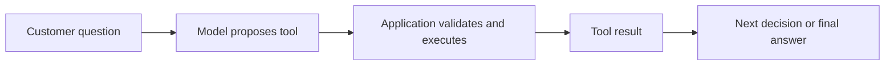
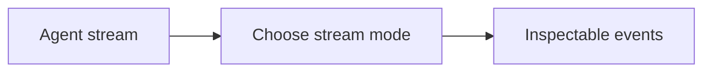
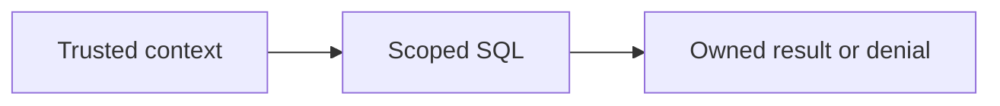
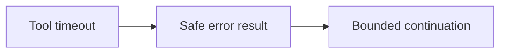

Assistant version 6: Combine SQL, stock and policy tools with validated return creation.

# Agents with create_agent

**Outcome:** Combine SQL, stock and policy tools with validated return creation.

**Time:** 150 minutes plus optional practice. **Level:** Intermediate; complete the earlier tiers first.

**Cost:** Offline fixtures cost $0 in API fees. Local models have no API fee but require hardware. Short hosted examples normally budget under $0.01; allow up to $0.10 for the full checkpoint. Model fallback, retries, summaries and tool selection can add calls. These are estimates for low-cost configured profiles, not spending guarantees. Synthetic ledger writes never send money.

## Prerequisites

Complete [Advanced RAG and evaluation](../09_advanced_rag/README.md). Commands below run from the repository root in Windows PowerShell, macOS and Linux:

```text
uv sync --locked --extra agents
uv run --extra agents python scripts/check_env.py --offline
```

Keep `--extra agents` on uv commands so optional dependencies remain installed. See the root [pip fallback](../../README.md) and [provider capabilities](../../docs/PROVIDER_CAPABILITIES.md). Omit `--offline` to use the configured real model; unsupported capabilities fail visibly. Offline mode blocks outbound networking and uses explicit scripted responses; actual local tool, database and protocol code still executes.

## Learning objectives

- Build the current create_agent loop and inspect its complete message trace.
- Compare graph updates, streamed chunks and structured final responses.
- Keep customer identity in trusted runtime context outside tool schemas.
- Validate and deduplicate synthetic return writes in a transaction.

## The big idea

An agent is a support colleague with a tool drawer and a repeated decision cycle. It reads a request, proposes a tool call, sees the tool result, and decides whether to continue. The application owns the drawer and permissions. A model can ask for a refund, but code must decide whether the customer owns the order and whether the policy allows it. Use an agent when the sequence needs to vary; use fixed code when the steps are already known.

## How it works



### From a manual loop to an agent

Module 05 made the loop visible. `create_agent` builds that loop on LangGraph: the returned runnable accepts a dictionary containing `messages` and produces updated state. **State** is the data carried through the run. The framework dispatches named tools and joins tool results to the model's call IDs. It does not make your tools safe automatically. A final assistant message ends a normal run; an interrupt pauses it, and a limit can stop it with an error or a limit message.

An agent is useful when the next step depends on new evidence. For a single known policy lookup, the fixed RAG path from module 08 is simpler and easier to budget. More tools and decisions add latency, cost and failure opportunities. Tool descriptions help selection but are not authorization rules. The scripted model explicitly requests tools offline; these trajectories test the loop and controls, not tool-selection intelligence.

### Three different outputs

`stream_mode="updates"` yields node/state changes. `stream_mode="messages"` yields model chunks paired with metadata. Streaming is about delivery timing, not lower token cost. Our generic fake exposes content chunks but is not a provider-specific streaming emulator. Inspect `messages` for the full tool-call/result trace; never show private tool results to an unauthorized customer.

`ToolStrategy` asks the model to fill a tool-shaped final response. `ProviderStrategy` uses provider-native structured output. Both expose parsed data at `structured_response`; schema-valid data can still be factually wrong. Offline native JSON is a supplied JSON string passed through the actual agent parser, not a claim that the fake enforces a provider schema. Choose a supported live model/strategy and let unsupported capabilities fail visibly. The central factory remains the only place that creates models.

### Identity and safe writes

A **dataclass** is a Python record type. The frozen `SupportContext` holds authenticated customer identity, runtime database path, a fixed teaching date and trusted warehouse checks. **Runtime context** is supplied by application code when invoking the agent. `ToolRuntime[SupportContext]` makes it available to a tool while excluding it from the model's input schema. In a real service, the host must authenticate the user; a customer ID typed into a prompt is not authentication.

The return demonstration uses a disposable database copy and the synthetic date **2026-01-15**. It supports one purchased unit per request. Code verifies ownership, purchased SKU, delivered-within-30-days eligibility, proof/accessories and unused condition. Wrong-item and defect exceptions require a trusted matching warehouse verification; the model cannot waive the $6 label fee by changing the reason. Excluded items require defect review. The calculated item refund excludes original shipping and deducts 600 cents for an ordinary unused return. Refunds strictly over 10,000 cents are refused here until module 12 adds human review. Exactly $100 does not require approval.

**Idempotency** means retrying the same logical request does not repeat the side effect. A unique key identifies the request. Reusing a key for different arguments fails; replaying the same request returns the existing record. A **transaction** groups validation and insertion into one atomic operation; SQLite's `BEGIN IMMEDIATE` serializes competing writers. A quantity check also rejects a second key for an already-returned unit. These are synthetic approved ledger records after simulated inspection, not payments, warehouse automation or a complete commerce returns system.

The first seed item already has a return, so the write lesson uses customer C008, order BW1008, SKU BW-021. Its 5,595-cent unit price minus the 600-cent label produces 4,995 cents. The immutable seed database is never modified.

New terms are also collected in the [glossary](../../docs/GLOSSARY.md).

## Key APIs at a glance

| API or concept | Example | What to inspect |
|---|---|---|
| create_agent(model, tools, system_prompt); compare manual loop; when not to use agents | [01_create_agent.py](examples/01_create_agent.py) | create_agent manages the model/tool loop and returns the message history. |
| Read message trace; stream_mode updates and messages | [02_trace_stream.py](examples/02_trace_stream.py) | Updates describe graph execution; messages describe streamed model chunks. |
| response_format; ToolStrategy and ProviderStrategy; structured final response | [03_response_format.py](examples/03_response_format.py) | The chosen response strategy validates SupportAnswer and stores it separately from message text. |
| context_schema; customer identity injected outside model arguments | [04_context.py](examples/04_context.py) | ToolRuntime receives SupportContext from the host; customer_id is absent from the model schema. |
| Tool errors; recursion_limit; bounded recovery | [05_errors_limits.py](examples/05_errors_limits.py) | The wrapper turns a timeout into an error ToolMessage; a separate repeating fixture reaches GraphRecursionError. |
| SQLite return creation on a runtime copy; policy validation; idempotency key | [06_return_write.py](examples/06_return_write.py) | Policy checks and the insert share a transaction; repeated keys return the same record. |

## Walkthrough

Read each script, predict its tool/state changes, run it, then change one input. A scripted answer may stay fixed; inspect the real program behaviour around it.

### 1. Create agent

**Analogy:** A colleague opens only the supplied tool drawer. **Under the hood:** create_agent manages the model/tool loop and returns the message history.


```text
uv run --extra agents python modules/10_agents/examples/01_create_agent.py --offline
```

**Expected:** Human, assistant tool call, tool result, final assistant message. Inspect [the source](examples/01_create_agent.py) and its `KEY IDEA` comment. Live model decisions and wording may differ.

### 2. Trace stream

**Analogy:** Watch either workshop milestones or words arriving. **Under the hood:** Updates describe graph execution; messages describe streamed model chunks.



```text
uv run --extra agents python modules/10_agents/examples/02_trace_stream.py --offline
```

**Expected:** Updates contain node changes; messages contain chunks and metadata. Inspect [the source](examples/02_trace_stream.py) and its `KEY IDEA` comment. Live model decisions and wording may differ.

### 3. Response format

**Analogy:** Use a checked answer form instead of guessing its layout. **Under the hood:** The chosen response strategy validates SupportAnswer and stores it separately from message text.


```text
uv run --extra agents python modules/10_agents/examples/03_response_format.py --offline
```

**Expected:** Both paths return a validated SupportAnswer in structured_response. Inspect [the source](examples/03_response_format.py) and its `KEY IDEA` comment. Live model decisions and wording may differ.

### 4. Context

**Analogy:** Hand the clerk an authenticated badge outside the customer letter. **Under the hood:** ToolRuntime receives SupportContext from the host; customer_id is absent from the model schema.



```text
uv run --extra agents python modules/10_agents/examples/04_context.py --offline
```

**Expected:** BW1001 is visible only to C001; the schema has no customer_id. Inspect [the source](examples/04_context.py) and its `KEY IDEA` comment. Live model decisions and wording may differ.

### 5. Errors limits

**Analogy:** Give a failed lookup one clear response and stop circular work. **Under the hood:** The wrapper turns a timeout into an error ToolMessage; a separate repeating fixture reaches GraphRecursionError.



```text
uv run --extra agents python modules/10_agents/examples/05_errors_limits.py --offline
```

**Expected:** One recovered read error, then GraphRecursionError from a deliberate loop. Inspect [the source](examples/05_errors_limits.py) and its `KEY IDEA` comment. Live model decisions and wording may differ.

### 6. Return write

**Analogy:** Stamp a receipt with a unique transaction number. **Under the hood:** Policy checks and the insert share a transaction; repeated keys return the same record.


```text
uv run --extra agents python modules/10_agents/examples/06_return_write.py --offline
```

**Expected:** One refund record for 4995 cents; replay does not add a second record. Inspect [the source](examples/06_return_write.py) and its `KEY IDEA` comment. Live model decisions and wording may differ.

## Real-world use case

**Sample input:** Customer C008 requests the unused BW-021 item on BW1008.

```text
uv run --extra agents python modules/10_agents/use_case/support_agent.py --offline
```

**Sample output:** Order, stock and policy tool results, followed by a 4,995-cent synthetic return record.

**Business application:** The support workflow reads evidence before a constrained write; an operator can inspect the complete trace. No payment or customer message is sent. Inspect [the application](use_case/support_agent.py). The source labels simulated data and decisions explicitly.

## Common mistakes

These cases are exercised in the examples, exercise checks or [agent contracts](../../tests/test_agent_contracts.py). Exception-only entries name the stable class rather than promising provider-specific wording. The CLI prints a shorter troubleshooting hint.

### Wrong customer

```text
ValueError: Order not found for this customer.
```

**Fix:** Keep identity in trusted context and constrain SQL by both order and customer.

### Over-limit refund

```text
ValueError: Refund over $100 requires manager approval; no record written.
```

**Fix:** Request the reviewed path introduced in module 12; never accept a model-written approved flag.

### Already-returned unit

```text
ValueError: Purchased quantity already has a return record.
```

**Fix:** Inspect the existing record; changing the idempotency key must not create another return.

### Endless loop

```text
GraphRecursionError
```

**Fix:** Investigate repeated tool requests. Graph steps include orchestration; raising the limit does not fix an unbounded policy.

## Exercises

Starters run as baseline behaviour. Complete `YOUR CODE HERE`, then use the learner-target checks before inspecting the solution.

1. **Approval boundary.** Require approval only for integer cents strictly above 10000; reject negatives. [Starter](exercises/01_practice.py) · [Solution](solutions/01_practice.py).

2. **Scoped order lookup.** Use parameterized SQL to return only an order owned by the trusted customer. [Starter](exercises/02_apply.py) · [Solution](solutions/02_apply.py).

3. **Validated return request.** Validate order ID, SKU, reason and idempotency key; forbid extra model fields. [Starter](exercises/03_stretch.py) · [Solution](solutions/03_stretch.py).

```text
uv run --extra agents python modules/10_agents/exercises/01_practice.py --offline
uv run --extra agents pytest modules/10_agents/tests/test_exercises.py --exercise-target exercises
uv run --extra agents pytest modules/10_agents/tests
```

The middle command intentionally fails until you complete the starters. The last command checks supplied solutions, every script and the use case. The [notebook](notebook.ipynb) mirrors actual example/application source with cleared outputs. Install notebook tools with `uv sync --extra agents --group authoring`, then use `uv run --extra agents --group authoring jupyter lab`.

## Quiz

**When is an agent unnecessary?**

<details><summary>Answer</summary>

When the sequence is known in advance, such as one fixed retrieval-and-answer path.

</details>

**Does a tool description grant permission?**

<details><summary>Answer</summary>

No. Application code must enforce ownership, eligibility and allowed side effects.

</details>

**Where does a structured final answer appear?**

<details><summary>Answer</summary>

At structured_response; the message trace remains separate.

</details>

**Why keep customer_id out of tool arguments?**

<details><summary>Answer</summary>

The model must not choose which authenticated customer it represents.

</details>

**Why are integer cents useful?**

<details><summary>Answer</summary>

They make the exact $100 boundary unambiguous and avoid floating-point currency comparisons.

</details>

**Why check quantity as well as an idempotency key?**

<details><summary>Answer</summary>

A caller could use a new key for the same purchased unit; the quantity check prevents another return.

</details>

## Key takeaways

- Build the current create_agent loop and inspect its complete message trace.
- Compare graph updates, streamed chunks and structured final responses.
- Keep customer identity in trusted runtime context outside tool schemas.
- Validate and deduplicate synthetic return writes in a transaction.
- Keep scripted control tests distinct from live model quality and deployment guarantees.

## Go deeper

- [Official agents reference](https://docs.langchain.com/oss/python/langchain/agents)
- [Official streaming reference](https://docs.langchain.com/oss/python/langchain/streaming)
- [Official structured-output reference](https://docs.langchain.com/oss/python/langchain/structured-output)
- [Official tools reference](https://docs.langchain.com/oss/python/langchain/tools)
- [Verified versions, substitutions and limits](../../docs/VERIFICATION_NOTES.md)

## Next: Memory and state

Continue to [Memory and state](../11_memory/README.md). Re-run shared contract tests if you change the helper code.
