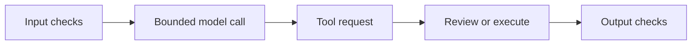
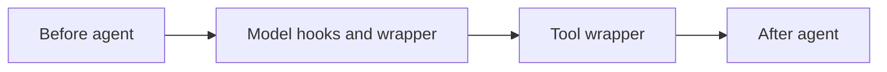
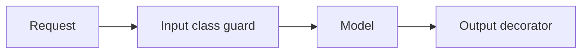
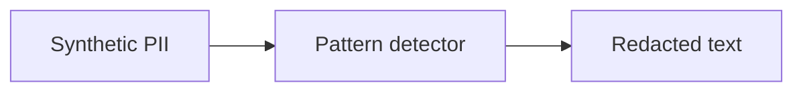
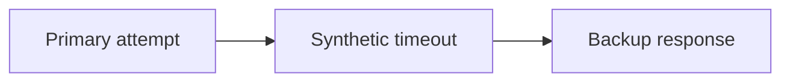
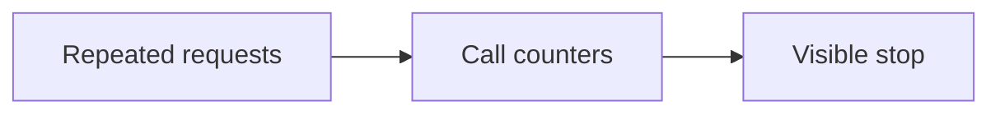
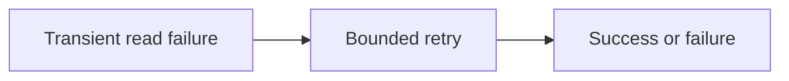
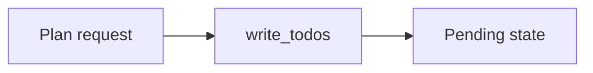
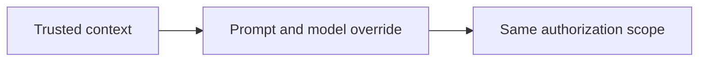

Assistant version 8: Redact PII, pause refunds over $100, add fallback and enforce limits.

# Middleware and guardrails

**Outcome:** Redact PII, pause refunds over $100, add fallback and enforce limits.

**Time:** 180 minutes plus optional practice. **Level:** Intermediate; complete the earlier tiers first.

**Cost:** Offline fixtures cost $0 in API fees. Local models have no API fee but require hardware. Short hosted examples normally budget under $0.01; allow up to $0.10 for the full checkpoint. Model fallback, retries, summaries and tool selection can add calls. These are estimates for low-cost configured profiles, not spending guarantees. Synthetic ledger writes never send money.

## Prerequisites

Complete [Memory and state](../11_memory/README.md). Commands below run from the repository root in Windows PowerShell, macOS and Linux:

```text
uv sync --locked --extra agents
uv run --extra agents python scripts/check_env.py --offline
```

Keep `--extra agents` on uv commands so optional dependencies remain installed. See the root [pip fallback](../../README.md) and [provider capabilities](../../docs/PROVIDER_CAPABILITIES.md). Omit `--offline` to use the configured real model; unsupported capabilities fail visibly. Offline mode blocks outbound networking and uses explicit scripted responses; actual local tool, database and protocol code still executes.

## Learning objectives

- Observe node hooks and model/tool wrappers in their actual order.
- Redact synthetic identifiers and reject oversized inputs deterministically.
- Pause, approve, reject and resume high-value refunds without premature writes.
- Bound fallback, retry, selection and planning behaviour while preserving customer scope.

## The big idea

Middleware is a set of checkpoints around a support desk. Some checks inspect a request before work begins; others wrap a model or tool call; others inspect the result. These checks can redact text, pause a risky action or stop too many calls. Order matters: a retry around an approval step could ask for the same approval repeatedly. Every control should have a test that proves what happens when it rejects an operation.

## How it works



### Middleware before the first guard

**Middleware** is code attached around the agent's lifecycle. Node hooks run before/after the agent or model. Wrap hooks receive a request and a handler: calling the handler continues the operation, returning early changes it, and raising stops it. A decorator is a concise way to define one hook; an `AgentMiddleware` class groups related hooks. The hook-order example records event names without logging customer content. Middleware ordering changes which wrapper catches an exception or sees an overridden request.

The input guard rejects human messages longer than 4,000 characters. The output example similarly rejects an oversized answer. These deterministic bounds enforce specific contracts; they are not general content-safety classifiers. `PIIMiddleware` redacts email-like data and a custom card-like fixture pattern on configured inputs, outputs and tool results. **PII** means personally identifying information. A pattern detector can miss data, over-redact and alter useful evidence. The synthetic card detector is not a comprehensive financial-data detector. Redaction middleware also does not guarantee that an outer tracing callback or transport never observed the original input; real logging boundaries need separate review.

### Human review is a control-flow pause

`HumanInTheLoopMiddleware` interrupts the graph before `approve_refund` executes. A checkpointer saves pending state. The result contains `__interrupt__`; a trusted reviewer can resume it with a LangGraph `Command` containing an approve or reject decision. A **Command** here is a graph input object, not a shell command. Only those two decisions are allowed; the model cannot submit a manager-approved flag in tool arguments. Rejecting must produce no new return record. Approval still reruns ownership, eligibility, quantity and warehouse checks.

The ordinary `create_return` tool independently refuses amounts above $100. The approval-only tool is exposed only by the guarded factory, which always attaches its review middleware. Calling that internal Python tool without the harness would bypass orchestration, so do not publish it as an unauthenticated endpoint. The lesson explicitly simulates approve and reject decisions on disposable ledgers; the use case leaves the request paused. A real UI must authenticate a manager, authorize the thread, show the exact pending action and protect the resume endpoint. Those production controls are not supplied by the interrupt mechanism alone.

### Reliability and bounded cost

**Fallback** selects another model after a failure; **retry** repeats an operation after an allowed transient error. The fallback lesson injects a primary timeout and verifies a backup response. Both model instances use the configured profile; it demonstrates control flow, not independent-provider resilience. The guarded application includes a backup instance, email/card-fixture redaction, human review and limits. Its offline backup explicitly requests manual review rather than fabricating success.

ModelCallLimitMiddleware caps logical model calls; ToolCallLimitMiddleware caps dispatches. Neither is a dollar meter. Fallback attempts, selector calls, summaries and provider SDK retries can add physical requests within a logical call. The guarded factory allows five logical model calls and six tool calls; fallback can add up to five further generations. The host's recursion limit of 60 counts graph steps, including middleware nodes, and is a separate backstop. Each model still has the configured output cap. Inspect provider usage for actual cost.

The retry lesson permits only TimeoutError, with one retry and zero test delay, and retries a read-only tool. Do not retry permission/validation failures. A write needs transactional idempotency even if it appears safe to retry, because a timeout can happen after commit. `LLMToolSelectorMiddleware` adds a model call to narrow reviewed tool schemas; tool relevance is not authorization. `TodoListMiddleware` records tasks but does not execute or verify completion. The dynamic prompt/model example changes request instructions and model selection while preserving immutable customer scope; both instances use the same configured model profile for portability.

New terms are also collected in the [glossary](../../docs/GLOSSARY.md).

## Key APIs at a glance

| API or concept | Example | What to inspect |
|---|---|---|
| before_agent, before_model, wrap_model_call, after_model, wrap_tool_call, after_agent; hook ordering | [01_hooks.py](examples/01_hooks.py) | HookLog records before/after hooks and wrapper entry/exit around an actual stock tool call. |
| Decorator and AgentMiddleware class; input/output guardrails | [02_custom_middleware.py](examples/02_custom_middleware.py) | A class rejects oversized input and a decorator checks the generated output length. |
| PIIMiddleware; email and card-like-number redaction; synthetic fixtures | [03_pii.py](examples/03_pii.py) | PIIMiddleware applies configured email and card-fixture detectors to messages. |
| HumanInTheLoopMiddleware; route refunds over $100 to an approval-only tool; approve/reject/resume | [04_approval.py](examples/04_approval.py) | HITL pauses before the tool; separate simulated approve/reject runs verify write counts. |
| ModelFallbackMiddleware; primary fails, backup responds | [05_fallback.py](examples/05_fallback.py) | An outer fallback wrapper handles the injected primary timeout and calls the backup model. |
| ModelCallLimitMiddleware; ToolCallLimitMiddleware; stop runaway loops | [06_call_limits.py](examples/06_call_limits.py) | Separate model/tool call limit demonstrations halt a repeating scripted trajectory. |
| ModelRetryMiddleware; ToolRetryMiddleware; avoid repeated write side effects | [07_retry.py](examples/07_retry.py) | Narrow retry predicates permit one timeout retry; no write is retried. |
| LLMToolSelectorMiddleware; tool relevance versus extra model cost | [08_tool_selector.py](examples/08_tool_selector.py) | The selector model narrows tool schemas and the agent uses the result; permissions remain in code. |
| TodoListMiddleware; inspect task planning state | [09_todo.py](examples/09_todo.py) | TodoListMiddleware adds a planning tool and preserves two pending tasks in state. |
| Dynamic system prompt; runtime model selection; immutable customer scope | [10_dynamic_model.py](examples/10_dynamic_model.py) | A dynamic prompt reads trusted context and a wrapper overrides the model instance. |

## Walkthrough

Read each script, predict its tool/state changes, run it, then change one input. A scripted answer may stay fixed; inspect the real program behaviour around it.

### 1. Hooks

**Analogy:** Watch a parcel pass each inspection desk. **Under the hood:** HookLog records before/after hooks and wrapper entry/exit around an actual stock tool call.



```text
uv run --extra agents python modules/12_middleware/examples/01_hooks.py --offline
```

**Expected:** Hook names show node hooks and nested model/tool wrappers. Inspect [the source](examples/01_hooks.py) and its `KEY IDEA` comment. Live model decisions and wording may differ.

### 2. Custom middleware

**Analogy:** Put a ruler at the input and output gates. **Under the hood:** A class rejects oversized input and a decorator checks the generated output length.



```text
uv run --extra agents python modules/12_middleware/examples/02_custom_middleware.py --offline
```

**Expected:** A decorator observes valid input; oversized input is rejected before generation. Inspect [the source](examples/02_custom_middleware.py) and its `KEY IDEA` comment. Live model decisions and wording may differ.

### 3. Pii

**Analogy:** Cover synthetic identifiers before copying a letter. **Under the hood:** PIIMiddleware applies configured email and card-fixture detectors to messages.



```text
uv run --extra agents python modules/12_middleware/examples/03_pii.py --offline
```

**Expected:** Redacted markers replace synthetic identifiers in retained messages. Inspect [the source](examples/03_pii.py) and its `KEY IDEA` comment. Live model decisions and wording may differ.

### 4. Approval

**Analogy:** Hold an unsigned high-value order at the approval desk. **Under the hood:** HITL pauses before the tool; separate simulated approve/reject runs verify write counts.


```text
uv run --extra agents python modules/12_middleware/examples/04_approval.py --offline
```

**Expected:** Approval writes once; rejection writes nothing. Inspect [the source](examples/04_approval.py) and its `KEY IDEA` comment. Live model decisions and wording may differ.

### 5. Fallback

**Analogy:** Ask a backup desk after the first desk is unavailable. **Under the hood:** An outer fallback wrapper handles the injected primary timeout and calls the backup model.



```text
uv run --extra agents python modules/12_middleware/examples/05_fallback.py --offline
```

**Expected:** Backup response appears after the injected primary failure. Inspect [the source](examples/05_fallback.py) and its `KEY IDEA` comment. Live model decisions and wording may differ.

### 6. Call limits

**Analogy:** Stop work when the call allowance is exhausted. **Under the hood:** Separate model/tool call limit demonstrations halt a repeating scripted trajectory.



```text
uv run --extra agents python modules/12_middleware/examples/06_call_limits.py --offline
```

**Expected:** The run ends with a visible limit message rather than looping. Inspect [the source](examples/06_call_limits.py) and its `KEY IDEA` comment. Live model decisions and wording may differ.

### 7. Retry

**Analogy:** Try a temporarily busy read once more. **Under the hood:** Narrow retry predicates permit one timeout retry; no write is retried.



```text
uv run --extra agents python modules/12_middleware/examples/07_retry.py --offline
```

**Expected:** Three model attempts (one failure, one retry, then the final answer) and two read attempts; no write is retried. Inspect [the source](examples/07_retry.py) and its `KEY IDEA` comment. Live model decisions and wording may differ.

### 8. Tool selector

**Analogy:** Choose a small relevant drawer from already reviewed tools. **Under the hood:** The selector model narrows tool schemas and the agent uses the result; permissions remain in code.


```text
uv run --extra agents python modules/12_middleware/examples/08_tool_selector.py --offline
```

**Expected:** Only the reviewed stock tool is selected; selection adds model calls. Inspect [the source](examples/08_tool_selector.py) and its `KEY IDEA` comment. Live model decisions and wording may differ.

### 9. Todo

**Analogy:** Write a checklist without claiming the work is finished. **Under the hood:** TodoListMiddleware adds a planning tool and preserves two pending tasks in state.



```text
uv run --extra agents python modules/12_middleware/examples/09_todo.py --offline
```

**Expected:** The final state contains two pending tasks; planning does not execute them. Inspect [the source](examples/09_todo.py) and its `KEY IDEA` comment. Live model decisions and wording may differ.

### 10. Dynamic model

**Analogy:** Change the desk instructions without changing the customer badge. **Under the hood:** A dynamic prompt reads trusted context and a wrapper overrides the model instance.



```text
uv run --extra agents python modules/12_middleware/examples/10_dynamic_model.py --offline
```

**Expected:** A runtime prompt and model override keep the same customer context. Inspect [the source](examples/10_dynamic_model.py) and its `KEY IDEA` comment. Live model decisions and wording may differ.

## Real-world use case

**Sample input:** C001 requests a return for BW-014 on BW1001, whose ordinary refund is 12,195 cents.

```text
uv run --extra agents python modules/12_middleware/use_case/guarded_agent.py --offline
```

**Sample output:** A saved human-review interrupt appears before any new ledger record.

**Business application:** A reviewer can inspect the exact action; the demo stops with the write pending. Tests separately simulate approval and rejection and reopen a durable paused checkpoint. Inspect [the application](use_case/guarded_agent.py). The source labels simulated data and decisions explicitly.

## Common mistakes

These cases are exercised in the examples, exercise checks or [agent contracts](../../tests/test_agent_contracts.py). Exception-only entries name the stable class rather than promising provider-specific wording. The CLI prints a shorter troubleshooting hint.

### Oversized customer message

```text
ValueError: Customer messages must be at most 4000 characters.
```

**Fix:** Reject or intentionally summarize input before calling the agent; do not silently remove the guard.

### Approval bypass attempt

```text
ValueError: Refund over $100 requires manager approval; no record written.
```

**Fix:** The ordinary writer cannot approve itself; route the request to the reviewed tool.

### Invalid review decision

```text
ValueError
```

**Fix:** Only approve and reject are allowed. Do not use respond to fabricate a successful result for a denied side effect.

### Wrong retry category

```text
PermissionError / ValueError are not retryable in the exercise policy
```

**Fix:** Fix authorization or arguments instead of repeatedly issuing the same invalid operation.

## Exercises

Starters run as baseline behaviour. Complete `YOUR CODE HERE`, then use the learner-target checks before inspecting the solution.

1. **Redact synthetic email.** Replace email-like tokens with [REDACTED_EMAIL]; preserve ordinary text. This is a narrow regex exercise. [Starter](exercises/01_practice.py) · [Solution](solutions/01_practice.py).

2. **Review decision schema.** Allow only approve or reject; never accept an agent-supplied edit or respond decision. [Starter](exercises/02_apply.py) · [Solution](solutions/02_apply.py).

3. **Narrow retry policy.** Retry timeouts only; never retry permission or validation failures automatically. [Starter](exercises/03_stretch.py) · [Solution](solutions/03_stretch.py).

```text
uv run --extra agents python modules/12_middleware/exercises/01_practice.py --offline
uv run --extra agents pytest modules/12_middleware/tests/test_exercises.py --exercise-target exercises
uv run --extra agents pytest modules/12_middleware/tests
```

The middle command intentionally fails until you complete the starters. The last command checks supplied solutions, every script and the use case. The [notebook](notebook.ipynb) mirrors actual example/application source with cleared outputs. Install notebook tools with `uv sync --extra agents --group authoring`, then use `uv run --extra agents --group authoring jupyter lab`.

## Quiz

**How does a wrap hook continue execution?**

<details><summary>Answer</summary>

It calls the supplied handler, optionally with an overridden request.

</details>

**Does email redaction cover all private information?**

<details><summary>Answer</summary>

No. Detector coverage and logging boundaries require separate review and tests.

</details>

**Does approval waive eligibility?**

<details><summary>Answer</summary>

No. The transactional writer repeats ownership, policy, warehouse and quantity checks.

</details>

**Why can graph steps exceed model calls?**

<details><summary>Answer</summary>

Tool dispatch and middleware hooks add graph work between model invocations.

</details>

**Should every exception be retried?**

<details><summary>Answer</summary>

No. Retry narrowly selected transient failures; invalid requests and permission denials need correction.

</details>

**Does a pending to-do prove an action happened?**

<details><summary>Answer</summary>

No. A plan records intended work, and even a model-written completed label needs external verification.

</details>

## Key takeaways

- Observe node hooks and model/tool wrappers in their actual order.
- Redact synthetic identifiers and reject oversized inputs deterministically.
- Pause, approve, reject and resume high-value refunds without premature writes.
- Bound fallback, retry, selection and planning behaviour while preserving customer scope.
- Keep scripted control tests distinct from live model quality and deployment guarantees.

## Go deeper

- [Official custom reference](https://docs.langchain.com/oss/python/langchain/middleware/custom)
- [Official built-in reference](https://docs.langchain.com/oss/python/langchain/middleware/built-in)
- [Verified versions, substitutions and limits](../../docs/VERIFICATION_NOTES.md)

## Next: Model Context Protocol

Continue to [Model Context Protocol](../13_mcp/README.md). Re-run shared contract tests if you change the helper code.
