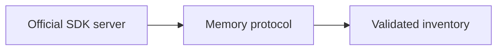
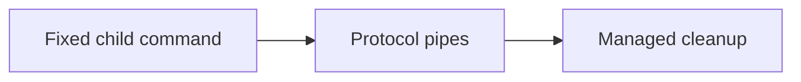
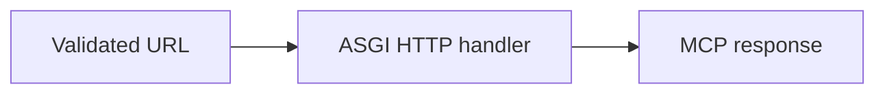
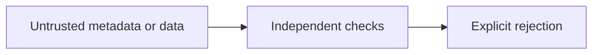

Assistant version 8: Connect inventory MCP tools to create_agent.

# Model Context Protocol

**Outcome:** Connect inventory MCP tools to create_agent.

**Time:** 120 minutes plus optional practice. **Level:** Intermediate; complete the earlier tiers first.

**Cost:** Offline fixtures cost $0 in API fees. Local models have no API fee but require hardware. Short hosted examples normally budget under $0.01; allow up to $0.10 for the full checkpoint. Model fallback, retries, summaries and tool selection can add calls. These are estimates for low-cost configured profiles, not spending guarantees. Synthetic ledger writes never send money.

## Prerequisites

Complete [Middleware and guardrails](../12_middleware/README.md). Commands below run from the repository root in Windows PowerShell, macOS and Linux:

```text
uv sync --locked --extra agents
uv run --extra agents python scripts/check_env.py --offline
```

Keep `--extra agents` on uv commands so optional dependencies remain installed. See the root [pip fallback](../../README.md) and [provider capabilities](../../docs/PROVIDER_CAPABILITIES.md). Omit `--offline` to use the configured real model; unsupported capabilities fail visibly. Offline mode blocks outbound networking and uses explicit scripted responses; actual local tool, database and protocol code still executes.

## Learning objectives

- Explain MCP client, server, discovery and tool-call boundaries.
- Run the official SDK inventory server through memory, stdio and HTTP transports.
- Connect reviewed discovered capabilities to an asynchronous create_agent run.
- Reject unreviewed endpoints, tools, schemas and malformed inventory data.

## The big idea

MCP is a shared plug for connecting an assistant to a tool service. Discovery tells the client which tools a server advertises, and protocol messages carry calls and results. A compatible plug does not mean a trustworthy appliance. Review the executable or endpoint, allowlist tools and arguments, and validate the result before handing it to an agent. This lesson runs a small read-only inventory server so the entire connection can be inspected locally.

## How it works


### Protocol and transport

**MCP**, Model Context Protocol, standardizes discovery and calls for tools and other context resources. A server provides capabilities; a client requests them. A **transport** carries protocol messages. **Stdio** uses a child process's standard input/output pipes. **Streamable HTTP** uses HTTP requests and may use server-sent events for streaming. A protocol handshake negotiates capabilities before discovery and calls.

The official `mcp` SDK 2.3.0 supplies `MCPServer`, a high-level server with typed tool registration. It is distinct from the separate FastMCP package used underneath LangChain's client adapter. The current `langchain.mcp.MCPAdapter` provides `list_tools()` and async lifecycle management. This namespace is explicitly **beta**; its warning remains visible. The previously planned retired adapter package is replaced as documented in [verification notes](../../docs/VERIFICATION_NOTES.md). All changing MCP details stay in [common/mcp.py](../../common/mcp.py).

Our server exposes one public read-only `inventory_stock` capability with a SKU schema and typed result. The SKU is validated again on the server, and SQL uses bound parameters. Stock is an observation, not a reservation. Read-only annotations are descriptive hints, not proof that a remote server has no side effects. The lesson's server implementation is reviewed local code, with no credentials and no payment or shell tools.

### Three real protocol paths

The memory transport performs a real handshake, discovery and invocation in the same process. The stdio transport launches the fixed reviewed server script using the current Python interpreter, retains its session for the whole operation, and shuts down the child when the context closes. The child also blocks outbound networking. Never print diagnostic prose to protocol stdout; use stderr if needed. A command or argument supplied by the model must not select the executable.

The HTTP example uses the SDK's actual ASGI application with `httpx2.ASGITransport`. **ASGI** is the Python interface between asynchronous web applications and servers. This test drives HTTP request/response handlers in process without binding a port or opening network sockets. It validates Streamable HTTP protocol behaviour, not a deployed endpoint, TLS, proxy or authentication setup. The client accepts only the exact lesson endpoint `http://127.0.0.1:8765/mcp` and rejects credentials, query strings, alternate ports and arbitrary remote hosts.

For a separate local HTTP server, the official SDK also exposes `run_streamable_http_async`; a real deployment needs reviewed authentication and transport configuration. The main course path intentionally uses the in-process HTTP transport so no extra service or port is needed. External server credentials belong in host configuration, never prompts or model-written arguments. No remote MCP endpoint is contacted by these examples.

### Async lifecycle and trust

Review module 01's async primer: `await` waits while allowing other work, and `async with` guarantees connection cleanup on success or failure. MCP tools are asynchronous, so the agent uses `ainvoke`. The entire agent operation stays inside the adapter's context. Notebook cells run the script's main in a worker thread because notebooks already own an event loop.

Discovery is checked against one allowlisted tool and the expected SKU field. The agent wrapper replaces untrusted server description text with a reviewed description and uses `call_inventory`, which validates the input, output fields, nonnegative stock and matching SKU before returning data to the model. A valid schema cannot prove a remote server's stock is accurate; the local database is the trusted source in this lesson. Tool selection, result validation, authorization and transport security are different responsibilities. Retain all of them when connecting a real service.

New terms are also collected in the [glossary](../../docs/GLOSSARY.md).

## Key APIs at a glance

| API or concept | Example | What to inspect |
|---|---|---|
| Official mcp SDK server; inventory tool schemas; stdio lifecycle | [01_official_server.py](examples/01_official_server.py) | The official server and adapter exchange discovery/call messages in process. |
| Current MCPAdapter list_tools; stdio; compare replaced MultiServerMCPClient in migration notes | [02_stdio_client.py](examples/02_stdio_client.py) | StdioTransport launches the fixed Python script and closes its process session after the call. |
| Streamable HTTP; endpoint validation and session lifetime | [03_http_client.py](examples/03_http_client.py) | ASGITransport sends real HTTP requests to the local MCP application in process. |
| Pass discovered tools into create_agent; managed connection cleanup | [04_agent_connection.py](examples/04_agent_connection.py) | Discovered capabilities are checked and wrapped with result validation before create_agent receives them. |
| Trust review; server/tool allowlist; credentials, side effects and result validation | [05_trust_boundary.py](examples/05_trust_boundary.py) | Endpoint, tool-set and result schemas each reject a different unsafe input. |

## Walkthrough

Read each script, predict its tool/state changes, run it, then change one input. A scripted answer may stay fixed; inspect the real program behaviour around it.

### 1. Official server

**Analogy:** Plug two local components together using the real protocol. **Under the hood:** The official server and adapter exchange discovery/call messages in process.



```text
uv run --extra agents python modules/13_mcp/examples/01_official_server.py --offline
```

**Expected:** One reviewed inventory_stock tool and the BW-001 record. Inspect [the source](examples/01_official_server.py) and its `KEY IDEA` comment. Live model decisions and wording may differ.

### 2. Stdio client

**Analogy:** Talk to a reviewed worker through dedicated pipes. **Under the hood:** StdioTransport launches the fixed Python script and closes its process session after the call.



```text
uv run --extra agents python modules/13_mcp/examples/02_stdio_client.py --offline
```

**Expected:** The official server responds over stdio and exits when the connection closes. Inspect [the source](examples/02_stdio_client.py) and its `KEY IDEA` comment. Live model decisions and wording may differ.

### 3. Http client

**Analogy:** Exercise the web counter without opening the public doors. **Under the hood:** ASGITransport sends real HTTP requests to the local MCP application in process.



```text
uv run --extra agents python modules/13_mcp/examples/03_http_client.py --offline
```

**Expected:** HTTP protocol discovery and call succeed without binding a network port. Inspect [the source](examples/03_http_client.py) and its `KEY IDEA` comment. Live model decisions and wording may differ.

### 4. Agent connection

**Analogy:** Give the agent a reviewed service button. **Under the hood:** Discovered capabilities are checked and wrapped with result validation before create_agent receives them.


```text
uv run --extra agents python modules/13_mcp/examples/04_agent_connection.py --offline
```

**Expected:** The agent calls inventory_stock and receives validated inventory data. Inspect [the source](examples/04_agent_connection.py) and its `KEY IDEA` comment. Live model decisions and wording may differ.

### 5. Trust boundary

**Analogy:** Check the address, tool list and returned parcel separately. **Under the hood:** Endpoint, tool-set and result schemas each reject a different unsafe input.



```text
uv run --extra agents python modules/13_mcp/examples/05_trust_boundary.py --offline
```

**Expected:** Three explicit validation failures; trusted annotations are not assumed. Inspect [the source](examples/05_trust_boundary.py) and its `KEY IDEA` comment. Live model decisions and wording may differ.

## Real-world use case

**Sample input:** Is BW-001 in stock?

```text
uv run --extra agents python modules/13_mcp/use_case/inventory_agent.py --offline
```

**Sample output:** A real stdio MCP call returns Ridge Tent with stock 87, then the agent drafts a response.

**Business application:** The client can consume a reviewed inventory service without embedding database access in the model. The output makes no purchase or reservation. Inspect [the application](use_case/inventory_agent.py). The source labels simulated data and decisions explicitly.

## Common mistakes

These cases are exercised in the examples, exercise checks or [agent contracts](../../tests/test_agent_contracts.py). Exception-only entries name the stable class rather than promising provider-specific wording. The CLI prints a shorter troubleshooting hint.

### Unexpected endpoint

```text
ValueError: Only http://127.0.0.1:8765/mcp is allowed in this lesson.
```

**Fix:** Use the fixed lesson endpoint and reviewed transport; do not weaken validation to make an arbitrary URL work.

### Changed tool inventory

```text
ValueError: Unexpected server tools; review before exposing them to the agent.
```

**Fix:** Review new capabilities and update the deliberate allowlist only after understanding their side effects.

### Malformed SKU

```text
ValidationError
```

**Fix:** Use a Brightwave SKU such as BW-001; reject extra request fields and invalid identifiers.

### Invalid returned stock

```text
ValidationError
```

**Fix:** Reject negative or out-of-bounds stock; a successful HTTP status is not data validation.

## Exercises

Starters run as baseline behaviour. Complete `YOUR CODE HERE`, then use the learner-target checks before inspecting the solution.

1. **Endpoint boundary.** Accept only the exact local endpoint; reject credentials, query parameters and remote hosts. [Starter](exercises/01_practice.py) · [Solution](solutions/01_practice.py).

2. **Tool allowlist.** Accept exactly one inventory_stock tool name; reject duplicates and additional tools. [Starter](exercises/02_apply.py) · [Solution](solutions/02_apply.py).

3. **Validate server response.** Validate stock bounds and identity, then reject a response for a different requested SKU. [Starter](exercises/03_stretch.py) · [Solution](solutions/03_stretch.py).

```text
uv run --extra agents python modules/13_mcp/exercises/01_practice.py --offline
uv run --extra agents pytest modules/13_mcp/tests/test_exercises.py --exercise-target exercises
uv run --extra agents pytest modules/13_mcp/tests
```

The middle command intentionally fails until you complete the starters. The last command checks supplied solutions, every script and the use case. The [notebook](notebook.ipynb) mirrors actual example/application source with cleared outputs. Install notebook tools with `uv sync --extra agents --group authoring`, then use `uv run --extra agents --group authoring jupyter lab`.

## Quiz

**Does MCP make a server trustworthy?**

<details><summary>Answer</summary>

No. Protocol compatibility says nothing about permission, accuracy or side effects.

</details>

**Why keep stdout clean in a stdio server?**

<details><summary>Answer</summary>

It carries protocol messages; ordinary diagnostic text can corrupt communication.

</details>

**What does the in-process HTTP test verify?**

<details><summary>Answer</summary>

Actual HTTP/MCP handler behaviour and lifecycle, not deployed network security or availability.

</details>

**Can the model choose a subprocess command here?**

<details><summary>Answer</summary>

No. The executable and script arguments are fixed by reviewed application code.

</details>

**Why validate the returned SKU?**

<details><summary>Answer</summary>

A well-shaped response for another product must not be treated as the requested evidence.

</details>

**Why await the agent inside the adapter context?**

<details><summary>Answer</summary>

Its tool calls need the live session, and the context guarantees cleanup when the operation ends.

</details>

## Key takeaways

- Explain MCP client, server, discovery and tool-call boundaries.
- Run the official SDK inventory server through memory, stdio and HTTP transports.
- Connect reviewed discovered capabilities to an asynchronous create_agent run.
- Reject unreviewed endpoints, tools, schemas and malformed inventory data.
- Keep scripted control tests distinct from live model quality and deployment guarantees.

## Go deeper

- [Official python-sdk reference](https://github.com/modelcontextprotocol/python-sdk)
- [Official mcp reference](https://docs.langchain.com/oss/python/langchain/mcp)
- [Verified versions, substitutions and limits](../../docs/VERIFICATION_NOTES.md)

## Next: LangGraph fundamentals

Complete [Guarded Support](../../checkpoints/03_guarded_support/README.md). You are ready when you can prove a rejected request wrote nothing, reopen a paused workflow, and explain why protocol compatibility is not permission.

Continue to [LangGraph fundamentals](../14_langgraph/README.md). The next tier is planned for Phase 6.
