Assistant version 9: Classify, check policy, interrupt for approval, record refund and write a local notification outbox.

# LangGraph fundamentals

**Time:** 210 minutes plus optional practice. **Level:** Advanced.

**Cost:** Most examples make no model calls; examples 04 and 09 use up to three and one calls respectively. Offline fixtures are free and block networking. Live short runs should be tested one at a time against your provider's rates; the call ceiling is not a dollar guarantee. Provider retries can add requests. To run locally for free, use the Ollama profile from the [root guide](../../README.md); agent and structured-output lessons require the configured model's tool-calling support.

## Prerequisites

Complete the preceding module and understand Python functions, typed state, the [module 10 agent loop](../10_agents/README.md) and [module 11 memory](../11_memory/README.md). The earlier modules teach async Python and Pydantic before this tier uses them. Run commands from the repository root on Windows PowerShell, macOS or Linux.

```text
uv sync --extra agents
```

No extra service or account is required for the offline path.

## Learning objectives

- StateGraph; TypedDict and Pydantic state; nodes, edges, START, END; compile.
- add_messages and operator.add reducers; concurrent writes.
- Conditional edges; Command update and goto.
- Build it yourself: model node, ToolNode, conditional edge and bounded loop.
- Checkpointers; durable execution; idempotent side effects.
- interrupt; Command(resume=...); approval and rejection branches.
- State history; replay; fork from checkpoint.
- Subgraphs; private/shared state; recursion limits.
- values, updates, messages, custom streams; progress events.
- @entrypoint; @task; task-result replay; sync and async entry points.
- draw_mermaid; local LangGraph CLI dev server; Studio; account-free diagram alternative.

## The big idea

A graph is a railway map for a program: stations do work, tracks decide what runs next, and the shared timetable records progress. Use it when the order of operations matters more than letting a model decide every step. A refund cannot jump straight from a customer message to a payment. It must pass ownership, policy and approval checks. LangGraph coordinates these steps, saves progress and exposes pauses. Your application still owns business validation and permissions. A saved graph checkpoint is not a transaction across every external system.

## How it works

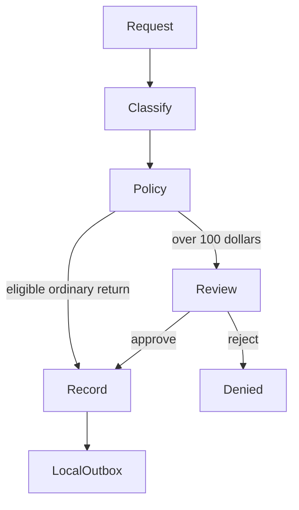

### State, nodes and edges

**State** is the named information carried through a graph run. A `TypedDict` describes dictionary fields for editors and type checkers; it does not validate arbitrary Python input at runtime. A Pydantic state model adds validation when inputs enter nodes. Neither replaces validation before a database write. A **node** receives state and returns a partial update. An **edge** schedules the next node. `START` and `END` mark entry and completion; they do not call a model. `compile()` validates and builds the runnable graph.

An ordinary state field accepts one update per graph step. Parallel writers need a **reducer**, a function combining old and new values. `operator.add` concatenates lists; it does not remove duplicates. `add_messages` merges message lists and can replace a message with the same ID. Keep IDs stable for corrections and fresh for new events. Parallel completion order is not a presentation order: sort results before showing them.

A conditional edge chooses a named destination. `Command(update=..., goto=...)` can change state and route from the same node. Do not also attach an ordinary outgoing edge unless you intend both routes to run. Type the permitted destinations with `Literal` so the diagram and reader can see them.

### Persistence, interruption and recovery

A **checkpoint** stores graph state between steps. A thread ID selects a sequence of checkpoints; it is not an identity credential. The host must authorize who can access it. `InMemorySaver` is temporary; `SqliteSaver` survives reopening its file. Never share a SQLite connection across unrelated threads without following the checkpointer's threading requirements. This lesson opens and closes it in one controlled scope.

`interrupt(payload)` pauses the node and exposes a review request. Resume with `Command(resume=decision)` using the same thread and saver. The node restarts from its beginning, so code before the interrupt executes again. Put irreversible work after review, and still make writes idempotent: repeating the same request must have the same business effect. Do not catch the interrupt as an ordinary application error or reorder interrupt calls between pause and resume.

The return graph validates request fields, classifies the declared return reason, reads eligibility, pauses for refunds strictly over 10,000 cents, and repeats eligibility checks inside the write transaction. A changed refund amount requires a new review. This classification is deterministic policy routing, not a language-model decision. Trusted runtime context supplies identity and warehouse attestations. Approval cannot override ownership, dates, quantity or inspection requirements.

After the return commits, another node writes a **notification outbox**, a local queue of messages to deliver later. It does not send an email. The two writes are separate transactions: a crash can leave a recorded return without a notice. Resuming the graph retries the notice by return ID; both operations are idempotent. The recovery test demonstrates this gap and repair rather than claiming distributed exactly-once delivery.

### History, subgraphs and streams

`get_state_history` returns snapshots, with newer checkpoints first. Invoking from a saved config replays later work; `update_state` creates a fork and returns its config. Replaying can repeat side effects. The time-travel example uses read-only quotes so experimentation is safe. A subgraph may share state keys with its parent, but an explicit adapter can instead map inputs and return only selected outputs. That mapping is how the example keeps a private note out of parent state.

`recursion_limit` limits graph steps, not model calls. A short graph can still make several model calls inside one node. Use business iteration limits as well. Streams expose complete state (`values`), node changes (`updates`), model message chunks with metadata (`messages`), or application progress (`custom`). Streaming progress is not proof that a business transaction committed.

The Functional API uses `@entrypoint` for ordinary control flow and `@task` for checkpointed results. An entrypoint restarts after interruption, while a completed task can reuse its saved result. Use `.result()` in the synchronous example and `await` in its async counterpart. Keep nondeterministic work and side effects inside tasks and retain business idempotency; checkpointing does not make arbitrary external operations atomic.

### Local debugging

`get_graph().draw_mermaid()` emits text locally without an account or remote renderer. The root `langgraph.json` registers a deliberately read-only graph. Install `uv sync --extra deployment`, then run `uv run --extra deployment langgraph dev --config langgraph.json --no-browser --host 127.0.0.1`. The server stays running until Ctrl+C. Its health endpoint is `http://127.0.0.1:2024/ok`; the API documentation is available from the server. The actual health check and graph HTTP invocation were tested locally with the server stopped afterward.

The CLI also prints a Studio connection link. Studio is a separate browser interface and may require a LangSmith account; it was not verified in this phase. The Mermaid path is the account-free alternative. On a Windows terminal that cannot encode the CLI help's emoji, set `$env:PYTHONIOENCODING="utf-8"` before starting it. The local stateless demo can emit an upstream durability warning because it has no checkpointer; the return workflow separately verifies persistence.


New terms are collected in the [glossary](../../docs/GLOSSARY.md). Use the [verification notes](../../docs/VERIFICATION_NOTES.md) for versions, actual checks and limitations.

## Key APIs at a glance

| API or concept | Runnable example | What actually happens |
|---|---|---|
| StateGraph; TypedDict and Pydantic state; nodes, edges, START, END; compile | [01_state_graph.py](examples/01_state_graph.py) | StateGraph gives each node its schema-shaped input; the returned review flag updates state. |
| add_messages and operator.add reducers; concurrent writes | [02_reducers.py](examples/02_reducers.py) | The graph merges both parallel lists through operator.add; add_messages corrects a message by ID. |
| Conditional edges; Command update and goto | [03_routing_command.py](examples/03_routing_command.py) | A conditional edge chooses review; Command records status and schedules finish. |
| Build it yourself: model node, ToolNode, conditional edge and bounded loop | [04_manual_agent_graph.py](examples/04_manual_agent_graph.py) | The model returns tool calls, ToolNode executes allowed tools, and a conditional edge loops with a three-call ceiling. |
| Checkpointers; durable execution; idempotent side effects | [05_persistence.py](examples/05_persistence.py) | SQLite stores graph checkpoints; business idempotency returns the existing record and keeps one outbox row. |
| interrupt; Command(resume=...); approval and rejection branches | [06_interrupt.py](examples/06_interrupt.py) | interrupt saves the pause; a simulated reviewer resumes the same thread with approve or reject. |
| State history; replay; fork from checkpoint | [07_time_travel.py](examples/07_time_travel.py) | Snapshot configs identify history; update_state returns a new branch without changing historical values. |
| Subgraphs; private/shared state; recursion limits | [08_subgraphs.py](examples/08_subgraphs.py) | An adapter maps parent fields into child state and copies only answer back; a deliberate loop demonstrates the step ceiling. |
| values, updates, messages, custom streams; progress events | [09_stream_modes.py](examples/09_stream_modes.py) | One invocation yields labelled values, updates, message chunks and custom progress events. |
| @entrypoint; @task; task-result replay; sync and async entry points | [10_functional_api.py](examples/10_functional_api.py) | Task results are cached in the checkpoint across an interrupt; async entrypoint awaits an async task. |
| draw_mermaid; local LangGraph CLI dev server; Studio; account-free diagram alternative | [11_studio.py](examples/11_studio.py) | draw_mermaid inspects the compiled graph locally; the optional CLI serves the same registered demo graph. |

## Walkthrough

Read each script and predict its state changes before running it. Scripted replies may stay fixed when inputs change; inspect the graph, tools and database rather than interpreting fixtures as model behavior.

### 1. State graph

**Analogy:** A labelled parcel versus a parcel inspected at intake. **Under the hood:** StateGraph gives each node its schema-shaped input; the returned review flag updates state.

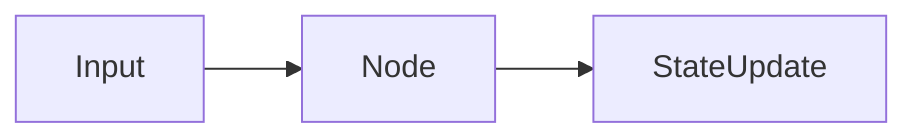

```text
uv run --extra agents python modules/14_langgraph/examples/01_state_graph.py --offline
```

**Expected:** Both graphs route a 12,195-cent refund to review. Inspect the [source](examples/01_state_graph.py) and its `KEY IDEA` comment. Live model choices and wording may differ; validation errors remain visible.

### 2. Reducers

**Analogy:** Two clerks add evidence to one case folder. **Under the hood:** The first graph demonstrates InvalidUpdateError without a reducer. The repaired graph merges both parallel lists through operator.add; add_messages corrects a message by ID.

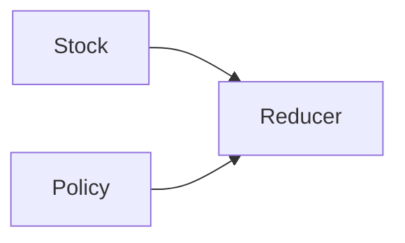

```text
uv run --extra agents python modules/14_langgraph/examples/02_reducers.py --offline
```

**Expected:** Two evidence records; one corrected message. Inspect the [source](examples/02_reducers.py) and its `KEY IDEA` comment. Live model choices and wording may differ; validation errors remain visible.

### 3. Routing command

**Analogy:** A dispatcher changes the ticket and its destination together. **Under the hood:** A conditional edge chooses review; Command records status and schedules finish.

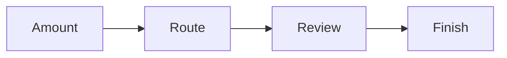

```text
uv run --extra agents python modules/14_langgraph/examples/03_routing_command.py --offline
```

**Expected:** The refund takes the review path; status is review requested. Inspect the [source](examples/03_routing_command.py) and its `KEY IDEA` comment. Live model choices and wording may differ; validation errors remain visible.

### 4. Manual agent graph

**Analogy:** A driver follows a map until the tools are no longer needed. **Under the hood:** The model returns tool calls, ToolNode executes allowed tools, and a conditional edge loops with a three-call ceiling.

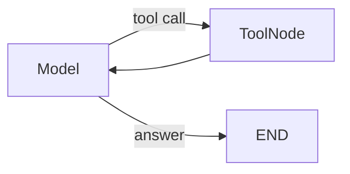

```text
uv run --extra agents python modules/14_langgraph/examples/04_manual_agent_graph.py --offline
```

**Expected:** One stock tool result and a final model answer. Inspect the [source](examples/04_manual_agent_graph.py) and its `KEY IDEA` comment. Live model choices and wording may differ; validation errors remain visible.

### 5. Persistence

**Analogy:** A saved case file and a duplicate-resistant receipt book. **Under the hood:** SQLite stores graph checkpoints; business idempotency returns the existing record and keeps one outbox row.


```text
uv run --extra agents python modules/14_langgraph/examples/05_persistence.py --offline
```

**Expected:** One return and one outbox row after repeated requests. Inspect the [source](examples/05_persistence.py) and its `KEY IDEA` comment. Live model choices and wording may differ; validation errors remain visible.

### 6. Interrupt

**Analogy:** A clerk places an unsigned form in a manager inbox. **Under the hood:** interrupt saves the pause; a simulated reviewer resumes the same thread with approve or reject.

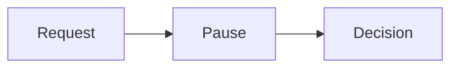

```text
uv run --extra agents python modules/14_langgraph/examples/06_interrupt.py --offline
```

**Expected:** Approve and reject take different branches; neither writes before review. Inspect the [source](examples/06_interrupt.py) and its `KEY IDEA` comment. Live model choices and wording may differ; validation errors remain visible.

### 7. Time travel

**Analogy:** Replaying a journey from an old station, then taking a new branch. **Under the hood:** Snapshot configs identify history; update_state returns a new branch without changing historical values.

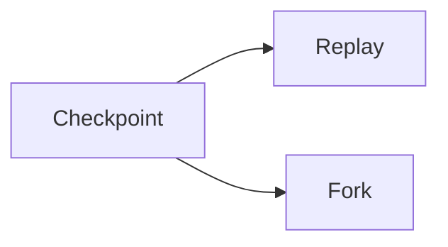

```text
uv run --extra agents python modules/14_langgraph/examples/07_time_travel.py --offline
```

**Expected:** Original standard quote stays available; fork uses expedited. Inspect the [source](examples/07_time_travel.py) and its `KEY IDEA` comment. Live model choices and wording may differ; validation errors remain visible.

### 8. Subgraphs

**Analogy:** A specialist reads a brief and returns only the approved summary. **Under the hood:** A directly embedded child shares query/answer fields while keeping its private field out of the parent. An explicit adapter then maps a differently named question field and copies only answer back. A deliberate loop demonstrates the step ceiling.

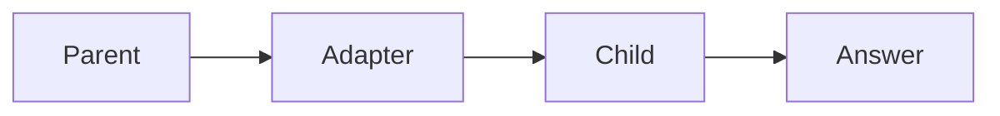

```text
uv run --extra agents python modules/14_langgraph/examples/08_subgraphs.py --offline
```

**Expected:** Private notes stay inside the child; an intentional loop hits its limit. Inspect the [source](examples/08_subgraphs.py) and its `KEY IDEA` comment. Live model choices and wording may differ; validation errors remain visible.

### 9. Stream modes

**Analogy:** A dashboard distinguishes a full snapshot, a change and a progress light. **Under the hood:** One invocation yields labelled values, updates, message chunks and custom progress events.

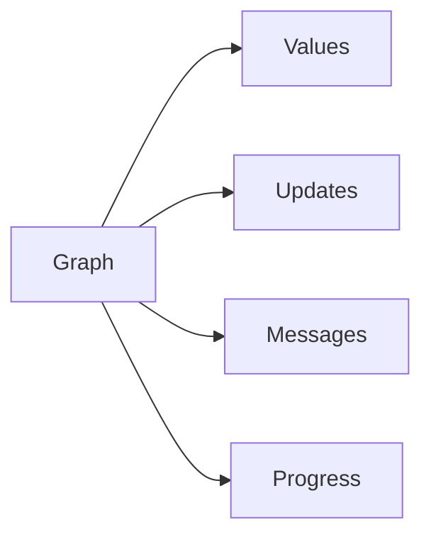

```text
uv run --extra agents python modules/14_langgraph/examples/09_stream_modes.py --offline
```

**Expected:** All four stream modes emit distinct kinds of events. Inspect the [source](examples/09_stream_modes.py) and its `KEY IDEA` comment. Live model choices and wording may differ; validation errors remain visible.

### 10. Functional api

**Analogy:** A recipe remembers which preparation steps are already done. **Under the hood:** Task results are cached in the checkpoint across an interrupt; async entrypoint awaits an async task.

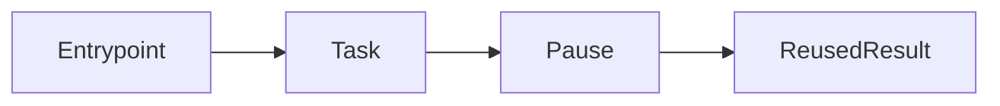

```text
uv run --extra agents python modules/14_langgraph/examples/10_functional_api.py --offline
```

**Expected:** The drafting task executes once across pause/resume; async workflow returns. Inspect the [source](examples/10_functional_api.py) and its `KEY IDEA` comment. Live model choices and wording may differ; validation errors remain visible.

### 11. Studio

**Analogy:** A printed transit map before opening a dispatch control room. **Under the hood:** draw_mermaid inspects the compiled graph locally; the optional CLI serves the same registered demo graph.

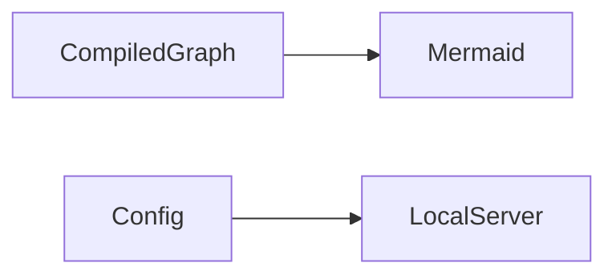

```text
uv run --extra agents python modules/14_langgraph/examples/11_studio.py --offline
```

**Expected:** Mermaid graph text; the example does not start a persistent service. Inspect the [source](examples/11_studio.py) and its `KEY IDEA` comment. Live model choices and wording may differ; validation errors remain visible.

## Real-world use case

Input: C001 requests an unused return for BW1001/BW-014, with trusted inspection flags. Output: a $121.95 review pause, then a synthetic return and a queued local notice after simulated approval. A real business can recover interrupted processing and audit which stage ran. The demonstration discards its temporary database; persistent reopening is shown separately in example 05. No payment or email service is connected.

```text
uv run --extra agents python modules/14_langgraph/use_case/return_workflow.py --offline
uv run --extra agents pytest modules/14_langgraph/tests -q
```

The [application source](use_case/return_workflow.py) uses shared helpers so its boundaries can be tested independently. Synthetic database reads preserve committed data; writes use runtime copies. No live provider run is claimed.

## Common mistakes

| Trigger or mistake | Failure you can observe | Fix |
|---|---|---|
| Parallel writes to an unreduced field | InvalidUpdateError reports that a channel received more than one value. | Use Annotated[list, operator.add] for collected results, then sort them. |
| Resuming without a thread configuration | The checkpointer raises ValueError for missing configurable keys. | Use the same authorized thread ID and checkpoint database as the paused run. |
| An endless conditional cycle | GraphRecursionError appears at the configured step limit, as example 08 demonstrates. | Add a business termination condition; raising the limit alone does not fix the loop. |
| Writing before review or trusting stale policy results | Re-execution can duplicate an effect, and eligibility can change during a pause. | Write after review, repeat policy checks in the transaction, and use a stable idempotency key. |

## Exercises

Each starter runs before you edit it, but its deliberately incomplete behavior does not pass the target checks. Complete `YOUR CODE HERE`, then compare with the full solution.

1. **Review routing:** Reject negative cents; route strictly over 10000 cents to review. [Starter](exercises/01_practice.py) · [Solution](solutions/01_practice.py).
2. **Explicit graph:** Build a StateGraph that increments attempts once and returns the compiled graph. [Starter](exercises/02_apply.py) · [Solution](solutions/02_apply.py).
3. **Safe review command:** Accept exactly approve or reject, then construct Command(resume=...). [Starter](exercises/03_stretch.py) · [Solution](solutions/03_stretch.py).

```text
uv run --extra agents python modules/14_langgraph/exercises/01_practice.py --offline
uv run --extra agents pytest modules/14_langgraph/tests/test_exercises.py --exercise-target exercises
uv run --extra agents pytest modules/14_langgraph/tests/test_exercises.py --exercise-target solutions
```

Use [notebook.ipynb](notebook.ipynb) to run the same example and application source interactively. Install `uv sync --extra agents --group authoring`, then start `uv run --extra agents --group authoring jupyter lab` from the root. Outputs are cleared in Git; execution checks use copies under `.runtime`.

## Quiz

Answer before opening the solutions. The same questions are in [quiz.md](quiz.md).

1. Does TypedDict validate untrusted amounts at runtime?

<details>
<summary>Answer</summary>

No. Validate untrusted inputs explicitly, for example with Pydantic, before using them.

</details>

2. Why does a parallel report list need a reducer?

<details>
<summary>Answer</summary>

Several workers update the same field in one step; the reducer defines how to combine those writes.

</details>

3. What executes again when an interrupted node resumes?

<details>
<summary>Answer</summary>

The node starts from its beginning. Completed task results can be replayed in the Functional API, but arbitrary effects still need idempotency.

</details>

4. Can approval override the warehouse checks?

<details>
<summary>Answer</summary>

No. The writer rechecks eligibility, ownership and quantity even after approval.

</details>

5. Is a thread ID authentication?

<details>
<summary>Answer</summary>

No. The host must authorize access to the selected thread and its persisted state.

</details>

6. Does queueing a notification mean the customer received it?

<details>
<summary>Answer</summary>

No. This outbox is local pending work; an actual delivery worker and delivery evidence are separate.

</details>

## Key takeaways

1. Return partial state updates from nodes.
2. Choose reducers for concurrent writes.
3. Keep review before side effects.
4. Combine durable checkpoints with business idempotency.
5. Use streams and diagrams to inspect the mechanism.

## Go deeper

- [Official graph api guide](https://docs.langchain.com/oss/python/langgraph/graph-api)
- [Official persistence guide](https://docs.langchain.com/oss/python/langgraph/persistence)
- [Official interrupts guide](https://docs.langchain.com/oss/python/langgraph/interrupts)
- [Official functional api guide](https://docs.langchain.com/oss/python/langgraph/functional-api)
- [Official local dev testing guide](https://docs.langchain.com/langsmith/local-dev-testing)

## Next: Workflow patterns

Continue to [Workflow patterns](../15_workflows/README.md) after you can explain and modify this module's control flow.
