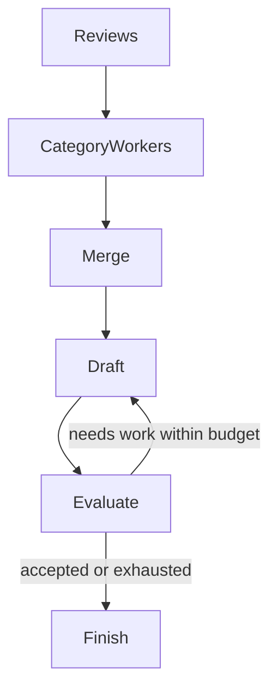
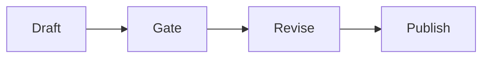
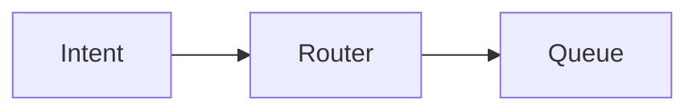
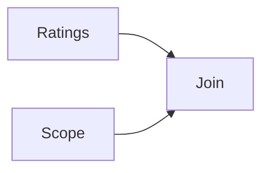
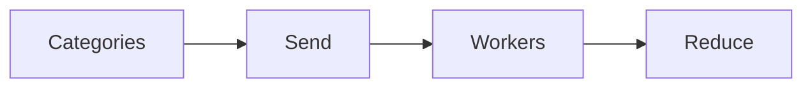
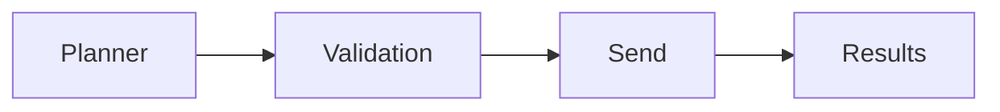
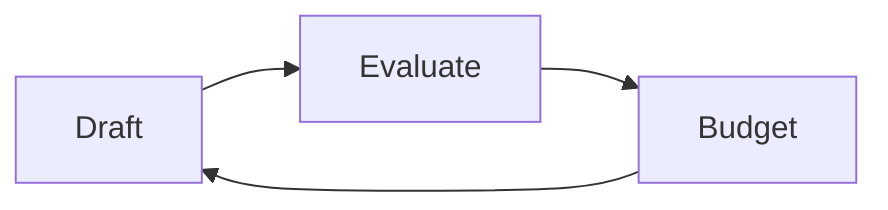
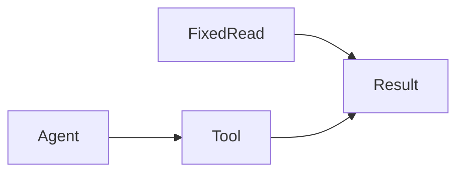

Assistant version 9: Map-reduce product reviews by category and improve the report with a bounded evaluator loop.

# Workflow patterns

**Time:** 150 minutes plus optional practice. **Level:** Advanced.

**Cost:** The full report uses at most ten short logical calls; smaller examples use zero to six. Offline fixtures are free and block networking. Live short runs should be tested one at a time against your provider's rates; the call ceiling is not a dollar guarantee. Provider retries can add requests. To run locally for free, use the Ollama profile from the [root guide](../../README.md); agent and structured-output lessons require the configured model's tool-calling support.

## Prerequisites

Complete the preceding module and understand Python functions, typed state, the [module 10 agent loop](../10_agents/README.md) and [module 11 memory](../11_memory/README.md). The earlier modules teach async Python and Pydantic before this tier uses them. Run commands from the repository root on Windows PowerShell, macOS or Linux.

```text
uv sync --extra agents
```

No extra service or account is required for the offline path.

## Learning objectives

- Prompt chaining; validation gates.
- Routing; explicit fallback branch.
- Fan-out/fan-in; reducers; deterministic merge.
- Send API; dynamic map-reduce.
- Orchestrator planning; workers; result aggregation.
- Evaluator-optimizer; quality rubric; iteration/cost ceiling.
- Fixed workflow versus autonomous agent; compare measurable outcomes.

## The big idea

A workflow is an assembly line whose stations and quality checks are chosen in code. Some stations can work in parallel, and some can send a draft back for another pass. A model may propose a plan or judge a draft, but your program still decides which plans are allowed and when to stop. This is useful when producing a weekly report: every product category needs coverage, every statistic needs a source, and a poor draft must not trigger an endless paid loop.

## How it works



### Patterns and their purpose

**Prompt chaining** passes one model result to the next step. A **gate** checks a condition between steps. The citation gate in example 01 shows a failed draft and one revision; it refuses to mark an uncited final draft as published. A string citation check is a format contract, not proof that the claim is correct.

**Routing** selects one of several paths. An explicit fallback makes unknown inputs visible instead of silently choosing a privileged default. A deterministic route can be preferable when the input label is already validated; introducing a model adds uncertainty and cost.

**Fan-out/fan-in** runs independent workers and joins their outputs. `add_edge([left, right], merge)` waits for both named producers. A list reducer accepts their parallel updates. Sorting by a stable key makes display independent of scheduling. Do not have workers append to a shared global list: use state updates so the graph can manage their results.

**Map-reduce** applies one analysis to many pieces of data and combines the results. `Send(node, input)` creates dynamic work with a small worker-specific input. This is useful when the number of categories comes from the data rather than being fixed in the graph. Each worker returns a partial update to the parent reducer. Validate nonempty, unique categories before dispatch; a duplicated task can duplicate evidence and cost.

An **orchestrator-worker** pattern adds a planning step. The model proposes categories through a Pydantic schema; code checks the allowlist, duplicates and worker ceiling. The proposal is not executable authority. The planning example allows at most three categories, while the full report permits the six categories present in the dataset.

### Evaluating and improving a report

An **evaluator-optimizer** loop alternates drafting and feedback. Here each category worker computes count and mean rating in Python and suggests an action from a small review sample. The drafting model receives these evidence records. A structured evaluator returns approved/feedback, and a separate code gate requires all exact category headings and the source filename.

The offline first draft intentionally fails; the second contains the required structure. This demonstrates retry control flow through actual graph nodes. It does not demonstrate that a real model improves after feedback. The code gate measures structure, and the model judge remains fallible about semantics. The evaluation JSON keeps the evidence, draft, attempts and feedback for inspection.

At most two draft/evaluation pairs run by default. With six category workers, that is ten logical model calls: six worker calls plus four loop calls. `max_concurrency=2` bounds simultaneous workers. A graph step limit is another backstop, not a substitute for the attempt ceiling. Provider retries can add physical requests, and large prompts cost more even with the same call count.

### Choosing a workflow or an agent

Use a workflow when the necessary operations and safety checks are known. Use an agent when tool selection must adapt to a request and the extra uncertainty is acceptable. Example 07 performs one stock read directly and through an agent, then reports observed time and model turns. The fixed read uses no model; the scripted agent uses two turns. Offline timings describe local overhead and are not a hosted latency prediction. Evaluate real answers separately before deciding an architecture is better.


New terms are collected in the [glossary](../../docs/GLOSSARY.md). Use the [verification notes](../../docs/VERIFICATION_NOTES.md) for versions, actual checks and limitations.

## Key APIs at a glance

| API or concept | Runnable example | What actually happens |
|---|---|---|
| Prompt chaining; validation gates | [01_chain_gate.py](examples/01_chain_gate.py) | The graph routes an uncited draft to one revision and rechecks before marking it published. |
| Routing; explicit fallback branch | [02_route.py](examples/02_route.py) | A Literal route selects logistics, billing or the explicit clarification branch. |
| Fan-out/fan-in; reducers; deterministic merge | [03_parallel.py](examples/03_parallel.py) | The join edge waits for both analyses; the reducer combines facts and merge sorts them. |
| Send API; dynamic map-reduce | [04_send_map_reduce.py](examples/04_send_map_reduce.py) | Send creates one category input per worker; returned facts merge into a sorted report. |
| Orchestrator planning; workers; result aggregation | [05_orchestrator_workers.py](examples/05_orchestrator_workers.py) | Structured output parses a plan, then code rejects unknown or duplicate categories before Send. |
| Evaluator-optimizer; quality rubric; iteration/cost ceiling | [06_evaluator_optimizer.py](examples/06_evaluator_optimizer.py) | A real evaluator node and code gate check the report, while the attempt counter forces termination. |
| Fixed workflow versus autonomous agent; compare measurable outcomes | [07_choose_workflow.py](examples/07_choose_workflow.py) | Both paths invoke the same read-only tool; the example counts actual agent turns and measures elapsed time. |

## Walkthrough

Read each script and predict its state changes before running it. Scripted replies may stay fixed when inputs change; inspect the graph, tools and database rather than interpreting fixtures as model behavior.

### 1. Chain gate

**Analogy:** A draft moves through an editor only if the checklist is complete. **Under the hood:** The graph routes an uncited draft to one revision and rechecks before marking it published.



```text
uv run --extra agents python modules/15_workflows/examples/01_chain_gate.py --offline
```

**Expected:** A missing citation blocks publication; a revision supplies it. Inspect the [source](examples/01_chain_gate.py) and its `KEY IDEA` comment. Live model choices and wording may differ; validation errors remain visible.

### 2. Route

**Analogy:** A mail sorter uses known destination labels and keeps an unknown bin. **Under the hood:** A Literal route selects logistics, billing or the explicit clarification branch.



```text
uv run --extra agents python modules/15_workflows/examples/02_route.py --offline
```

**Expected:** Shipping selects logistics; an unknown request selects manual review. Inspect the [source](examples/02_route.py) and its `KEY IDEA` comment. Live model choices and wording may differ; validation errors remain visible.

### 3. Parallel

**Analogy:** Two analysts complete independent parts of the same briefing. **Under the hood:** The join edge waits for both analyses; the reducer combines facts and merge sorts them.



```text
uv run --extra agents python modules/15_workflows/examples/03_parallel.py --offline
```

**Expected:** One deterministic report contains both worker outputs. Inspect the [source](examples/03_parallel.py) and its `KEY IDEA` comment. Live model choices and wording may differ; validation errors remain visible.

### 4. Send map reduce

**Analogy:** One identical worksheet is handed to each product-category team. **Under the hood:** Send creates one category input per worker; returned facts merge into a sorted report.



```text
uv run --extra agents python modules/15_workflows/examples/04_send_map_reduce.py --offline
```

**Expected:** Six category groups are reduced in sorted order. Inspect the [source](examples/04_send_map_reduce.py) and its `KEY IDEA` comment. Live model choices and wording may differ; validation errors remain visible.

### 5. Orchestrator workers

**Analogy:** A manager proposes a small work order before staff receive assignments. **Under the hood:** Structured output parses a plan, then code rejects unknown or duplicate categories before Send.



```text
uv run --extra agents python modules/15_workflows/examples/05_orchestrator_workers.py --offline
```

**Expected:** A real structured parser produces two allowed category assignments. Inspect the [source](examples/05_orchestrator_workers.py) and its `KEY IDEA` comment. Live model choices and wording may differ; validation errors remain visible.

### 6. Evaluator optimizer

**Analogy:** An editor permits a fixed number of revision rounds. **Under the hood:** A real evaluator node and code gate check the report, while the attempt counter forces termination.



```text
uv run --extra agents python modules/15_workflows/examples/06_evaluator_optimizer.py --offline
```

**Expected:** Two attempts, six logical model calls, and an accepted synthetic report. Inspect the [source](examples/06_evaluator_optimizer.py) and its `KEY IDEA` comment. Live model choices and wording may differ; validation errors remain visible.

### 7. Choose workflow

**Analogy:** Compare walking straight to a shelf with asking a clerk to find it. **Under the hood:** Both paths invoke the same read-only tool; the example counts actual agent turns and measures elapsed time.



```text
uv run --extra agents python modules/15_workflows/examples/07_choose_workflow.py --offline
```

**Expected:** Both get the same stock; the fixed read uses zero model calls. Inspect the [source](examples/07_choose_workflow.py) and its `KEY IDEA` comment. Live model choices and wording may differ; validation errors remain visible.

## Real-world use case

Input: all 300 synthetic reviews grouped into six categories. Output: category counts, mean ratings, cited report text and evaluation JSON in `.runtime/weekly-report`. The offline path takes two attempts and ten logical model calls. A business team can inspect which categories and sample reviews support suggested actions. Only an accepted draft is saved as report.md; an exhausted run remains in evaluation.json.

```text
uv run --extra agents python modules/15_workflows/use_case/weekly_report.py --offline
uv run --extra agents pytest modules/15_workflows/tests -q
```

The [application source](use_case/weekly_report.py) uses shared helpers so its boundaries can be tested independently. Synthetic database reads preserve committed data; writes use runtime copies. No live provider run is claimed.

## Common mistakes

| Trigger or mistake | Failure you can observe | Fix |
|---|---|---|
| Dispatching the same category twice | ValueError rejects duplicate category assignments. | Validate uniqueness before constructing Send objects. |
| Sharing a scalar output between parallel workers | InvalidUpdateError indicates conflicting writes. | Use an append reducer and derive the final scalar in one merge node. |
| Letting the evaluator run until it is happy | A never-approved draft can otherwise consume an unbounded budget. | Stop at max_attempts and leave accepted=false; do not publish that draft. |
| Calling fixture scores quality scores | The synthetic second draft passes the structural gate by construction. | Label it a control-flow fixture and collect independent real-provider quality evidence. |

## Exercises

Each starter runs before you edit it, but its deliberately incomplete behavior does not pass the target checks. Complete `YOUR CODE HERE`, then compare with the full solution.

1. **Deterministic merge:** Sort by category without mutating worker result lists. [Starter](exercises/01_practice.py) · [Solution](solutions/01_practice.py).
2. **Bounded evaluator loop:** Stop if accepted or attempts reaches the positive limit; reject negative attempts. [Starter](exercises/02_apply.py) · [Solution](solutions/02_apply.py).
3. **Validated worker plan:** Produce one Send per unique allowlisted category; reject empty, repeated or unknown work. [Starter](exercises/03_stretch.py) · [Solution](solutions/03_stretch.py).

```text
uv run --extra agents python modules/15_workflows/exercises/01_practice.py --offline
uv run --extra agents pytest modules/15_workflows/tests/test_exercises.py --exercise-target exercises
uv run --extra agents pytest modules/15_workflows/tests/test_exercises.py --exercise-target solutions
```

Use [notebook.ipynb](notebook.ipynb) to run the same example and application source interactively. Install `uv sync --extra agents --group authoring`, then start `uv run --extra agents --group authoring jupyter lab` from the root. Outputs are cleared in Git; execution checks use copies under `.runtime`.

## Quiz

Answer before opening the solutions. The same questions are in [quiz.md](quiz.md).

1. What distinguishes a gate from a prompt instruction?

<details>
<summary>Answer</summary>

A gate runs code that can block the next step; a prompt merely requests behavior.

</details>

2. Why sort worker results?

<details>
<summary>Answer</summary>

Concurrent completion order need not be stable; sorting makes presentation deterministic.

</details>

3. What does Send carry?

<details>
<summary>Answer</summary>

The destination node and the input for one dynamically created worker task.

</details>

4. Should a planner be allowed to name arbitrary tools or categories?

<details>
<summary>Answer</summary>

No. Validate plans against a finite allowlist and a worker budget.

</details>

5. How many calls can six workers plus two draft/evaluate rounds make?

<details>
<summary>Answer</summary>

Ten logical model calls, before any provider retries.

</details>

6. Does a passing structural gate prove factual accuracy?

<details>
<summary>Answer</summary>

No. It verifies the chosen format conditions; semantic correctness needs separate evaluation.

</details>

## Key takeaways

1. Put code gates between risky stages.
2. Project one small input per worker.
3. Merge through reducers and sort outputs.
4. Bound both worker counts and revision attempts.
5. Compare measured work before adding autonomy.

## Go deeper

- [Official workflows agents guide](https://docs.langchain.com/oss/python/langgraph/workflows-agents)
- [Official graph api guide](https://docs.langchain.com/oss/python/langgraph/graph-api)

## Next: Multi-agent systems

Continue to [Multi-agent systems](../16_multi_agent/README.md) after you can explain and modify this module's control flow.
