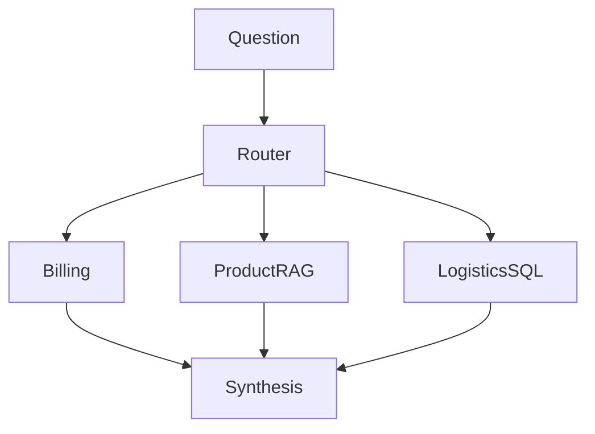
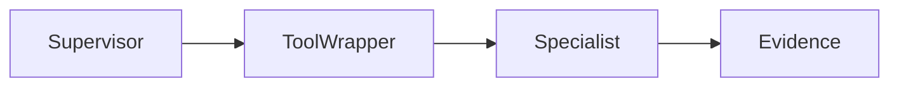
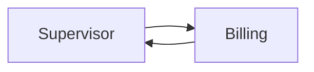
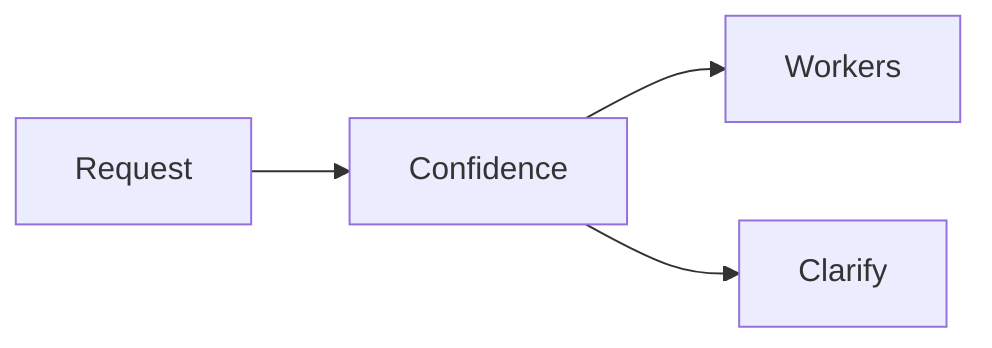
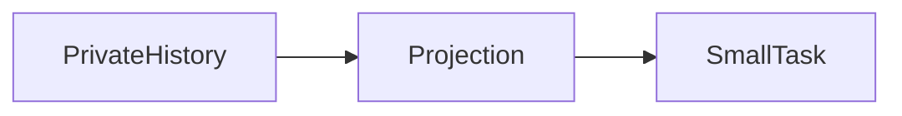
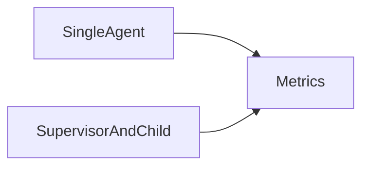

Assistant version 10: Route to billing, product RAG and logistics SQL specialists; supervise the combined answer.

# Multi-agent systems

**Time:** 180 minutes plus optional practice. **Level:** Advanced.

**Cost:** The three-specialist app permits at most twelve logical calls; small demonstrations use fewer. Offline fixtures are free and block networking. Live short runs should be tested one at a time against your provider's rates; the call ceiling is not a dollar guarantee. Provider retries can add requests. To run locally for free, use the Ollama profile from the [root guide](../../README.md); agent and structured-output lessons require the configured model's tool-calling support.

## Prerequisites

Complete the preceding module and understand Python functions, typed state, the [module 10 agent loop](../10_agents/README.md) and [module 11 memory](../11_memory/README.md). The earlier modules teach async Python and Pydantic before this tier uses them. Run commands from the repository root on Windows PowerShell, macOS or Linux.

```text
uv sync --extra agents
```

No extra service or account is required for the offline path.

## Learning objectives

- Subagents exposed as tools; supervisor; restricted tool sets.
- Command-based handoffs; explicit ownership and return routing.
- Specialist router; confidence and fallback handling.
- Shared versus private state; context engineering; minimum necessary history.
- When multiple agents help or hurt; latency, token use and quality comparison.

## The big idea

A specialist team can help when different jobs need different tools, prompts or access rules. It also adds coordination work: a supervisor must delegate, workers must receive enough context, and someone must combine the answers. Think of a customer-service desk with billing, product and shipping clerks. Giving every clerk the entire customer file is unnecessary, and letting the product clerk issue refunds is dangerous. This module makes the tool sets and context boundaries visible, then measures the added work instead of assuming more agents means better answers.

## How it works



### Three coordination patterns

In **subagents as tools**, the supervisor sees a tool such as ask_logistics. Calling it invokes a separate agent and returns a compact result. The supervisor retains control of the conversation. The child uses its own message history and restricted tools. This is still ordinary Python composition; there is no separate machine or operating-system security boundary.

In a **handoff**, ownership of the next step changes. Example 02 writes owner=billing and routes there with `Command`, then routes back to the supervisor with the result. A handoff is not the same as a nested function call: the active role is explicit graph state. Avoid an ordinary outgoing edge that unintentionally runs alongside Command's destination.

A **router** selects specialists for a request and can fan out to several workers. The RoutePlan schema permits billing, product and logistics, caps the list at three, and validates confidence. Code rejects duplicate roles. Confidence below 0.7 produces clarification; that threshold is a teaching choice, not a calibrated production accuracy guarantee. The offline router uses a visible keyword fixture so tests can verify branches without pretending to understand language.

### Tools and context are separate boundaries

Billing receives a customer-scoped order-total tool. Logistics receives a customer-scoped shipment tool. Product receives a retrieval tool over the public catalogue and an answer generator that validates exact-quote citations. None receives writes, refunds, shell access or an arbitrary database query tool. SQL binds the host-selected customer ID separately from model arguments.

**Context engineering** means choosing the information supplied to each model. A product worker receives a SKU and a specifications task, while logistics receives an order ID and a shipment task. Neither receives the full customer history. This projection happens in code. Telling a model to ignore private history would still expose that history to it.

The parent receives only a role, final draft, evidence list and whether the tool result passed basic checks. Internal child messages are not copied back. Tool output remains untrusted content: valid JSON or a valid citation cannot prove every generated sentence is true. A denial is kept in evidence even if a final model draft is misleading. Use evidence and code permissions for actions, not prose.

The host must authenticate the customer before constructing these tools. A hard-coded synthetic C001 in a lesson is a demonstration identity, not an authentication implementation. Module 14's reviewed return workflow stays separate; the read-only team cannot bypass it by requesting an unsupported write.

### Coordination cost and budgets

Each child has a three-model-call ceiling and one tool-call ceiling. The full router allows three children, one routing call and one synthesis call. Product retrieval adds up to one generation call. The upper bound is twelve logical calls before provider retries. Limit concurrent workers independently, because low latency can otherwise mean a burst of paid requests.

Example 05 measures a single logistics agent and a supervisor delegating to it. Callbacks observe nested model calls, elapsed time uses perf_counter, and input character count divided by four is labelled a rough token proxy. It is not provider usage or a bill. The fixture normally makes two calls for the single agent and four with delegation. There is no claim that the extra calls improve accuracy. Use separate labelled quality cases and real provider usage when making that decision.


New terms are collected in the [glossary](../../docs/GLOSSARY.md). Use the [verification notes](../../docs/VERIFICATION_NOTES.md) for versions, actual checks and limitations.

## Key APIs at a glance

| API or concept | Runnable example | What actually happens |
|---|---|---|
| Subagents exposed as tools; supervisor; restricted tool sets | [01_supervisor_tools.py](examples/01_supervisor_tools.py) | A supervisor tool wraps a restricted child agent; customer identity stays in the host closure. |
| Command-based handoffs; explicit ownership and return routing | [02_handoffs.py](examples/02_handoffs.py) | Command updates owner and schedules billing, whose completion routes back to the supervisor. |
| Specialist router; confidence and fallback handling | [03_router.py](examples/03_router.py) | Structured routing selects an allowlisted role set; low confidence schedules a fallback with no workers. |
| Shared versus private state; context engineering; minimum necessary history | [04_context_boundaries.py](examples/04_context_boundaries.py) | specialist_input projects a role and necessary identifier; SQL denies another customer order. |
| When multiple agents help or hurt; latency, token use and quality comparison | [05_compare_single.py](examples/05_compare_single.py) | Callbacks count nested model starts and prompt characters; both runs use the same logistics capability. |

## Walkthrough

Read each script and predict its state changes before running it. Scripted replies may stay fixed when inputs change; inspect the graph, tools and database rather than interpreting fixtures as model behavior.

### 1. Supervisor tools

**Analogy:** The front desk calls the shipping desk and keeps talking to the customer. **Under the hood:** A supervisor tool wraps a restricted child agent; customer identity stays in the host closure.



```text
uv run --extra agents python modules/16_multi_agent/examples/01_supervisor_tools.py --offline
```

**Expected:** The supervisor delegates; the child performs one scoped SQL tool call. Inspect the [source](examples/01_supervisor_tools.py) and its `KEY IDEA` comment. Live model choices and wording may differ; validation errors remain visible.

### 2. Handoffs

**Analogy:** A case folder changes its assigned owner and then comes back. **Under the hood:** Command updates owner and schedules billing, whose completion routes back to the supervisor.



```text
uv run --extra agents python modules/16_multi_agent/examples/02_handoffs.py --offline
```

**Expected:** Supervisor hands off to billing, then receives the read-only result. Inspect the [source](examples/02_handoffs.py) and its `KEY IDEA` comment. Live model choices and wording may differ; validation errors remain visible.

### 3. Router

**Analogy:** A switchboard sends uncertain calls to clarification. **Under the hood:** Structured routing selects an allowlisted role set; low confidence schedules a fallback with no workers.



```text
uv run --extra agents python modules/16_multi_agent/examples/03_router.py --offline
```

**Expected:** A shipping request selects logistics; an unclear request uses fallback. Inspect the [source](examples/03_router.py) and its `KEY IDEA` comment. Live model choices and wording may differ; validation errors remain visible.

### 4. Context boundaries

**Analogy:** Each clerk receives a task slip rather than the whole customer file. **Under the hood:** specialist_input projects a role and necessary identifier; SQL denies another customer order.



```text
uv run --extra agents python modules/16_multi_agent/examples/04_context_boundaries.py --offline
```

**Expected:** Product sees the SKU; logistics sees the order; neither sees the full history. Inspect the [source](examples/04_context_boundaries.py) and its `KEY IDEA` comment. Live model choices and wording may differ; validation errors remain visible.

### 5. Compare single

**Analogy:** Measure the extra handoff before hiring another coordinator. **Under the hood:** Callbacks count nested model starts and prompt characters; both runs use the same logistics capability.



```text
uv run --extra agents python modules/16_multi_agent/examples/05_compare_single.py --offline
```

**Expected:** Both paths expose evidence; delegation adds model work without proving better quality. Inspect the [source](examples/05_compare_single.py) and its `KEY IDEA` comment. Live model choices and wording may differ; validation errors remain visible.

## Real-world use case

Input: C001 asks about billing total, tent specifications and shipping for BW1001/BW-001. Output: three read-only specialist reports plus a synthesis draft. Product evidence carries source citations; private order reads stay customer-scoped. The business can maintain each specialist independently and audit its evidence. The application does not send messages or issue refunds.

```text
uv run --extra agents python modules/16_multi_agent/use_case/operations_team.py --offline
uv run --extra agents pytest modules/16_multi_agent/tests -q
```

The [application source](use_case/operations_team.py) uses shared helpers so its boundaries can be tested independently. Synthetic database reads preserve committed data; writes use runtime copies. No live provider run is claimed.

## Common mistakes

| Trigger or mistake | Failure you can observe | Fix |
|---|---|---|
| Allowing an arbitrary role label | Pydantic ValidationError rejects an admin role outside the schema. | Keep roles and tool sets finite in code. |
| Forgetting ownership at the child boundary | A question can contain someone else's order ID. | Bind the authenticated customer in the host and keep the scoped SQL denial in the report. |
| Passing every message to every agent | Unrelated private customer history becomes visible to the product model. | Project only the required identifier and task before invoking the child. |
| Comparing only the supervisor call count | Nested child model calls disappear from a naive count. | Use inherited callbacks or aggregate worker records; distinguish approximate tokens from actual usage. |

## Exercises

Each starter runs before you edit it, but its deliberately incomplete behavior does not pass the target checks. Complete `YOUR CODE HERE`, then compare with the full solution.

1. **Confidence gate:** Return sorted distinct roles only at confidence >=0.7 using RoutePlan validation. [Starter](exercises/01_practice.py) · [Solution](solutions/01_practice.py).
2. **Private context projection:** Return only order_id to logistics; do not include history, email or customer ID. [Starter](exercises/02_apply.py) · [Solution](solutions/02_apply.py).
3. **Scoped read:** Call the existing customer-scoped logistics tool and preserve access denials. [Starter](exercises/03_stretch.py) · [Solution](solutions/03_stretch.py).

```text
uv run --extra agents python modules/16_multi_agent/exercises/01_practice.py --offline
uv run --extra agents pytest modules/16_multi_agent/tests/test_exercises.py --exercise-target exercises
uv run --extra agents pytest modules/16_multi_agent/tests/test_exercises.py --exercise-target solutions
```

Use [notebook.ipynb](notebook.ipynb) to run the same example and application source interactively. Install `uv sync --extra agents --group authoring`, then start `uv run --extra agents --group authoring jupyter lab` from the root. Outputs are cleared in Git; execution checks use copies under `.runtime`.

## Quiz

Answer before opening the solutions. The same questions are in [quiz.md](quiz.md).

1. Who keeps control when subagents are exposed as tools?

<details>
<summary>Answer</summary>

The supervisor calls a child and resumes after the child returns.

</details>

2. How is a handoff different?

<details>
<summary>Answer</summary>

It explicitly changes the active owner and routes graph control to another role.

</details>

3. Can a model choose customer identity in these tools?

<details>
<summary>Answer</summary>

No. The host binds identity outside the model-visible schema.

</details>

4. Why does product receive a SKU instead of the whole conversation?

<details>
<summary>Answer</summary>

It needs public product context, not private order history or unrelated customer data.

</details>

5. Do multiple agents automatically improve quality?

<details>
<summary>Answer</summary>

No. They add latency, tokens and failure modes; test whether specialization helps the actual task.

</details>

6. Does dividing characters by four produce a billing token count?

<details>
<summary>Answer</summary>

No. It is a rough comparison proxy; billing requires real provider usage metadata.

</details>

## Key takeaways

1. Choose a coordination pattern for a concrete need.
2. Restrict each specialist tool set.
3. Project the minimum necessary context.
4. Preserve tool denials independently of prose.
5. Measure total work, including children.

## Go deeper

- [Official multi agent guide](https://docs.langchain.com/oss/python/langchain/multi-agent)

## Next: Deep Agents (optional)

Continue to [Deep Agents (optional)](../17_deep_agents/README.md) after you can explain and modify this module's control flow.
