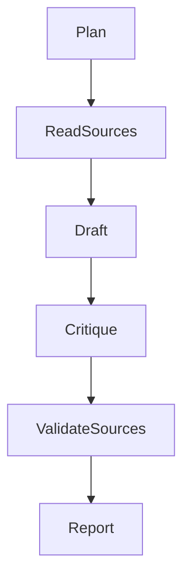
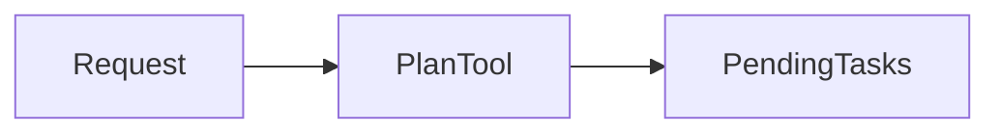
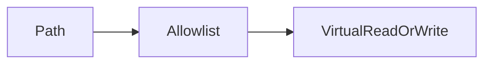
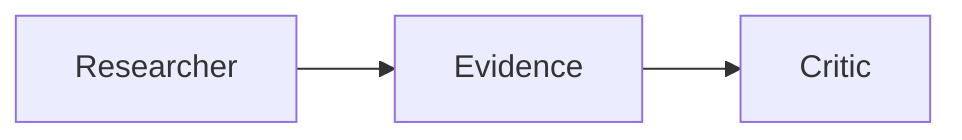
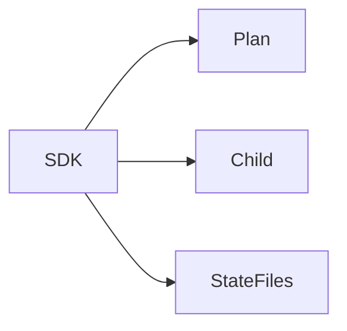
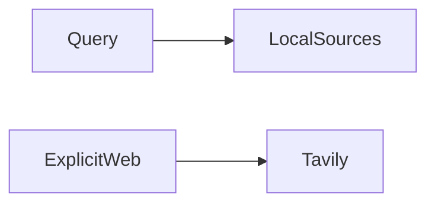

Assistant version 10: Plan, research offline documents and write a sourced outdoor-gear trends report.

# Deep Agents (optional)

**Time:** 120 minutes plus optional practice. **Level:** Advanced.

**Cost:** The manual report permits six main-agent calls plus one critique; the SDK demonstration permits five parent calls and at most three one-call children. Offline fixtures are free and block networking. Live short runs should be tested one at a time against your provider's rates; the call ceiling is not a dollar guarantee. Provider retries can add requests. To run locally for free, use the Ollama profile from the [root guide](../../README.md); agent and structured-output lessons require the configured model's tool-calling support.

## Prerequisites

Complete the preceding module and understand Python functions, typed state, the [module 10 agent loop](../10_agents/README.md) and [module 11 memory](../11_memory/README.md). The earlier modules teach async Python and Pydantic before this tier uses them. Run commands from the repository root on Windows PowerShell, macOS or Linux.

```text
uv sync --extra agents
```

Install `uv sync --extra deep` only for example 04. The main path and use case work with agents alone.

## Learning objectives

- create_agent plus TodoListMiddleware; bounded plan execution.
- Allowlisted virtual filesystem tools; path confinement; no shell.
- Specialized research and critique subagents; budgets.
- create_deep_agent; planning, virtual filesystem and subagents; optional pre-1.0 SDK path.
- Tavily opt-in web search; offline synthetic research corpus fallback; provenance.

## The big idea

Long tasks need a place to keep a plan, evidence and drafts without stuffing every detail into one conversation. A deep-agent harness combines planning, files and delegation, much like a researcher using a notebook, a document cabinet and a colleague for critique. These conveniences do not remove the need for budgets or permissions. First build the ideas with create_agent and tightly controlled virtual tools. Then compare the current optional Deep Agents SDK using state-backed files, with no access to the host filesystem or a shell.

## How it works



### Plans are state, not completed work

`TodoListMiddleware` adds a write_todos tool and a todo field to agent state. A plan records intentions and status; it does not perform research by itself. Example 01 leaves tasks pending honestly. The SDK demonstration leaves its plan in progress even after a scope note is written, showing that progress labels require their own updates. Do not use a todo status as proof that a business side effect occurred.

### Virtual files and provenance

A **virtual filesystem** provides file-like names without necessarily touching disk. The hand-built VirtualFiles object contains three allowlisted synthetic sources and one writable report path. It never translates model paths into host paths. Traversal, Windows-style paths, unknown sources and source overwrites are rejected; report text is capped at 12,000 characters. A fresh instance isolates each run.

The final host application deliberately saves an approved-format draft under the configured runtime directory. The agent itself has no tool for selecting that host destination. Paths, quotas and permissions belong in code, not just a system prompt. State-backed SDK files are also virtual, but its normal file namespace is broader than this lesson's hand-built allowlist; do not confuse the two policies.

**Provenance** records where information came from. Local search returns source paths and synthetic=true. The report cites virtual source names, and code checks that the sources exist and the draft says it is synthetic. This verifies reference integrity, not whether every sentence is supported. The critic receives the draft and cited source text, but its opinion is still fallible. Inspect quoted figures against the source documents.

### Delegation and the optional SDK

The manual research agent can read sources but cannot write; a separate critic receives only the collected evidence. Both use the same configurable model factory and have finite call ceilings. Different agent roles need not use different providers, and two prompts do not create independent factual evidence.

The optional `deepagents` **0.7.32** package is pre-1.0. Its actual create_deep_agent signature was checked against the installed code and current docs. We pass a model instance from the common factory, `StateBackend()`, explicit bounded subagent models, and planning middleware. The SDK exposes planning, the task delegation tool and virtual file tools. It also supplies additional middleware, so its graph needs a larger step limit than a simple two-node loop.

The current SDK can auto-add a general-purpose child. This lesson supplies that child explicitly with a one-call limit as well as the researcher, so an unexpected delegation cannot inherit an unbounded configuration. The parent permits at most five model calls and three tool calls; at most three one-call child delegations could fit inside that tool budget. No shell backend is supplied. StateBackend stores data in graph state; it does not prove a real host filesystem backend would be confined. The SDK example actually exercises write_todos, task and write_file with scripted envelopes, rather than only constructing the agent.

Use the manual path when a small set of tools and explicit control flow is enough, especially when a pre-1.0 dependency is undesirable. Use the SDK when its context management and file/delegation conventions reduce enough application code to justify the dependency and review effort. The main report application works without it.

### Search stays opt-in

Example 05 searches the committed research corpus by default, even when a live model profile is configured. These documents are invented classroom evidence and cannot support claims about the real outdoor market. `--web` opts into one Tavily search, requires the search extra and TAVILY_API_KEY, and is rejected together with offline mode. Search results carry their original source URLs and synthetic=false. Returned snippets are untrusted data, not instructions. No Tavily query or live model generation was performed during this phase.

To try live search deliberately: `uv run --extra agents --extra search python modules/17_deep_agents/examples/05_search_sources.py --web`. Configure COURSE_OFFLINE=false and the search key first. This is separate from the model provider settings and can consume search credits. The provider adapter was inspected and mocked in tests; availability and remote behavior remain unverified.


New terms are collected in the [glossary](../../docs/GLOSSARY.md). Use the [verification notes](../../docs/VERIFICATION_NOTES.md) for versions, actual checks and limitations.

## Key APIs at a glance

| API or concept | Runnable example | What actually happens |
|---|---|---|
| create_agent plus TodoListMiddleware; bounded plan execution | [01_plan_by_hand.py](examples/01_plan_by_hand.py) | TodoListMiddleware records pending tasks through a real tool call; call limits prevent endless planning. |
| Allowlisted virtual filesystem tools; path confinement; no shell | [02_virtual_files.py](examples/02_virtual_files.py) | VirtualFiles validates canonical paths and enforces read/write allowlists without mapping to disk. |
| Specialized research and critique subagents; budgets | [03_subagents.py](examples/03_subagents.py) | One bounded read-only agent collects a source; a second agent sees only that evidence for critique. |
| create_deep_agent; planning, virtual filesystem and subagents; optional pre-1.0 SDK path | [04_deepagents_sdk.py](examples/04_deepagents_sdk.py) | create_deep_agent combines verified middleware and StateBackend; real tool envelopes plan, delegate and write. |
| Tavily opt-in web search; offline synthetic research corpus fallback; provenance | [05_search_sources.py](examples/05_search_sources.py) | Local BM25 returns synthetic source metadata; --web constructs the bounded Tavily query only after live opt-in. |

## Walkthrough

Read each script and predict its state changes before running it. Scripted replies may stay fixed when inputs change; inspect the graph, tools and database rather than interpreting fixtures as model behavior.

### 1. Plan by hand

**Analogy:** A to-do notebook lists the research steps without pretending they happened. **Under the hood:** TodoListMiddleware records pending tasks through a real tool call; call limits prevent endless planning.



```text
uv run --extra agents python modules/17_deep_agents/examples/01_plan_by_hand.py --offline
```

**Expected:** The todo list is pending; a plan is not evidence that tasks ran. Inspect the [source](examples/01_plan_by_hand.py) and its `KEY IDEA` comment. Live model choices and wording may differ; validation errors remain visible.

### 2. Virtual files

**Analogy:** A desk drawer contains only approved documents and one draft slot. **Under the hood:** VirtualFiles validates canonical paths and enforces read/write allowlists without mapping to disk.



```text
uv run --extra agents python modules/17_deep_agents/examples/02_virtual_files.py --offline
```

**Expected:** One source read, one virtual report, and rejected path traversal. Inspect the [source](examples/02_virtual_files.py) and its `KEY IDEA` comment. Live model choices and wording may differ; validation errors remain visible.

### 3. Subagents

**Analogy:** A researcher gives a short evidence packet to an independent editor. **Under the hood:** One bounded read-only agent collects a source; a second agent sees only that evidence for critique.



```text
uv run --extra agents python modules/17_deep_agents/examples/03_subagents.py --offline
```

**Expected:** Research returns a source; critique receives only the draft evidence. Inspect the [source](examples/03_subagents.py) and its `KEY IDEA` comment. Live model choices and wording may differ; validation errors remain visible.

### 4. Deepagents sdk

**Analogy:** Compare a prepared research desk with assembling the desk yourself. **Under the hood:** create_deep_agent combines verified middleware and StateBackend; real tool envelopes plan, delegate and write.



```text
uv run --extra deep python modules/17_deep_agents/examples/04_deepagents_sdk.py --offline
```

**Expected:** Planning, delegation and a virtual file write run through the actual SDK. Inspect the [source](examples/04_deepagents_sdk.py) and its `KEY IDEA` comment. Live model choices and wording may differ; validation errors remain visible.

### 5. Search sources

**Analogy:** A library search is the default; an outside search service needs an explicit request. **Under the hood:** Local BM25 returns synthetic source metadata; --web constructs the bounded Tavily query only after live opt-in.



```text
uv run --extra agents python modules/17_deep_agents/examples/05_search_sources.py --offline
```

**Expected:** Retrieved source paths and synthetic labels; no default web call. Inspect the [source](examples/05_search_sources.py) and its `KEY IDEA` comment. Live model choices and wording may differ; validation errors remain visible.

## Real-world use case

Input: the synthetic market brief and customer interviews. Output: a source-labelled outdoor-gear report and critique under `.runtime/research-report`. The report preserves the invented-sample warning and validates every cited virtual source. This is a useful design for organizing evidence and separating research from critique; it is not a real market-research conclusion.

```text
uv run --extra agents python modules/17_deep_agents/use_case/research_report.py --offline
uv run --extra agents pytest modules/17_deep_agents/tests -q
```

The [application source](use_case/research_report.py) uses shared helpers so its boundaries can be tested independently. Synthetic database reads preserve committed data; writes use runtime copies. No live provider run is claimed.

## Common mistakes

| Trigger or mistake | Failure you can observe | Fix |
|---|---|---|
| Using a virtual path as a host filesystem path | Traversal or a Windows drive string must raise ValueError. | Keep virtual storage in memory and validate a canonical allowlist before access. |
| Marking a plan complete immediately after creation | No source has actually been read despite an optimistic label. | Track completed tool results separately; leave pending tasks pending. |
| Installing only agents then running the SDK example | ModuleNotFoundError for deepagents indicates the optional dependency is absent. | Install with uv sync --extra deep, or use examples 01–03 and the manual report application. |
| Mixing --offline and --web | ValueError explicitly refuses a web call from the offline path. | Use the local corpus for free tests, or deliberately configure a live search run and key. |

## Exercises

Each starter runs before you edit it, but its deliberately incomplete behavior does not pass the target checks. Complete `YOUR CODE HERE`, then compare with the full solution.

1. **Confined virtual path:** Validate writes against the single allowed report path; reject traversal. [Starter](exercises/01_practice.py) · [Solution](solutions/01_practice.py).
2. **Source provenance:** Require synthetic wording and validate each cited virtual source exists. [Starter](exercises/02_apply.py) · [Solution](solutions/02_apply.py).
3. **Delegation budget:** Charge parent plus every worker call against a nonnegative budget; reject invalid inputs. [Starter](exercises/03_stretch.py) · [Solution](solutions/03_stretch.py).

```text
uv run --extra agents python modules/17_deep_agents/exercises/01_practice.py --offline
uv run --extra agents pytest modules/17_deep_agents/tests/test_exercises.py --exercise-target exercises
uv run --extra agents pytest modules/17_deep_agents/tests/test_exercises.py --exercise-target solutions
```

Use [notebook.ipynb](notebook.ipynb) to run the same example and application source interactively. Install `uv sync --extra deep --group authoring`, then start `uv run --extra deep --group authoring jupyter lab` from the root. Outputs are cleared in Git; execution checks use copies under `.runtime`.

## Quiz

Answer before opening the solutions. The same questions are in [quiz.md](quiz.md).

1. Does a todo entry run the task it describes?

<details>
<summary>Answer</summary>

No. The application or agent must execute the necessary tools and record their results.

</details>

2. Can VirtualFiles read the host .env file?

<details>
<summary>Answer</summary>

No. Model paths are never mapped to the host filesystem, and unknown virtual paths are rejected.

</details>

3. What does StateBackend store?

<details>
<summary>Answer</summary>

Files in graph state. It is distinct from a backend with access to the host filesystem or a shell.

</details>

4. Why explicitly bound the general-purpose SDK child?

<details>
<summary>Answer</summary>

The SDK can add one automatically; explicit configuration makes its model and budget reviewable.

</details>

5. What does citation validation prove here?

<details>
<summary>Answer</summary>

That allowed sources exist and the draft identifies synthetic evidence. It does not prove entailment.

</details>

6. When does the search example contact Tavily?

<details>
<summary>Answer</summary>

Only with --web in a live configuration, with the search extra and key; offline mode rejects it.

</details>

## Key takeaways

1. Plans and results are different records.
2. Constrain virtual file paths and write sizes.
3. Give child agents narrow evidence and budgets.
4. Verify optional SDK behavior in the installed version.
5. Preserve provenance and label synthetic research.

## Go deeper

- [Official built in guide](https://docs.langchain.com/oss/python/langchain/middleware/built-in)
- [Official overview guide](https://docs.langchain.com/oss/python/deepagents/overview)
- [Official backends guide](https://docs.langchain.com/oss/python/deepagents/backends)
- [Tavily integration](https://docs.langchain.com/oss/python/integrations/tools/tavily_search)

## Next: Operations Desk checkpoint

Build the [Operations Desk](../../checkpoints/04_operations_desk/README.md), draw the actual graph and explain your permission and budget choices. Phase 7 adds the production interface.
