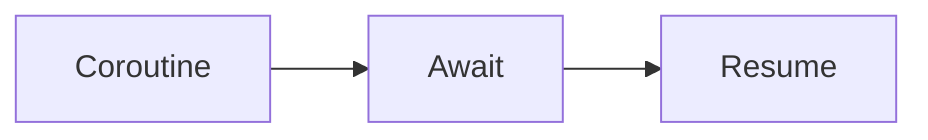
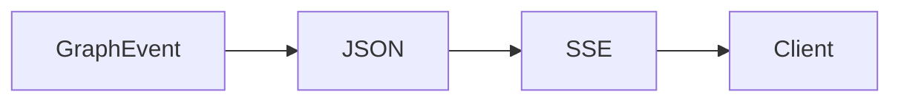
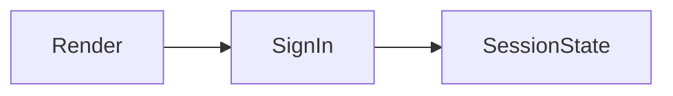
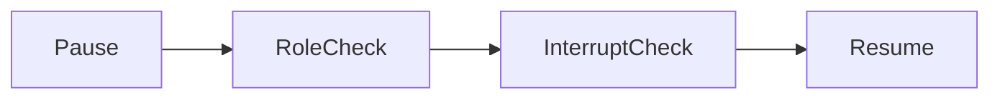
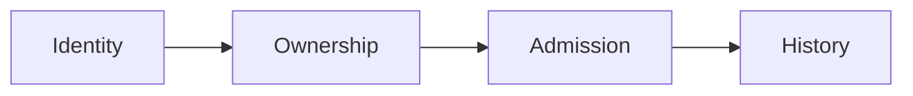

# Assistant version 10: Streaming, APIs and user interfaces

FastAPI streaming backend and Streamlit chat with per-thread memory and approval controls.

**Time:** about 180 minutes. **Cost:** `--offline` is free; examples identify their fixture behavior. Small hosted-model calls are usually cents at the configured rates; six-case live evaluation can make up to 30 logical calls (provider retries can add attempts), and prompt comparisons double that. Inspect usage, bound input/output, and stop when cost is unknown. Ollama has no API fee but consumes local resources. Cloud service and infrastructure costs are separate.

## Prerequisites

Complete modules 00–17 and the preceding production-tier lessons in order. Run `uv sync --extra apps` from the repository root with Python 3.12. For all notebooks install `uv sync --extra deep --extra deployment --group authoring`. Keep `.env` out of Git. Data and credentials in tests are synthetic. Ordinary scripts do not start external services automatically.

## Learning objectives

- Await I/O and clean up cancelled work.
- Authenticate before reading a thread.
- Distinguish progress from completion.
- Keep approval authority on the server.
- Bound concurrency, history and call reservations.

## The big idea

An application is a staffed service desk. The browser is the counter, the API is the clerk accepting requests, and the agent is a helper behind the counter. A conversation ID labels a folder; it is not proof that the visitor owns it. Streaming reports progress while work continues. Every request still needs authentication, ownership checks, bounded work and a clear final outcome.

## How it works

### Async without mystery

Calling an `async def` creates a coroutine; awaiting it runs work that can pause for I/O. `asyncio.gather` waits for independent tasks together. A semaphore bounds how many enter a section concurrently. This improves waiting time, not the speed of CPU computation. A blocking library inside `async def` still blocks the event loop: use an async library or `asyncio.to_thread` for blocking I/O. CPU-heavy work belongs in a separate process or worker service.

Cancel a task and await it so cleanup runs. The API wraps each stream in `asyncio.timeout`, closes its async generator after disconnect and releases admission in `finally`. Cancellation cannot roll back a remote side effect. Chat tools only read data; return writes use a separate reviewed, idempotent workflow.

### From graph events to browser events

`messages` streams model chunks; `updates` reports graph steps. The service drops tool-message bodies from visible output and maps updates to generic progress messages. It buffers assistant text until newline or completion before redaction, preventing synthetic emails split across tokens from leaking. This sacrifices token latency; it is not a general PII protection system.

SSE records contain an event name and JSON data, separated by a blank line. JSON escapes embedded newlines so generated text cannot manufacture another event. Before headers, bad credentials get 401, another customer's thread gets 403, and busy/rate-limited requests get 429. After headers, failures become an `error` event with a correlation ID. Only `done` confirms chat history was saved. Partial text is not evidence of a committed return.

### Identity, history and reviews

The local host maps distinct bearer tokens to a customer and manager. The client never chooses customer identity. The API creates random thread IDs, checks ownership on each operation, stores scrubbed messages in SQLite and trims old history. One process admits at most two concurrent requests, one per thread, and twelve requests per identity per minute. Each chat reserves three model calls, up to thirty per thread. Reservations survive restart and are never refunded after cancellation. This is not an account-wide billing cap; a real service needs shared quotas on accounts and thread creation.

Return payloads contain order, SKU, reason and idempotency key. Inspection and proof come from a host-only integration, never client fields or model tools. The configured app has no warehouse attestations and denies unverified returns. Finite examples explicitly seed a synthetic attestation. Refunds strictly above $100 pause. Only a manager with the current interrupt ID can resume. Ownership, inspection and the reviewed amount are checked again before writing. A rejected review writes nothing; an altered amount is denied. The policy clock is fixed to the synthetic dataset's 2026-01-15 date, not current-date business logic.

### Launch the real application

Install `uv sync --extra apps`. Copy `.env.example` to `.env` if needed. Generate two new tokens by running `uv run python -c "import secrets; print(secrets.token_urlsafe(36))"` twice. Set `API_CUSTOMER_TOKEN`, `API_MANAGER_TOKEN` and `API_CUSTOMER_ID=C001`. Keep credentials out of screenshots and logs. Set `COURSE_OFFLINE=true` for free scripted chat; keep tracing off. The app disables raw model tracing even if general tracing is enabled.

From the repository root in terminal one:

```text
uv run --extra apps uvicorn common.web:configured_app --factory --host 127.0.0.1 --port 8000 --workers 1
```

In terminal two:

```text
uv run --extra apps streamlit run modules/18_apps/use_case/app.py --server.address 127.0.0.1
```

Open the Streamlit URL, enter the customer token and send `Please check BW1001`. **New conversation** creates a new active thread; it does not delete earlier owned data. For the reviewed success path run example 04 or UI tests, which supply an explicit warehouse fixture. The configured browser app denies unattested returns. A reviewer enters their own token and pending reference, loads the review, then approves or rejects it. Stop both terminals with Ctrl+C. `/health` checks the app process, not provider readiness.

Before exposing this localhost demonstration, replace static tokens with verified identity, enforce TLS, implement retention/deletion and shared quotas/locks, and load-test. Add CSRF protection if moving to cookie authentication. Do not increase workers while admission is process-local. Browser credentials stay in the local Streamlit session. UI tests run the real render function and verify chat, reset, token changes, approval and rejection.


## Key APIs at a glance

| API | Purpose |
|---|---|
| `asyncio.gather / Semaphore / to_thread` | Coordinate waiting work and move blocking I/O. |
| `agent.astream` | Receive message chunks and node updates. |
| `StreamingResponse` | Send an async response with cleanup. |
| `st.chat_input / st.chat_message / st.write_stream` | Capture and display turns. |
| `SqliteSaver / Command` | Persist and resume authorized reviews. |

## Walkthrough

Read each script, predict the output, then change one input. The [cleared notebook](notebook.ipynb) mirrors every example and use-case source. Scripted model replies are transport fixtures, not quality evidence.

### 1. Coroutines, concurrency, cancellation and blocking work; token and step streaming

**Analogy:** A clerk handles another customer while a printer runs.



**Under the hood:** Await yields control, gather schedules replies and a semaphore bounds active calls. Cancelled work is awaited.

```text
uv run --extra apps python modules/18_apps/examples/01_async_basics.py --offline
```

Expected: Three replies, cancellation acknowledgement and streamed model chunks. Read [the source](examples/01_async_basics.py) and [the official guide](https://docs.langchain.com/oss/python/langchain/streaming).

### 2. FastAPI StreamingResponse; server-sent-event framing; disconnects and errors

**Analogy:** A status board posts one labelled update at a time.



**Under the hood:** StreamingResponse wraps graph events in SSE; the real test client consumes framed HTTP output.

```text
uv run --extra apps python modules/18_apps/examples/02_sse.py --offline
```

Expected: Progress, assistant text and done events. Read [the source](examples/02_sse.py) and [the official guide](https://fastapi.tiangolo.com/advanced/custom-response/).

### 3. Streamlit chat; per-conversation thread state; new conversation reset

**Analogy:** A counter opens with a sign-in form.



**Under the hood:** AppTest executes the actual Streamlit entry point and its credential prompt. Session state holds active thread and history.

```text
uv run --extra apps python modules/18_apps/examples/03_streamlit_chat.py --offline
```

Expected: Credential prompt; no live server is needed. Read [the source](examples/03_streamlit_chat.py) and [the official guide](https://docs.streamlit.io/develop/api-reference/chat).

### 4. Approve/reject buttons; interrupted state; server-side authorization and safe resume

**Analogy:** A manager signs the current form revision.



**Under the hood:** HTTP role and interrupt-ID checks precede Command resume, then the graph rechecks policy before writing.

```text
uv run --extra apps python modules/18_apps/examples/04_approval_ui.py --offline
```

Expected: Approve and reject outcomes; unauthorized and duplicate reviews denied. Read [the source](examples/04_approval_ui.py) and [the official guide](https://docs.langchain.com/oss/python/langgraph/interrupts).

### 5. Session identity, thread ownership and bounded concurrent requests

**Analogy:** A filing cabinet admits one clerk per folder.



**Under the hood:** SQLite supplies the owner; a lock guards active threads and releases them on exit.

```text
uv run --extra apps python modules/18_apps/examples/05_session_isolation.py --offline
```

Expected: Cross-customer and overlapping requests denied. Read [the source](examples/05_session_isolation.py) and [the official guide](https://docs.langchain.com/oss/python/langchain/short-term-memory).

## Real-world use case

Input: C001 asks about BW1001 and requests an unused BW-014 return. Output: chat events, a $121.95 review pause, then one synthetic return and a locally queued notice after approval. The finite use case uses a temporary database and explicit warehouse fixture. It demonstrates enforceable customer boundaries and high-value review; no payment or email is sent.

```text
uv run --extra apps python modules/18_apps/use_case/support_web.py --offline
```

## Common mistakes

| Mistake | Symptom | Fix |
|---|---|---|
| Blocking inside async def | Other requests stop progressing. | Use awaited I/O or to_thread. |
| Using a guessed thread as login | Another customer receives HTTP 403. | Use authenticated ownership on each request. |
| Submitting a stale approval | Review POST returns 409. | Reload the pending review and current interrupt ID. |
| Missing or duplicate startup tokens | Startup raises ValueError. | Configure two distinct random tokens, at least 32 characters, and one worker. |

## Exercises

Starters run but intentionally omit a contract. Replace `YOUR CODE HERE`; their target checks should fail until completed. Reference solutions pass.

1. [01_practice.py](exercises/01_practice.py): Frame one safe SSE event; reject unknown event names. Delegate to the checked framing helper. [Solution](solutions/01_practice.py).
2. [02_apply.py](exercises/02_apply.py): Ask the host for customer-scoped history; a guessed thread must not bypass ownership. [Solution](solutions/02_apply.py).
3. [03_stretch.py](exercises/03_stretch.py): Route review through the server boundary; preserve role and current interrupt validation. [Solution](solutions/03_stretch.py).

```text
uv run --extra apps pytest modules/18_apps/tests/test_exercises.py --exercise-target exercises
uv run --extra apps pytest modules/18_apps/tests
```

## Quiz

Try [the six questions](quiz.md) before revealing their answers.

1. Does async def make blocking code concurrent?

<details>
<summary>Answer</summary>

No. It needs an actual await point or worker offloading.

</details>

2. Can the chat payload choose customer_id?

<details>
<summary>Answer</summary>

No. Extra fields are rejected; identity comes from the host.

</details>

3. Does a step event mean the request is complete?

<details>
<summary>Answer</summary>

No. Only done confirms completed chat history was saved.

</details>

4. Why buffer tokens before redacting?

<details>
<summary>Answer</summary>

Sensitive patterns can span chunks; full-line buffering protects the narrow patterns at some latency cost.

</details>

5. Can approval override absent inspection?

<details>
<summary>Answer</summary>

No. Trusted facts are rechecked before the write.

</details>

6. Does reset delete earlier conversations?

<details>
<summary>Answer</summary>

No. It changes the active thread; deletion is a separate policy.

</details>

## Key takeaways

- Await I/O and clean up cancelled work.
- Authenticate before reading a thread.
- Distinguish progress from completion.
- Keep approval authority on the server.
- Bound concurrency, history and call reservations.

## Go deeper

- [Coroutines, concurrency, cancellation and blocking work](https://docs.langchain.com/oss/python/langchain/streaming)
- [FastAPI StreamingResponse](https://fastapi.tiangolo.com/advanced/custom-response/)
- [Streamlit chat](https://docs.streamlit.io/develop/api-reference/chat)
- [Approve/reject buttons](https://docs.langchain.com/oss/python/langgraph/interrupts)
- [Session identity, thread ownership and bounded concurrent requests](https://docs.langchain.com/oss/python/langchain/short-term-memory)

## Next:

Continue to [the next lesson or checkpoint](../19_evaluation/README.md). You are ready when your exercise targets pass and you can explain the limitations as well as the successes.
