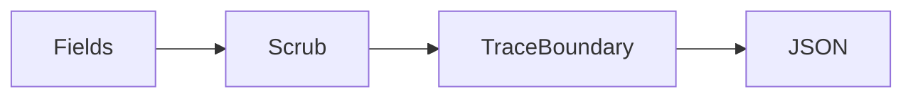
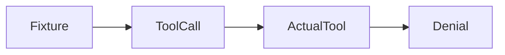
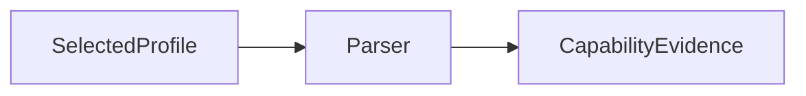
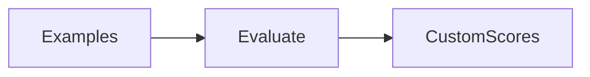
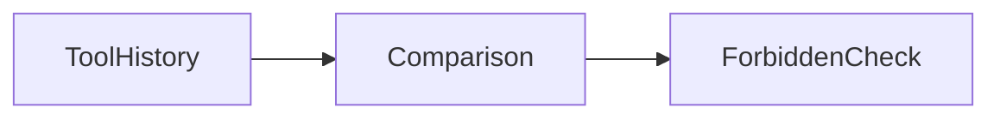
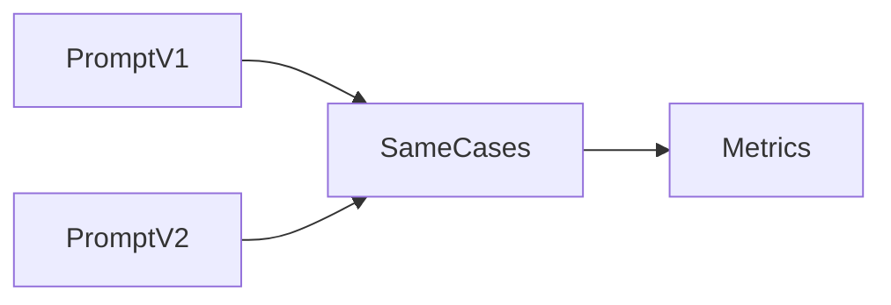
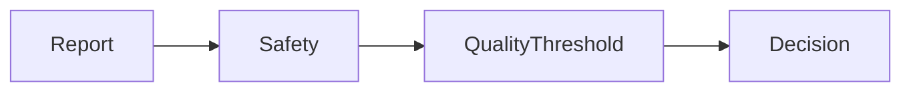

# Assistant version 10: Observability, testing and evaluation

Gate regressions in tool trajectories, grounding and tone with a local evaluation suite.

**Time:** about 180 minutes. **Cost:** `--offline` is free; examples identify their fixture behavior. Small hosted-model calls are usually cents at the configured rates; six-case live evaluation can make up to 30 logical calls (provider retries can add attempts), and prompt comparisons double that. Inspect usage, bound input/output, and stop when cost is unknown. Ollama has no API fee but consumes local resources. Cloud service and infrastructure costs are separate.

## Prerequisites

Complete modules 00–17 and the preceding production-tier lessons in order. Run `uv sync --extra agents` from the repository root with Python 3.12. For all notebooks install `uv sync --extra deep --extra deployment --group authoring`. Keep `.env` out of Git. Data and credentials in tests are synthetic. Ordinary scripts do not start external services automatically.

## Learning objectives

- Separate code tests from quality evidence.
- Keep answer labels outside the target.
- Report metrics with their limitations.
- Redact before tracing.
- Let failed contracts stop release.

## The big idea

A unit test is like checking that a thermometer turns on; an evaluation asks whether its readings are useful. A trace records the path through the instrument. Scripted models make program contracts repeatable, while live evaluations expose behavior the script cannot predict. Keep inputs, expected outcomes and scoring code separate so the application cannot read the answer key.

## How it works

### Three different forms of evidence

Unit tests verify code contracts, such as customer-scoped SQL denying another customer's order. Integration tests connect components, such as streaming a fake tool call through a real agent and HTTP response. Evaluations measure output behavior on selected data. Passing the first two does not establish the third.

`GenericFakeChatModel` emits predetermined replies. Our small subclass binds modern tool schemas and preserves `AIMessage.tool_calls` in streamed chunks; it does not make decisions. Fake embeddings likewise test interfaces, not semantic similarity. Live tests need a real provider and are skipped unless explicitly enabled.

The six support cases in `use_case/eval.jsonl` are developer-visible held-out inputs excluded from prompts and retrieval indexes. The target receives only question and authenticated customer. Expected tools and answer keywords reach evaluators after execution. A test changes an expected label and proves the answer stays unchanged. This is separation of concerns, not evidence of blind generalization.

### Read the actual report

The corrected offline path passes **6 of 6 complete cases**. All six satisfy exact tool-trajectory and ownership contracts. The earlier 4/6 baseline selected fees instead of durations. Grammatical matching and a duration requirement now select the relevant literal evidence; a test changes the policy numbers to verify they are not hard-coded. Inspect [the saved report](use_case/evaluation_report.json).

The default `evaluation_gate` requires all correctness contracts plus ownership, trajectory, tone and applicable exact-evidence-support checks, so the corrected offline report returns **true**. The checkpoint's explicit `--release` command succeeds. Tests remove required facts and force a gate rejection to prove failures still stop release. Do not lower thresholds after inspecting failures to manufacture success. Improve the method, add new held-out cases and obtain live and human evidence.

### Metrics and optional judges

Trajectory matching compares ordered names and arguments. A forbidden action fails even when the final answer is polite. Keyword correctness checks expected facts such as numbers or ownership denial rather than exact prose, but can be fooled by a misleading sentence containing those words. Exact support checks a literal substring in a validated citation; it does not prove relevance. The tone proxy checks for a polite cue and a small prohibited-phrase list. These are limited proxies, not complete correctness, faithfulness or tone measurements.

The optional `judge_answer` asks the selected model for a structured rubric verdict. Offline it deliberately states that no semantic assessment occurred; no positive quality score is invented. Live judges incur calls, disagree and need calibration against human-labelled cases. Untrusted evaluation text can also attempt injection. A judge must never replace deterministic access checks or authorize a refund.

### LangSmith locally and in the cloud

`langsmith.evaluate` accepts in-memory `Example` records. `run_experiment(..., cloud=False)` uses `upload_results=False`, disables evaluator tracing, and executes the actual runner under network denial in tests. The installed SDK marks this option beta. Its upstream AST deprecation warnings are recorded rather than suppressed.

Optional cloud usage requires a LangSmith key, live settings and the explicit call `run_experiment(load_cases(), settings, cloud=True)`. This creates a uniquely named dataset, uploads synthetic inputs/references and uploads experiment results. Model and service costs may apply. Reference labels belong in the dataset but still do not enter the target's inputs. This phase did not create a cloud dataset or run cloud evaluation.

`sanitized_trace` scrubs inputs before the decorated trace function sees them. Tags identify course/redaction and metadata identifies schema version. The API separately disables raw model spans, preventing nested callbacks from exporting unfiltered prompts. A local JSON envelope preserves safe fields and a correlation ID without an account. The narrow filter recognizes configured secrets, synthetic email and card-like patterns; it is not a general DLP or compliance guarantee.

### Live tests and prompt versions

Run `uv run --extra agents pytest modules/19_evaluation/tests/test_live.py --live` only after configuring a provider and checking budget. Repeat with OpenAI, Anthropic, Google or Ollama by changing the selected environment profile. Example 03's capability matrix reports only the invoked profile; other rows say not tested. Root tests verify adapter construction without claiming remote capability.

Versioned `prompts/support_v1.txt` and `support_v2.txt` have hashes in each report. Offline scores are identical because the scripted model does not interpret prompt prose. To compare live versions, hold datasets, models, tools and evaluators constant; inspect failures and collect repeated runs rather than assuming a longer prompt improves quality. The local harness reports unknown/not-applicable evidence metrics as null, not as fabricated positive scores.


## Key APIs at a glance

| API | Purpose |
|---|---|
| `GenericFakeChatModel / AIMessage.tool_calls` | Repeat transport and dispatch contracts. |
| `traceable / tracing_context` | Scope tracing and disable raw spans. |
| `Client.create_dataset / create_examples` | Explicit synthetic cloud upload. |
| `evaluate / Example` | Real local or hosted experiment runner. |
| `with_structured_output` | Parse a judge rubric requiring human calibration. |

## Walkthrough

Read each script, predict the output, then change one input. The [cleared notebook](notebook.ipynb) mirrors every example and use-case source. Scripted model replies are transport fixtures, not quality evidence.

### 1. LangSmith tracing; tags, metadata; redact before tracing; account-free JSON logs

**Analogy:** Seal private details before archiving a report.



**Under the hood:** Sanitization precedes traceable; the local JSON path works with tracing disabled.

```text
uv run --extra agents python modules/19_evaluation/examples/01_trace.py --offline
```

Expected: Redacted email and secret fields. Read [the source](examples/01_trace.py) and [the official guide](https://docs.langchain.com/langsmith/observability-quickstart).

### 2. GenericFakeChatModel; scripted tool-call messages; fake embeddings; tool tests

**Analogy:** A crash-test dummy checks a car, not human driving judgment.



**Under the hood:** The model fixture proposes a tool call; real customer-scoped SQL denies it.

```text
uv run --extra agents python modules/19_evaluation/examples/02_fake_models.py --offline
```

Expected: A real ownership denial and explicitly fake vectors. Read [the source](examples/02_fake_models.py) and [the official guide](https://docs.langchain.com/oss/python/langchain/test).

### 3. pytest live marker; opt-in integration tests; provider/model capability matrix

**Analogy:** An inspection sheet marks unchecked equipment as unchecked.



**Under the hood:** Only the selected profile invokes structured output; the matrix preserves untested rows.

```text
uv run --extra agents python modules/19_evaluation/examples/03_live_tests.py --offline
```

Expected: A parsed company and honest provider matrix. Read [the source](examples/03_live_tests.py) and [the official guide](https://docs.langchain.com/oss/python/langchain/test).

### 4. LangSmith datasets and evaluate; custom evaluators; optional LLM judge

**Analogy:** A grading desk runs the same rubric locally or in a hosted dashboard.



**Under the hood:** Example records feed evaluate with a custom scorer; explicit cloud opt-in creates datasets.

```text
uv run --extra agents python modules/19_evaluation/examples/04_datasets_evaluate.py --offline
```

Expected: Two local evaluator rows and a judge fixture with no quality claim. Read [the source](examples/04_datasets_evaluate.py) and [the official guide](https://docs.langchain.com/langsmith/evaluate-llm-application).

### 5. Tool-call sequence, arguments, ownership and forbidden-action assertions

**Analogy:** An auditor reads every action on a receipt.



**Under the hood:** Exact names and arguments are compared, including forbidden side effects.

```text
uv run --extra agents python modules/19_evaluation/examples/05_trajectory.py --offline
```

Expected: Expected read trajectory passes; forbidden action fails. Read [the source](examples/05_trajectory.py) and [the official guide](https://docs.langchain.com/oss/python/langchain/test).

### 6. Versioned prompts; held-out inputs; semantic expectations rather than exact prose

**Analogy:** Two editions of a manual face the same tasks.



**Under the hood:** Prompt hashes differ; the same independent cases and metrics run for both.

```text
uv run --extra agents python modules/19_evaluation/examples/06_prompt_regression.py --offline
```

Expected: Both offline prompt versions score 6/6; no prompt-improvement claim. Read [the source](examples/06_prompt_regression.py) and [the official guide](https://docs.langchain.com/oss/python/langchain/test).

### 7. Local JSON evaluation; faithfulness, tone, correctness; CI thresholds and reports

**Analogy:** A failed inspection lights a stop signal.



**Under the hood:** The report retains failed cases and the strict release gate refuses them.

```text
uv run --extra agents python modules/19_evaluation/examples/07_local_harness.py --offline
```

Expected: 6/6 cases, release_allowed true. Read [the source](examples/07_local_harness.py) and [the official guide](https://docs.langchain.com/langsmith/evaluate-llm-application).

## Real-world use case

Input: six support questions and customers, with separately stored tool and answer expectations. Output: answers, real tool evidence, prompt hashes, per-case proxy metrics and an explicit release decision. The business value is a reproducible regression report that exposes failures before deployment. Its scripted 6/6 score is not a real-model benchmark.

```text
uv run --extra agents python modules/19_evaluation/use_case/support_eval.py --offline
```

## Common mistakes

| Mistake | Symptom | Fix |
|---|---|---|
| Calling fake outputs a model benchmark | Different prompts get identical scores. | Label fixtures and add live/human evaluation. |
| Using an empty dataset | local_evaluate raises ValueError. | Require cases including denials and boundary conditions. |
| Confusing quote support with correctness | The earlier returns/shipping failures copied evidence but missed facts. | Report dimensions separately; reject any missing fact. |
| Cloud upload while offline or without a key | run_experiment raises ValueError. | Use local mode or intentionally configure cloud credentials and synthetic data. |

## Exercises

Starters run but intentionally omit a contract. Replace `YOUR CODE HERE`; their target checks should fail until completed. Reference solutions pass.

1. [01_practice.py](exercises/01_practice.py): Compare tool names AND arguments; forbid unapproved side effects even if labels contain them. [Solution](solutions/01_practice.py).
2. [02_apply.py](exercises/02_apply.py): Sanitize nested inputs before the trace boundary without modifying the original object. [Solution](solutions/02_apply.py).
3. [03_stretch.py](exercises/03_stretch.py): Require nonempty data, exact safe trajectories and every correctness contract; never average away access failure. [Solution](solutions/03_stretch.py).

```text
uv run --extra agents pytest modules/19_evaluation/tests/test_exercises.py --exercise-target exercises
uv run --extra agents pytest modules/19_evaluation/tests
```

## Quiz

Try [the six questions](quiz.md) before revealing their answers.

1. Does fake embedding success prove semantic retrieval?

<details>
<summary>Answer</summary>

No. It verifies an interface with deterministic vectors.

</details>

2. Where do expected answers belong?

<details>
<summary>Answer</summary>

In evaluators, never target prompts or retrieval indexes.

</details>

3. Can a supported quote still answer the wrong question?

<details>
<summary>Answer</summary>

Yes; two baseline cases demonstrate this.

</details>

4. What does upload_results=False verify here?

<details>
<summary>Answer</summary>

The real local runner works without network; hosted LangSmith remains untested.

</details>

5. Why record prompt hashes?

<details>
<summary>Answer</summary>

They identify the precise version for reproducible regressions.

</details>

6. May average quality compensate for an ownership failure?

<details>
<summary>Answer</summary>

No. Access and forbidden-action contracts are independent mandatory gates.

</details>

## Key takeaways

- Separate code tests from quality evidence.
- Keep answer labels outside the target.
- Report metrics with their limitations.
- Redact before tracing.
- Let failed contracts stop release.

## Go deeper

- [LangSmith tracing](https://docs.langchain.com/langsmith/observability-quickstart)
- [GenericFakeChatModel](https://docs.langchain.com/oss/python/langchain/test)
- [pytest live marker](https://docs.langchain.com/oss/python/langchain/test)
- [LangSmith datasets and evaluate](https://docs.langchain.com/langsmith/evaluate-llm-application)
- [Tool-call sequence, arguments, ownership and forbidden-action assertions](https://docs.langchain.com/oss/python/langchain/test)
- [Versioned prompts](https://docs.langchain.com/oss/python/langchain/test)
- [Local JSON evaluation](https://docs.langchain.com/langsmith/evaluate-llm-application)

## Next:

Continue to [the next lesson or checkpoint](../20_production/README.md). You are ready when your exercise targets pass and you can explain the limitations as well as the successes.
