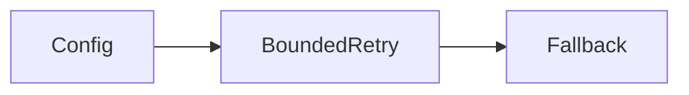
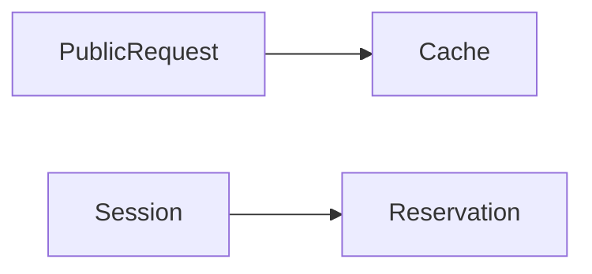
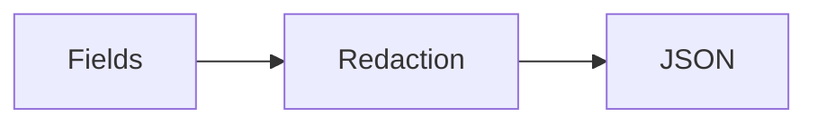
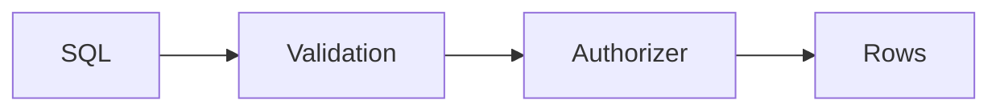
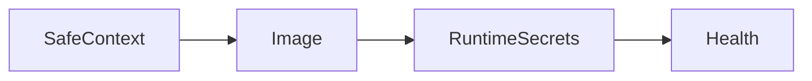
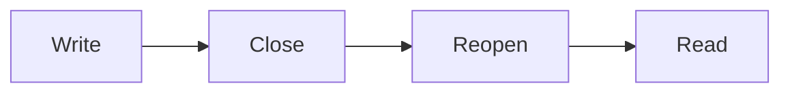

# Assistant version 11: Production readiness and deployment

Package the guarded assistant with logs, budgets, security checks and deployment documentation.

**Time:** about 180 minutes. **Cost:** `--offline` is free; examples identify their fixture behavior. Small hosted-model calls are usually cents at the configured rates; six-case live evaluation can make up to 30 logical calls (provider retries can add attempts), and prompt comparisons double that. Inspect usage, bound input/output, and stop when cost is unknown. Ollama has no API fee but consumes local resources. Cloud service and infrastructure costs are separate.

## Prerequisites

Complete modules 00–17 and the preceding production-tier lessons in order. Run `uv sync --extra apps` from the repository root with Python 3.12. For all notebooks install `uv sync --extra deep --extra deployment --group authoring`. Keep `.env` out of Git. Data and credentials in tests are synthetic. Ordinary scripts do not start external services automatically.

## Learning objectives

- Bound retries and reserve work.
- Keep private data out of shared caches.
- Treat retrieved text as untrusted.
- Verify persistence after reopening connections.
- Require quality evidence as well as healthy infrastructure.

## The big idea

Production readiness is a set of working brakes, not a polished answer. Think of a delivery van: the model is the engine, but a driver still needs keys, speed limits, maintenance records and a parking brake. The application must control access, storage, resource use and side effects even when the model proposes something unsafe or the network fails.

## How it works

### Bounded work and configuration

`Settings` loads environment configuration and wraps secrets in `SecretStr`. Startup rejects missing, short or duplicate API tokens and invalid customer identifiers. Central model factories configure provider, timeout and output limits. Example 01 retries only a synthetic timeout twice, then uses a bounded fallback. Authorization and validation failures should not retry. Do not combine unlimited application retries with hidden SDK retries: the API sets SDK retries to zero and bounds model and tool calls separately. `InMemoryRateLimiter` is per-instance, not a shared quota service.

The API reserves three calls per chat request and thirty per thread, limits input to 4,000 characters and trims history. Reservations are persistent and never refunded after cancellation. These are workload limits, not strict dollar caps or account-wide quotas. `UsageBudget` estimates token cost only for the exact configured price profile, records missing usage as unknown and can stop the next call. It cannot undo an already completed charge or guarantee a pre-charge maximum. Production billing controls should reserve a conservative maximum before calling, reconcile actual usage and limit authenticated accounts across threads.

### Cache privacy and logs

`set_llm_cache(InMemoryCache(...))` teaches public-response caching, restoring the prior cache afterward. Never share private support completions in an unscoped global cache. Private caches need verified tenant keys, model/prompt versioning, expiry and deletion policy. The API does not enable this demonstration cache.

JSON events preserve a correlation ID and scrub fields before serialization. Stream errors expose a generic message and ID, logging only exception type in a bounded local event list. The teaching sink is not durable monitoring. Production needs access-controlled storage, retention, alerting and an explicit sensitive-data policy. Keep credentials out of logs and exception strings; regex-based synthetic redaction is not general DLP.

### Assume text can be hostile

Direct injection comes from user input; indirect injection arrives through documents or tools. Delimiters and system instructions communicate boundaries, but actual authority remains in code. Example 04 deliberately scripts a compromised model proposing an export tool from both direct text and `poisoned_doc.md`. A real ToolNode inside a compiled graph denies the unregistered tool. This verifies restrictions, not model resistance. The poisoned document is excluded from normal policy retrieval.

SELECT is not a complete SQL safety rule. `public_query` combines single-statement validation, parameters, a read-only connection, an SQLite authorizer allowing named public product columns only, a VM-instruction ceiling and a twenty-row cap. Private-table reads and function calls are denied. The app uses fixed customer-scoped order queries and never exposes arbitrary SQL to its chat model. Validate output shape and preserve access denials.

### Build and run the container

The Dockerfile installs locked app extras into Python 3.12, copies code and synthetic data, and runs UID 10001 with one worker. Root `.dockerignore` and the adjacent `Dockerfile.dockerignore` allowlist the build context, excluding `.env`, `.runtime`, `.git` and local environments. Build from the repository root:

```text
docker build -f modules/20_production/use_case/Dockerfile -t brightwave-course:local .
docker run --rm --name brightwave-local --read-only --tmpfs /tmp:rw,nosuid,size=256m --tmpfs /runtime:rw,mode=1777,size=64m --env-file .env -p 127.0.0.1:8000:8000 brightwave-course:local
```

Use a running Docker-compatible engine and a dedicated course `.env` with distinct runtime API tokens. For free scripted chat, set `COURSE_OFFLINE=true`. Environment variables are visible to engine administrators; never bake secrets into images. Check `http://127.0.0.1:8000/health`, then launch module 18's Streamlit UI. Stop with Ctrl+C or `docker stop brightwave-local`. Tmpfs is disposable: sessions and local return records disappear at stop. For persistence, provision a narrowly permissioned volume owned by UID 10001 and test backup/restore. Never mount committed data writable.

The actual local build and runtime were tested on Podman 6.0.2 through its Docker-compatible context. This machine's bridge setup failed with netavark/nftables errors, so verification used an explicit context, the direct builder and host networking confined to VM loopback. The normal bridge command above remains unverified on this machine. Tests verified non-root identity, read-only source, runtime writes, authentication and SSE. Temporary services were stopped. See [recorded evidence](../../docs/phase7-verification.json); no image was pushed. [uv's official Docker guide](https://docs.astral.sh/uv/guides/integration/docker/) explains image integration.

### Agent Server and hosting choices

Root `langgraph.json` registers `common.graphs:studio_graph`, a read-only demonstration. Run `uv run --extra deployment langgraph dev --config langgraph.json --no-browser --host 127.0.0.1`. Agent Server is the serving runtime; LangSmith Deployment offers managed and self-hosted choices. The local CLI HTTP path passed in Phase 6. Studio browser usage and hosted deployment were not verified. The FastAPI image is an account-free serving lesson, not an implementation of all managed Agent Server features. Check [current official deployment requirements](https://docs.langchain.com/langsmith/deployment) before choosing a hosting plan. Agent Server manages graph persistence; do not manually attach a saver/store to its managed graphs.

### PostgreSQL and connection lifetime

`PostgresSaver` stores per-thread checkpoints; `PostgresStore` stores cross-thread namespaced data. Install deployment extras, point `POSTGRES_URI` at a disposable database, set `COURSE_OFFLINE=false`, then run example 08 without `--offline`. It creates SDK tables with `setup()`, which should be a controlled migration in production. It closes and reopens the saver and store before reading, demonstrating persistence beyond a Python object. It uses a random synthetic namespace, deletes its store value and retains the checkpoint for inspection. Destroy the disposable database to remove all probe artifacts.

Namespaces organize data; they do not authenticate anyone. The host must derive allowed namespace and thread from verified identity. A real temporary PostgreSQL 16 container passed checkpoint recovery, store recovery and namespace isolation in this phase. The course API still uses SQLite. Setting POSTGRES_URI does not migrate its session store or supply distributed admission controls; those are separate integration work.

### Pre-launch decision

Run tests, examples and notebooks; inspect evaluation failures; verify cancellation, stale reviews, backup/restore, quotas, identity, TLS and retention for your environment. The local container passes engineering contracts, but all six corrected scripted support cases now pass the strict offline quality gate. No live-provider quality, hosted LangSmith result, public app deployment, external payment or email delivery is claimed. Obtain live-model and human evidence before serving customers.


## Key APIs at a glance

| API | Purpose |
|---|---|
| `Settings / SecretStr` | Validate configuration and protect ordinary representations. |
| `with_retry / with_fallbacks / InMemoryRateLimiter` | Bound transient retries and per-instance rate. |
| `set_llm_cache / InMemoryCache` | Cache public requests with explicit lifecycle. |
| `sqlite3.set_authorizer` | Deny private tables, columns and functions. |
| `PostgresSaver / PostgresStore` | Persist thread state and namespaced data. |

## Walkthrough

Read each script, predict the output, then change one input. The [cleared notebook](notebook.ipynb) mirrors every example and use-case source. Scripted model replies are transport fixtures, not quality evidence.

### 1. Secrets, timeouts, retries, fallbacks, rate limits; startup validation

**Analogy:** A dispatcher retries the radio twice before using a fallback.



**Under the hood:** Retry catches only TimeoutError; settings and the factory validate startup.

```text
uv run --extra apps python modules/20_production/examples/01_config_resilience.py --offline
```

Expected: Two attempts, fallback and rejected invalid identity. Read [the source](examples/01_config_resilience.py) and [the official guide](https://docs.langchain.com/oss/python/langchain/models).

### 2. set_llm_cache; cache privacy; usage tracking; per-request/session budgets

**Analogy:** A public noticeboard and a call allowance serve different purposes.



**Under the hood:** A public completion is cached; SQLite reserves calls atomically and unknown usage blocks later cost authorization.

```text
uv run --extra apps python modules/20_production/examples/02_cache_budget.py --offline
```

Expected: A cache hit, unknown cost and exhausted session budget. Read [the source](examples/02_cache_budget.py) and [the official guide](https://reference.langchain.com/python/langchain_core/globals/).

### 3. Structured JSON logging; correlation IDs; redact secrets and PII

**Analogy:** A case number joins sanitized incident records.



**Under the hood:** Correlation IDs are validated and fields scrubbed before JSON encoding.

```text
uv run --extra apps python modules/20_production/examples/03_structured_logging.py --offline
```

Expected: Redacted parseable JSON. Read [the source](examples/03_structured_logging.py) and [the official guide](https://docs.langchain.com/langsmith/observability-quickstart).

### 4. Direct and indirect prompt injection; poisoned_doc.md; retrieval treated as untrusted data

**Analogy:** A forged memo cannot create a key to the records room.


**Under the hood:** The tool proposal is denied by a registered ToolNode inside a graph.

```text
uv run --extra apps python modules/20_production/examples/04_injection.py --offline
```

Expected: Both malicious export requests refused. Read [the source](examples/04_injection.py) and [the official guide](https://docs.langchain.com/oss/python/langchain/retrieval).

### 5. Tool permissions; read-only SQL; SELECT allowlist plus SQLite authorizer; clean/validate output

**Analogy:** Visitors can read a catalogue but cannot open employee files.



**Under the hood:** SQLite permits bounded reads of public columns only.

```text
uv run --extra apps python modules/20_production/examples/05_least_privilege.py --offline
```

Expected: Public product output and three denied requests. Read [the source](examples/05_least_privilege.py) and [the official guide](https://docs.langchain.com/oss/python/langchain/tools).

### 6. FastAPI container; non-root user; health endpoint; secrets at runtime; pre-launch checklist

**Analogy:** A sealed crate includes instructions but no house keys.



**Under the hood:** The allowlisted context builds a locked non-root image; credentials arrive at runtime.

```text
uv run --extra apps python modules/20_production/examples/06_docker.py --offline
```

Expected: Local health and a build command; no automatic container start. Read [the source](examples/06_docker.py) and [the official guide](https://fastapi.tiangolo.com/advanced/custom-response/).

### 7. langgraph.json; LangGraph CLI; Agent Server; LangSmith Deployment naming and optional service path

**Analogy:** A rehearsal precedes renting a managed venue.


**Under the hood:** The root configuration registers the read-only graph; local serving and hosted deployment are separate choices.

```text
uv run --extra apps python modules/20_production/examples/07_agent_server.py --offline
```

Expected: Graph result and optional CLI command. Read [the source](examples/07_agent_server.py) and [the official guide](https://docs.langchain.com/langsmith/local-dev-testing).

### 8. PostgresSaver and PostgresStore; persistence, user namespaces and connection lifetime

**Analogy:** A saved file survives closing and reopening an office.



**Under the hood:** Saver/store contexts reconnect before reading, and user namespaces stay separate.

```text
uv run --extra apps python modules/20_production/examples/08_postgres.py --offline
```

Expected: Local namespace check, or three true results with explicit Postgres configuration. Read [the source](examples/08_postgres.py) and [the official guide](https://docs.langchain.com/oss/python/langchain/long-term-memory).

## Real-world use case

Input: the guarded support API with synthetic orders and trusted review fixtures. Output: authenticated chat and reviewed returns, bounded call reservations, scrubbed logs and a buildable non-root container. This is a reproducible local release rehearsal that records remaining quality and deployment gaps before a team serves real customers.

```text
uv run --extra apps python modules/20_production/use_case/production_assistant.py --offline
```

## Common mistakes

| Mistake | Symptom | Fix |
|---|---|---|
| Retrying every exception | Authorization failures repeat and costs multiply. | Retry only transient failures with total limits and idempotent writes. |
| Calling SELECT a security boundary | Private reads are denied by the authorizer. | Use fixed scoped queries or an explicit column/function policy. |
| Expecting memory-only data after restart | Offline namespace check says persistence was not tested. | Run the opt-in Postgres reopen probe on a disposable database. |
| Multiple workers with process-local admission | Each process can admit the same thread. | Keep workers=1; adopt shared identity, quotas, locks and storage before scaling. |

## Exercises

Starters run but intentionally omit a contract. Replace `YOUR CODE HERE`; their target checks should fail until completed. Reference solutions pass.

1. [01_practice.py](exercises/01_practice.py): Persist a three-call session ceiling and reject invalid or excess reservations. [Solution](solutions/01_practice.py).
2. [02_apply.py](exercises/02_apply.py): Use the public-only authorized SQL connection and keep private tables inaccessible. [Solution](solutions/02_apply.py).
3. [03_stretch.py](exercises/03_stretch.py): Preserve a validated correlation ID and redact event fields before JSON serialization. [Solution](solutions/03_stretch.py).

```text
uv run --extra apps pytest modules/20_production/tests/test_exercises.py --exercise-target exercises
uv run --extra apps pytest modules/20_production/tests
```

## Quiz

Try [the six questions](quiz.md) before revealing their answers.

1. Is unknown token usage free?

<details>
<summary>Answer</summary>

No. Treat it as unknown and conservatively refuse further cost authorization.

</details>

2. Should private replies use the public global cache?

<details>
<summary>Answer</summary>

No. Scope caches by verified identity and lifecycle.

</details>

3. Does a system prompt stop all injection?

<details>
<summary>Answer</summary>

No. Permissions and validation must be enforced in host code.

</details>

4. Does a Postgres namespace authenticate its owner?

<details>
<summary>Answer</summary>

No. The host must authorize access to that namespace.

</details>

5. Does this API automatically use Postgres?

<details>
<summary>Answer</summary>

No. It uses SQLite; the Postgres probe is a separate integration example.

</details>

6. Why does a healthy container and passing offline gate not prove customer readiness?

<details>
<summary>Answer</summary>

Engineering and scripted quality contracts pass; live-model behavior and customer readiness remain unverified.

</details>

## Key takeaways

- Bound retries and reserve work.
- Keep private data out of shared caches.
- Treat retrieved text as untrusted.
- Verify persistence after reopening connections.
- Require quality evidence as well as healthy infrastructure.

## Go deeper

- [Secrets, timeouts, retries, fallbacks, rate limits](https://docs.langchain.com/oss/python/langchain/models)
- [set_llm_cache](https://reference.langchain.com/python/langchain_core/globals/)
- [Structured JSON logging](https://docs.langchain.com/langsmith/observability-quickstart)
- [Direct and indirect prompt injection](https://docs.langchain.com/oss/python/langchain/retrieval)
- [Tool permissions](https://docs.langchain.com/oss/python/langchain/tools)
- [FastAPI container](https://fastapi.tiangolo.com/advanced/custom-response/)
- [langgraph.json](https://docs.langchain.com/langsmith/local-dev-testing)
- [PostgresSaver and PostgresStore](https://docs.langchain.com/oss/python/langchain/long-term-memory)

## Next:

Continue to [the next lesson or checkpoint](../../checkpoints/05_production_release/README.md). You are ready when your exercise targets pass and you can explain the limitations as well as the successes.
